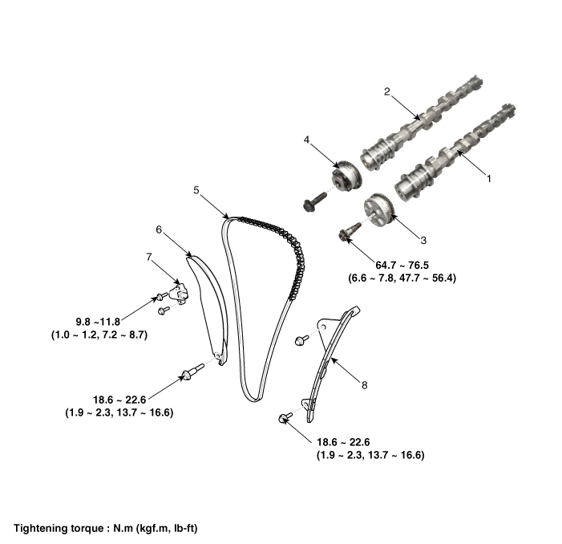

# Corrente de comando — Componentes e localização

[Home](../../index.md) / [Manual de Serviço e Reparo](../sportage-482.md) / [Motorização NU](index.md) / [Sistema de sincronismo](nu-timing_system-2862.md) / Componentes e localização

## Diagrama

## Legenda

| Nº | Componente |
| --- | --- |
| 1 | Comando de admissão |
| 2 | Comando de escape |
| 3 | Conjunto CVVT de admissão |
| 4 | Conjunto CVVT de escape |
| 5 | Corrente de comando |
| 6 | Braço tensor da corrente |
| 7 | Tensor da corrente |
| 8 | Guia da corrente |

## Torques de aperto

Unidades: N·m (kgf·m, lb·ft)

| Item | Local | Torque |
| --- | --- | --- |
| 3 / 4 | Parafuso do conjunto CVVT | 64,7 ~ 76,5 (6,6 ~ 7,8 · 47,7 ~ 56,4) |
| 6 / 8 | Parafusos do braço tensor e da guia | 18,6 ~ 22,6 (1,9 ~ 2,3 · 13,7 ~ 16,6) |
| 7 | Parafusos do tensor | 9,8 ~ 11,8 (1,0 ~ 1,2 · 7,2 ~ 8,7) |
