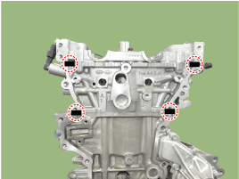
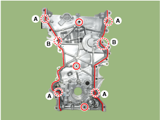
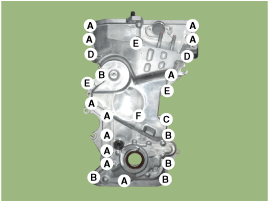
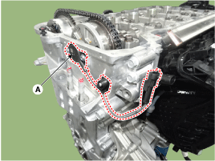
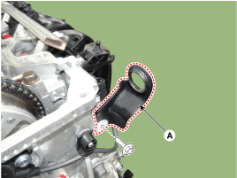

# Tampa da corrente de comando — procedimentos

## Instalação

1. Instale a tampa da corrente de comando.

   (1) Usando uma escova de selante, remova todo o material de preenchimento antigo das superfícies do selante.

   (2) As localizações do selante na tampa da corrente de comando e nos componentes (carrinho do alavanca, cabeçote do cilindro, bloco do cilindro e caixa inferior do cárter) devem estar livres de materiais estranhos prejudiciais, óleo, poeira e umidade. Limpe a superfície com limpeza e retire com um pano limpo.

   (3) Antes de montar a tampa da corrente de comando, deve-se aplicar selante líquido no espaço entre o carrinho do alavanca, cabeçote do cilindro e bloco do cilindro.

    ```
    Largura do pingente: 3,0 ~ 5,0 mm (0,11 ~ 0,20 in.)
    Selante: Threebond 1217H ou equivalente
    ```

    

   (4) Após a aplicação do selante líquido na tampa da corrente de comando, monte a cobertura dentro de 5 minutos após a aplicação do selante. Um pingente contínuo de selante deve ser aplicado para prevenir qualquer caminho de vazamento de óleo.

    ```
    Largura do pingente
    Seção inteira: 2,5 ~ 3,5 mm (0,10 ~ 0,14 in.)
    Seção A: 4,5 ~ 5,5 mm (0,18 ~ 0,22 in.)
    Seção B: 8,0 ~ 9,0 mm (0,32 ~ 0,35 in.)
    Selante: Threebond 1217H ou equivalente
    ```

    

   (5) Instale a tampa da corrente de comando. As pinetas no bloco do cilindro e os orifícios na tampa da corrente de comando devem ser usados como referência para montar a cobertura na posição exata.

    ```
    Torque de aperto
    Parafusos (A, B):
    18,6 ~ 23,5 N.m (1,9 ~ 2,4 kgf.m, 13,7 ~ 17,4 lb-ft)
    Parafuso (C):
    19,6 ~ 23,5 N.m (2,0 ~ 2,4 kgf.m, 14,5 ~ 17,4 lb-ft)
    Parafusos (D, E):
    39,2 ~ 49,0 N.m (4,0 ~ 5,0 kgf.m, 28,9 ~ 36,2 lb-ft)
    Parafuso (F):
    9,8 ~ 11,8 N.m (1,0 ~ 1,2 kgf.m, 7,2 ~ 8,7 lb-ft)
    ```

    

    > **Nota**
    >
    > - Não reutilize os parafusos de selante (C, F).

    > **Nota**
    >
    > - O funcionamento do motor ou teste de pressão não deve ser realizado nos 30 minutos após a montagem da tampa da corrente de comando.

2. Substitua a selante da frente se necessário.

   (Consulte o Sistema de Tempo - "Selante da Frente")

3. Monte o atuador intermediário do CVVT (A).

    ```
    Torque de aperto:
    8,8 ~ 9,8 N.m (0,9 ~ 1,0 kgf.m, 6,5 ~ 7,2 lb-ft)
    ```

    

    > **Nota**
    >
    > - Sempre use novos parafusos do atuador.
    > - O resíduo dentro do orifício do parafuso da tampa da corrente de comando deve ser descartado antes de selar.
    > - Os parafusos do atuador devem ser selados com o torque regulamentado.

4. Monte o suporte do motor da frente (A).

    ```
    Torque de aperto:
    34,3 ~ 39,2 N.m (3,5 ~ 4,0 kgf.m, 25,3 ~ 28,9 lb-ft)
    ```

    

5. Monte os outros componentes na ordem inversa à remoção.

6. Adicione todos os fluidos necessários e verifique se há vazamentos. Conecte o GDS. Verifique os códigos, anote e limpe-os. Reverifique.

   > **Nota**
   >
   > - Reforneça o motor com óleo de motor.
   > - Limpe as postas da bateria e os terminais das correias e monte.
   > - Inspecione para verificar vazamento de combustível.
   > - Após montar a linha de combustível, ligue o interruptor da ignição (não operando o motor starter) para que a bomba de combustível funcione por aproximadamente dois segundos e a linha de combustível seja pressurizada.
   > - Repita este procedimento duas ou três vezes, depois verifique se há vazamento em qualquer ponto da linha de combustível.
