# Corrente de comando — procedimentos

[Home](../../index.md) / [Manual de Serviço e Reparo](../sportage-482.md) / [Motorização NU](index.md) / Corrente de comando — procedimentos

## Remoção

1. Remova a tampa do cabeçote do cilindro.

   (Consulte a Montagem do Cabeçote do Cilindro - "Tampa do Cabeçote do Cilindro")

2. Ajuste o cilindro nº1 para o TDC (Top dead center) na compressão.

   (1) Vire o volante do eixo do crankshaft e alinhe a sua vagem com a marca do timing chain cover.

    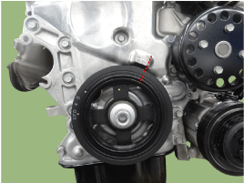

   (2) Verifique se as marcas TDC das correntes de admissão e exaustão CVVT estão alinhadas na superfície do cabeçote do cilindro, conforme ilustrado. Se não estiverem, vire o eixo do crankshaft mais uma revolução (360°).

    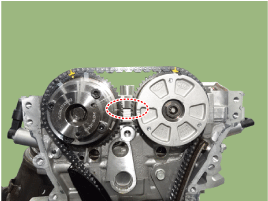

    > **Nota**
    >
    > - Não vire o volante do eixo do crankshaft no sentido contrário ao horário do relógio.

3. Remova a tampa da cadeia de alinhamento.

   (Consulte o Sistema de Alineação - "Tampa da Cadeia de Alineação")

4. Remova o amortecedor de tensão da cadeia (A).

   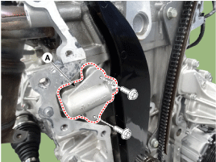

    > **Nota**
    >
    > - Não reutilize o amortecedor descolado.
    > - Se precisar reutilizar o amortecedor, remova o amortecedor, faça o pistão (A) projetar ao máximo, empurre o pistão (A) até o fim, e então monte o pinho de parada.
    > - Neste momento, o pinho de fixação do amortecedor deve ser posicionado da mesma forma como foi entregue pela fábrica pela primeira vez.

   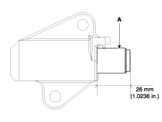

   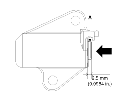

   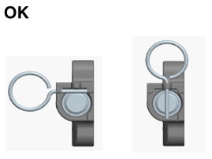

   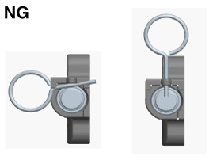

5. Remova o braço do amortecedor de tensão da cadeia (A).

   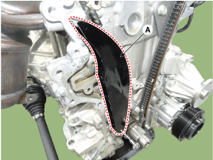

6. Remova a cadeia de alinhamento (A).

   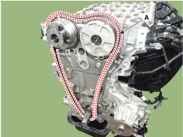

7. Remova o guia da cadeia de alinhamento (A).

   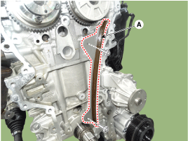

## Inspeção

Sprockets, Amortecedor de Tensão, Guia da Cadeia, Braço do Amortecedor de Tensão

1. Verifique os sprockets de CVVT e o sprocket do eixo do crankshaft para desgaste anormal, rachaduras ou danos. Substitua se necessário.

2. Inspeção do braço do amortecedor de tensão e do guia da cadeia para desgaste anormal, rachaduras ou danos. Substitua se necessário.

3. Verifique se o pistão do amortecedor de tensão move-se suavemente.

## Instalação

1. As marcas TDC das correntes de admissão e exaustão do CVVT estão ligeiramente desalinhadas do TDC quando a corrente de sincronização é removida.

   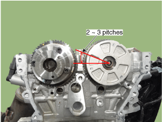

2. Vire o eixo do pistão no sentido horário (aproximadamente 2~3 dentes) a partir do TDC (a viga do eixo do pistão (A) está aproximadamente 3° com a linha vertical do motor) enquanto a corrente de admissão do CVVT é girada a partir do TDC.

   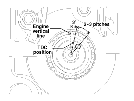

3. Instale o guia da corrente de sincronização (A).

   ```
   Torque de aperto:
   18,6 ~ 22,6 N.m (1,9 ~ 2,3 kgf.m, 13,7 ~ 16,6 lb-ft)
   ```

   

4. Instale o braço do regulador de tensão da corrente de sincronização (A).

   ```
   Torque de aperto:
   18,6 ~ 22,6 N.m (1,9 ~ 2,3 kgf.m, 13,7 ~ 16,6 lb-ft)
   ```

   

5. Instale a corrente de sincronização.

   Eixo do pistão > Guia da corrente de sincronização > Corrente de admissão do CVVT > Corrente de exaustão do CVVT

   (1) Instale a corrente de sincronização sem tensão entre o eixo do pistão e a corrente de admissão do CVVT.

    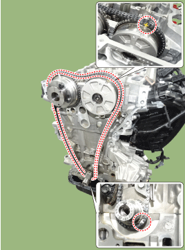

    > **Nota**
    >
    > - As marcas de sincronização de cada corrente devem estar alinhadas com as marcas de sincronização (ligação de cor) da corrente de sincronização durante a instalação da corrente de sincronização.

   (2) Instale a corrente de sincronização na corrente de exaustão do CVVT sem tensão enquanto a montagem do CVVT é girada no sentido horário.

    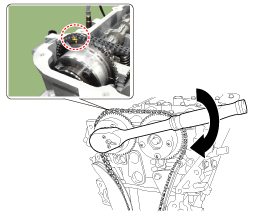

    > **Nota**
    >
    > - A marca de sincronização da corrente de exaustão do CVVT deve estar alinhada com a marca de sincronização (ligação de cor) da corrente de sincronização durante a instalação da corrente de sincronização.
    > - Comprenda as ligações da corrente de sincronização na corrente de exaustão do CVVT para prevenir a rotação do sprocket.

6. Instale o regulador de tensão automático da corrente de sincronização (A) e remova a viga de parada (B).

   ```
   Torque de aperto:
   9,8 ~ 11,8 N.m (1,0 ~ 1,2 kgf.m, 7,2 ~ 8,7 lb-ft)
   ```

   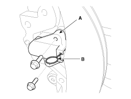

   > **Nota**
   >
   > - Ao reinstalar o regulador, verifique a função do relesse do regulador após a remoção da viga de fixação, retração do braço do regulador (A) ao máximo conforme mostrado abaixo.
   > - Ao ser retraído ao máximo, não deve haver interferência entre o braço do regulador (A) e a caixa do regulador (B).

   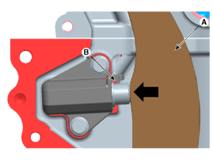

7. Após girar o eixo do pistão 2 revoluções no sentido normal (horário quando visto da frente), confirme que as marcas de sincronização das correntes de admissão e exaustão do CVVT estão alinhadas com a superfície superior do cabeçote do motor.

   

8. Instale as outras partes na ordem inversa à remoção.

> **Nota**
>
> - Reforneça o motor com óleo de motor.

> - Limpe as postas da bateria e os terminais das correias e reassemble.
> - Inspeção para vazamento de combustível.
> - Após o reassemble da linha de combustível, ligue o interruptor da ignição (sem operar o motorista) para que a bomba de combustível funcione por aproximadamente dois segundos e a linha de combustível seja pressurizada.
> - Repita essa operação duas ou três vezes, depois verifique para vazamento de combustível em qualquer ponto da linha de combustível.
