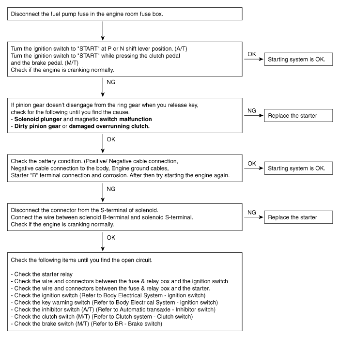

# Kia Sportage SL: Motorização NU / Troubleshooting

[Home](../../index.md) / [Kia Sportage SL Service & Repair Manual](../sportage-482.md) / [Motorização NU](index.md) / Troubleshooting

## Diagnóstico

> **Nota**
>
> - A bateria deve estar em bom estado e completamente carregada para este diagnóstico.

