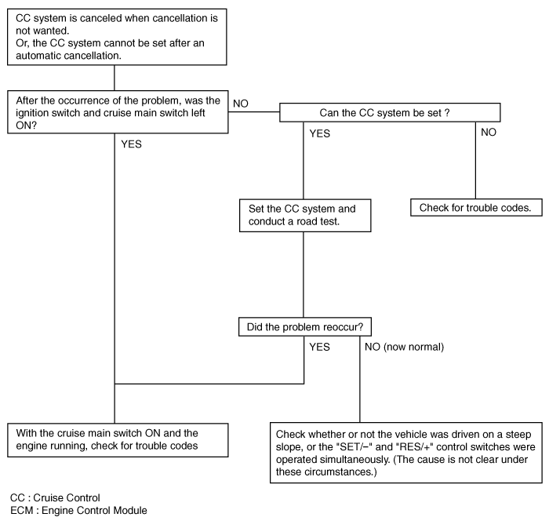

# Diagnóstico

[Home](../../index.md) / [Manual de Serviço e Reparo](../sportage-482.md) / [Motorização NU](index.md) / Diagnóstico

## Diagramas de Sintomas de Falha

Sintoma de Falha 1

Sintoma de Falha 2

| Sintoma de Falha | Causa Provável | Remédio |
| --- | --- | --- |
| A velocidade do veículo definida oscila muito para cima ou para baixo "Surging" (aceleração e desaceleração repetidas e alternadas) ocorre após a definição | Malfunction da circuital do sensor de velocidade do veículo | Repare o sistema do sensor de velocidade do veículo, ou substitua a peça |
| Malfunction do ECM | Verifique os sinais de entrada e saída no ECM |  |

Sintoma de Falha 3

| Sintoma de Falha | Causa Provável | Remédio |
| --- | --- | --- |
| O sistema CC não é cancelado quando o pedal do freio é pressionado | Dano ou conexão desconectada do cabo do sensor do pedal do freio | Repare o cabide ou substitua o sensor do pedal do freio |
| Malfunction dos sinais do ECM | Verifique os sinais de entrada e saída no ECM |  |

Sintoma de Falha 4

| Sintoma de Falha | Causa Provável | Remédio |
| --- | --- | --- |
| O sistema CC não é cancelado quando a alavanca de câmbio é movida para a posição "N" (ele é cancelado, no entanto, quando o pedal do freio é pressionado) | Dano ou conexão desconectada da circuital do sensor do inhibidor | Repare o cabide ou conserte ou substitua o sensor do inhibidor |
| Ajuste inadequado do sensor do inhibidor |  |  |
| Malfunction dos sinais do ECM | Verifique os sinais de entrada e saída no ECM |  |

Sintoma de Falha 5

| Sintoma de Falha | Causa Provável | Remédio |
| --- | --- | --- |
| Não é possível desacelerar (coast) usando o botão "SET/–" | Dano temporário ou conexão desconectada da circuital de entrada do botão "SET/–" | Repare o cabide ou substitua o botão "SET/–" |
| Malfunction dos sinais do ECM | Verifique os sinais de entrada e saída no ECM |  |

Sintoma de Falha 6

| Sintoma de Falha | Causa Provável | Remédio |
| --- | --- | --- |
| Não é possível acelerar ou retomar a velocidade usando o botão "RES/+" | Dano ou conexão desconectada, curto-circuito, ou circuital de entrada do botão "RES/+" | Repare o cabide ou substitua o botão "RES/+" |
| Malfunction dos sinais do ECM | Verifique os sinais de entrada e saída no ECM |  |

Sintoma de Falha 7

| Sintoma de Falha | Causa Provável | Remédio |
| --- | --- | --- |
| O sistema CC pode ser definido enquanto o veículo está em movimento a uma velocidade inferior a 40km/h (25mph), ou não há cancelamento automático nessa velocidade | Malfunction da circuital do sensor de velocidade do veículo | Repare o sistema do sensor de velocidade do veículo, ou substitua a peça |
| Malfunction dos sinais do ECM | Verifique os sinais de entrada e saída no ECM |  |

Sintoma de Falha 8

| Sintoma de Falha | Causa Provável | Remédio |
| --- | --- | --- |
| A lâmpada indicadora do interruptor principal do CC não acende (embora o sistema CC esteja normal) | Dano ou conexão desconectada da lâmpada do interruptor principal do CC | Repare o cabide ou substitua a peça. |
| Cabide danificado ou desconectado |  |  |
