# Kia Sportage SL: Motorização NU / Troubleshooting

[Home](../../index.md) / [Kia Sportage SL Service & Repair Manual](../sportage-482.md) / [Motorização NU](index.md) / Troubleshooting

## Diagnóstico Básico

Guia de Diagnóstico Básico

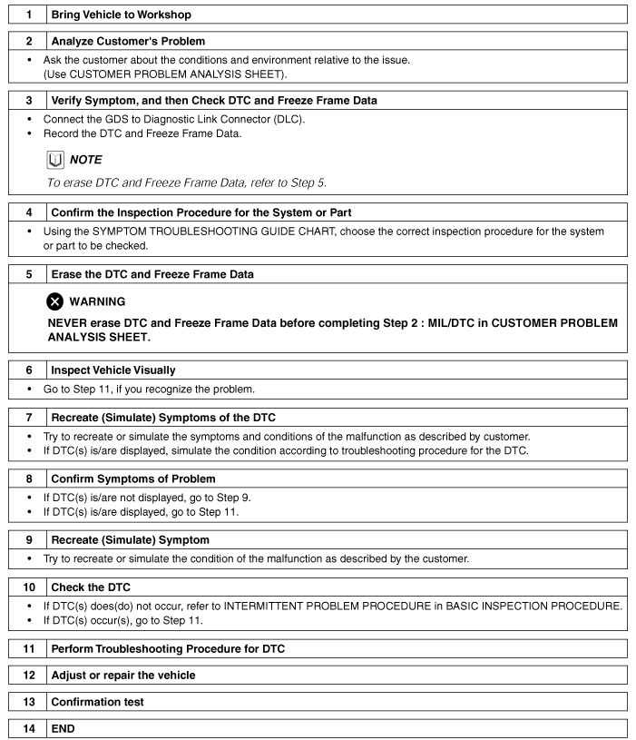

Análise do Problema do Cliente

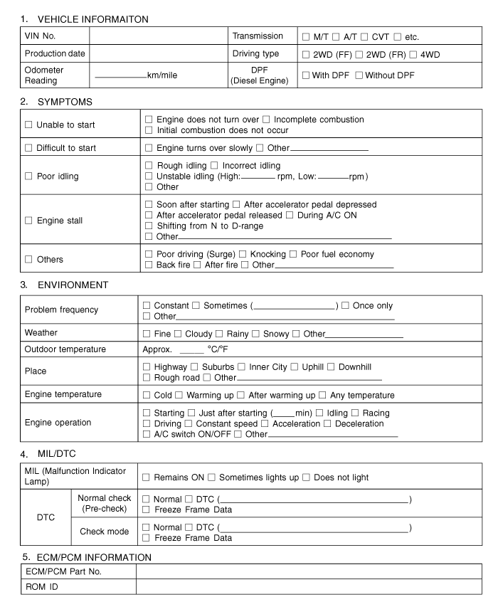

Procedimento de Inspeção Básica

Medição da Resistência de Peças Elétricas

A resistência medida em condições de alta temperatura após o funcionamento do veículo pode ser alta ou baixa. Portanto, todas as resistências devem ser medidas em temperatura ambiente (20°C, 68°F), a menos que seja especificado o contrário.

> **Nota**
>
> - A resistência medida em condições diferentes da temperatura ambiente (20°C, 68°F) é um valor de referência.

Procedimento de Inspeção de Problemas Intermittentes

Às vezes, o caso mais difícil de diagnóstico é quando um sintoma do problema ocorre, mas não ocorre novamente durante a teste. Um exemplo seria se um problema aparecer apenas quando o veículo estiver frio, mas não tiver aparecido quando quente. Neste caso, o técnico deve elaborar cuidadosamente uma "Análise do Problema do Cliente" e recriar (simular) o ambiente e as condições que ocorreram quando o veículo estava com o problema.

1. Limpar o Código de Falha Diagnóstico (CFD).

2. Inspeção da conexão do conectador e verificação de terminais para conexões frágeis, fios soltos, pinos torcidos, quebrados ou corroídos, e então verificar que os conectores estão sempre firmemente fixados.

   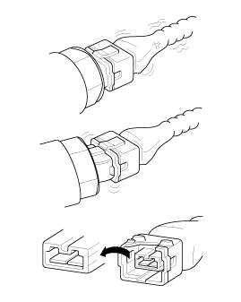

3. Agitar vertical e horizontalmente o conectador e o cabo de alimentação.

4. Reparar ou substituir o componente com problema.

5. Verificar que o problema desapareceu com o teste de estrada.

? Simulando Vibração

| 1) | Sensores e Executores: Vibre ligeiramente os sensores, executores ou relés com o dedo. • Vibração forte pode quebrar sensores, executores ou relés |
| --- | --- |
| • Vibração forte pode quebrar sensores, executores ou relés |  |
| • | Vibração forte pode quebrar sensores, executores ou relés |

| 2) | Conectores e Cabos: Agite ligeiramente o conectador e o cabo de alimentação vertical e horizontalmente. |
| --- | --- |

? Simulando Calor

| 1) | Aqueça os componentes suspeitos de causar o mal funcionamento com um secador de cabelos ou outro fonte de calor. • NÃO aqueça os componentes até o ponto de possam ser danificados. • NÃO aqueça o ECM diretamente. |
| --- | --- |
| • NÃO aqueça os componentes até o ponto de possam ser danificados. • NÃO aqueça o ECM diretamente. |  |
| • | NÃO aqueça os componentes até o ponto de possam ser danificados. |
| • | NÃO aqueça o ECM diretamente. |

? Simulando Chuva

| 1) | Vaque água no veículo para simular um dia chuvoso ou uma condição de alta umidade. • NÃO vaque água diretamente no compartimento do motor ou nos componentes eletrônicos. |
| --- | --- |
| • NÃO vaque água diretamente no compartimento do motor ou nos componentes eletrônicos. |  |
| • | NÃO vaque água diretamente no compartimento do motor ou nos componentes eletrônicos. |

? Simulando Carga Elétrica

| 1) | Ligue todos os sistemas elétricos para simular cargas elétricas excessivas (radios, ventiladores, luzes, desembaçador do vidro traseiro, etc.). |
| --- | --- |

Procedimento de Inspeção do Conector

1. Tratamento do Conector

   A. Nunca puxe o cabo de alimentação ao desconectar o conector.

    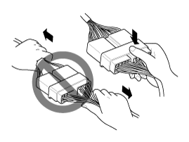

   B. Ao remover o conector com travamento, pressione ou puxe o travamento.

    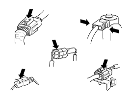

   C. Ouça um clique ao travar conectores. Este som indica que eles estão seguramente travados.

    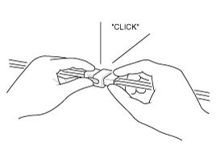

   D. Ao usar um teste para verificar a continuidade ou medir a tensão, sempre insira o cabo do teste do lado do cabo de alimentação.

    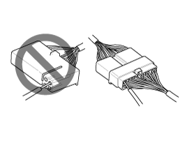

   E. Verifique os terminais de conector impermeável do lado do conector. Conectores impermeáveis não podem ser acessados do lado do cabo de alimentação.

    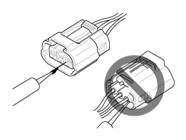

    > **Nota**
    >
    > - Use um fio fino para evitar danos ao terminal.
    > - Não danifique o terminal ao inserir o cabo do teste.

2. Pontos de Verificação do Conector

   A. Enquanto o conector estiver conectado:

    Segure o conector, verifique a condição de conexão e a eficiência de travamento.

   B. Quando o conector estiver desconectado:

    Verifique terminais perdidos, terminais soldados ou fios de núcleo quebrados puxando levemente o cabo de alimentação.

    Verifique visualmente para ferrugem, sujeira, deformação e curvatura.

   C. Verifique a condição de aperto do terminal:

    Insira um terminal macho de substituição em um terminal fêmea, e então verifique as condições de aperto do terminal.

   D. Puxe levemente cada fio para garantir que cada fio esteja fixo no terminal.

    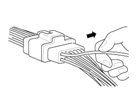

3. Método de Reparo do Terminal do Conector

   A. Limpe os pontos de contato usando um ar comprimido e/ou um pano de oficina.

    > **Nota**
    >
    > - Nunca use papel abrasivo para polir os pontos de contato, caso contrário, o ponto de contato pode ser danificado.

   B. Em caso de pressão de contato anormal, substitua o terminal fêmeo.

Procedimento de Inspeção do Cabo de Alimentação

1. Antes de remover o cabo de alimentação, verifique a posição e o soldo do cabo de alimentação para restaurá-lo corretamente.

2. Verifique se o cabo de alimentação está enrolado, puxado ou solto.

3. Verifique se a temperatura do cabo de alimentação está abnormalmente alta.

4. Verifique se o cabo de alimentação está girando, se movendo ou vibrando contra o bordo afiado de uma peça.

5. Verifique a conexão entre o cabo de alimentação e qualquer peça instalada.

6. Se a cobertura do cabo de alimentação estiver danificada; assegure, conserte ou substitua o cabo.

Procedimento de Inspeção da Circuito Elétrico

? Verificação de Circuito Aberto

1. Procedimentos para Circuito Aberto

   A. Verificação de Continuidade

   B. Verificação de Tensão

   Se um circuito aberto ocorrer (como visto em [FIG. 1]), pode ser
   encontrado realizando o Passo 2 (Método de Verificação de Continuidade) ou Passo 3 (Método de Verificação de Tensão)
   como mostrado abaixo.

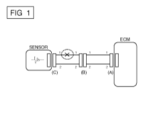

2. Método de Verificação de Continuidade

   > **Nota**
   >
   > - Ao medir a resistência, levemente agite o cabo de alimentação acima e abaixo ou de lado a lado.

   ```
   Especificação (Resistência)
   1? ou menos > Circuito Normal
   1M? ou Superior > Circuito Aberto
   ```

   A. Desconecte os conectores (A), (C) e mede a resistência entre o conectador (A) e (C) conforme mostrado em [FIG. 2].

    Na [FIG. 2.] a resistência medida das linhas 1 e 2 é superior a 1M? e inferior a 1 ?, respectivamente. Especificamente, a linha 1 está com um circuito aberto (a linha 2 está normal). Para encontrar o ponto exato do rompimento, verifique as sublinhas da linha 1 conforme descrito no próximo passo.

    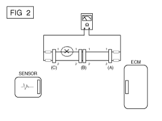

   B. Desconecte o conectador (B), e mede a resistência entre o conectador (C) e (B1) e entre (B2) e (A) conforme mostrado em [FIG. 3].

    Neste caso, a resistência medida entre o conectador (C) e (B1) é superior a 1M? e o circuito aberto está entre o terminal 1 do conectador (C) e o terminal 1 do conectador (B1).

    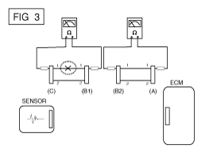

3. Método de Verificação de Tensão

   A. Com cada conectador ainda conectado, mede a tensão entre o solo do chassi e o terminal 1 de cada conectador (A), (B) e (C) conforme mostrado em [FIG. 4].

    A tensão medida em cada conectador é 5V, 5V e 0V, respectivamente. Portanto, o circuito aberto está entre o conectador (C) e (B).

    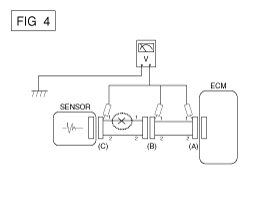

? Verificação de Circuito Curto

1. Método de Teste para Curto ao Terreno

   A. Verificação de Continuidade com Solo do Chassi

   Se ocorrer um curto ao terreno como mostrado em [FIG. 5], o ponto de rompimento pode ser encontrado realizando o Passo 2 (Método de Verificação de Continuidade com Solo do Chassi) conforme abaixo.

   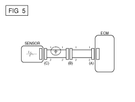

2. Método de Verificação de Continuidade (com Solo do Chassi)

   > **Nota**
   >
   > - Ao medir a resistência, levemente agite o cabo de alimentação acima e abaixo, ou de lado a lado.

   ```
   Especificação (Resistência)
   1? ou menos > Circuito Curto ao Terreno
   1M? ou Superior > Circuito Normal
   ```

   A. Desconecte os conectores (A), (C) e mede a resistência entre o conectador (A) e o solo do chassi conforme mostrado em [FIG. 6].

    Na exemplo, a resistência medida das linhas 1 e 2 é inferior a 1 ? e superior a 1M ?, respectivamente. Especificamente, o curto ao terreno está na linha 1 (a linha 2 está normal). Para encontrar o ponto exato do rompimento, verifique as sublinhas da linha 1 conforme descrito no próximo passo.

    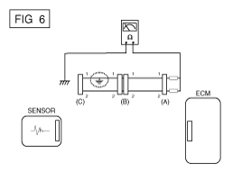

   B. Desconecte o conectador (B), e mede a resistência entre o conectador (A) e o solo do chassi, e entre (B1) e o solo do chassi conforme mostrado em [FIG. 7].

    A resistência medida entre o conectador (B1) e o solo do chassi é 1? ou menos. O curto ao terreno está entre o terminal 1 do conectador (C) e o terminal 1 do conectador (B1).

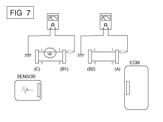

? Testando a Perda de Tensão

Este teste verifica a perda de tensão ao longo de um fio, ou através de uma conexão ou interruptor.

| 1) | Conecte o polo positivo de um voltmetro ao final do
fio (ou ao lado do conectador ou interruptor) mais próximo da bateria. |
| --- | --- |

| 2) | Conecte o polo negativo ao outro final do fio. (ou ao outro lado do conectador ou interruptor) |
| --- | --- |

| 3) | Operacionalize o circuito. |
| --- | --- |

| 4) | O voltmetro mostrará a diferença de tensão entre
os dois pontos. Uma diferença, ou queda superior a 0,1 volts (50mV em circuitos de 5V),
pode indicar um problema. Verifique o circuito para conexões soltas ou sujas. |
| --- | --- |

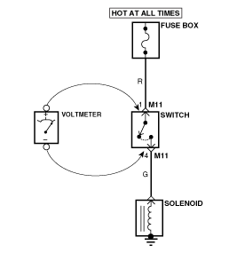

Guia de Troubleshooting de Sintomas

| Sintoma principal | Procedimento diagnóstico | Verifique também |
| --- | --- | --- |
| Não consegue ligar (Motor não gira) | 1. Teste a bateria 2. Teste o starter 3. Interruptor de inibição (AT) ou interruptor de partida da embreagem (MT) |  |
| 1. | Teste a bateria |  |
| 2. | Teste o starter |  |
| 3. | Interruptor de inibição (AT) ou interruptor de partida da embreagem (MT) |  |
| Não consegue ligar (Combustão incompleta) | 1. Teste a bateria 2. Verifique a pressão do combustível 3. Verifique o circuito de ignição 4. Troubleshooting do sistema de immobilizador (Caso o lampião do immobilizador esteja piscando) | • DTC • Baixa compressão • Vazamento de ar de admissão • Cinta de sincronização solta ou quebrada • Combustível contaminado |
| 1. | Teste a bateria |  |
| 2. | Verifique a pressão do combustível |  |
| 3. | Verifique o circuito de ignição |  |
| 4. | Troubleshooting do sistema de immobilizador (Caso o lampião do immobilizador esteja piscando) |  |
| • | DTC |  |
| • | Baixa compressão |  |
| • | Vazamento de ar de admissão |  |
| • | Cinta de sincronização solta ou quebrada |  |
| • | Combustível contaminado |  |
| Dificuldade para ligar | 1. Teste a bateria 2. Verifique a pressão do combustível 3. Verifique o sensor ECT e o circuito (Verifique DTC) 4. Verifique o circuito de ignição | • DTC • Baixa compressão • Vazamento de ar de admissão • Combustível contaminado • Chama de ignição fraca |
| 1. | Teste a bateria |  |
| 2. | Verifique a pressão do combustível |  |
| 3. | Verifique o sensor ECT e o circuito (Verifique DTC) |  |
| 4. | Verifique o circuito de ignição |  |
| • | DTC |  |
| • | Baixa compressão |  |
| • | Vazamento de ar de admissão |  |
| • | Combustível contaminado |  |
| • | Chama de ignição fraca |  |
| Malandragem (Ruído, instabilidade ou mal ajuste do Idle) | 1. Verifique a pressão do combustível 2. Verifique o injetor 3. Verifique o ajuste a longo prazo e acurado do injetor (Consulte os Dados do Cliente) 4. Verifique o circuito de controle de velocidade de rotação do motor (Verifique DTC) 5. Inspeção e teste do corpo do acelerador 6. Verifique o sensor ECT e o circuito (Verifique DTC) | • DTC • Baixa compressão • Vazamento de ar de admissão • Combustível contaminado • Chama de ignição fraca |

| 4. | Verifique o circuito de controle da velocidade de rotação do motor (Verifique DTC) |  |
| 5. | Inspeção e teste do corpo do acelerador |  |
| 6. | Verifique o sensor ECT e o circuito (Verifique DTC) |  |
| • | DTC |  |
| • | Baixa compressão |  |
| • | Vazamento de ar de admissão |  |
| • | Combustível contaminado |  |
| • | Fagulha de ignição fraca |  |
| Falta de motor | 1. Teste da bateria 2. Verifique a pressão do combustível 3. Verifique o circuito de controle da velocidade de rotação do motor (Verifique DTC) 4. Verifique o circuito de ignição 5. Verifique o circuito CKPS (Verifique DTC) | • DTC • Vazamento de ar de admissão • Combustível contaminado • Fagulha de ignição fraca |
| 1. | Teste da bateria |  |
| 2. | Verifique a pressão do combustível |  |
| 3. | Verifique o circuito de controle da velocidade de rotação do motor (Verifique DTC) |  |
| 4. | Verifique o circuito de ignição |  |
| 5. | Verifique o circuito CKPS (Verifique DTC) |  |
| • | DTC |  |
| • | Vazamento de ar de admissão |  |
| • | Combustível contaminado |  |
| • | Fagulha de ignição fraca |  |
| Desempenho ruim (Sobressalto) | 1. Verifique a pressão do combustível 2. Inspeção e teste do corpo do acelerador 3. Verifique o circuito de ignição 4. Verifique o sensor ECT e o circuito (Verifique DTC) 5. Teste do sistema de escape para possível obstrução 6. Verifique o ajuste a longo prazo do injetor e o ajuste a curto prazo do injetor (Consulte o CUSTOMER DATASTREAM) | • DTC • Baixa compressão • Vazamento de ar de admissão • Combustível contaminado • Fagulha de ignição fraca |
| 1. | Verifique a pressão do combustível |  |
| 2. | Inspeção e teste do corpo do acelerador |  |
| 3. | Verifique o circuito de ignição |  |
| 4. | Verifique o sensor ECT e o circuito (Verifique DTC) |  |
| 5. | Teste do sistema de escape para possível obstrução |  |
| 6. | Verifique o ajuste a longo prazo do injetor e o ajuste a curto prazo do injetor (Consulte o CUSTOMER DATASTREAM) |  |
| • | DTC |  |
| • | Baixa compressão |  |
| • | Vazamento de ar de admissão |  |
| • | Combustível contaminado |  |
| • | Fagulha de ignição fraca |  |
| Chacoalhamento | 1. Verifique a pressão do combustível 2. Inspeção do líquido de resfriamento do motor 3. Inspeção do radiador e do ventilador elétrico de resfriamento 4. Verifique as fagulhas | • DTC • Combustível contaminado |
| 1. | Verifique a pressão do combustível |  |
| 2. | Inspeção do líquido de resfriamento do motor |  |
| 3. | Inspeção do radiador e do ventilador elétrico de resfriamento |  |
| 4. | Verifique as fagulhas |  |
| • | DTC |  |
| • | Combustível contaminado |  |
| Baixa economia de combustível | 1. Verifique as práticas de direção do cliente · A/C ligado em tempo integral ou no modo desentorpecimento? · As rodas estão com a pressão correta? · Existe um carregamento excessivamente pesado? · O acelerador é usado muito, com frequência? 2. Verifique a pressão do combustível 3. Verifique o injetor 4. Teste do sistema de escape para possível obstrução 5. Verifique o sensor ECT e o circuito | • DTC • Baixa compressão • Vazamento de ar de admissão • Combustível contaminado • Fagulha de ignição fraca |
| 1. | Verifique as práticas de direção do cliente · A/C ligado em tempo integral ou no modo desentorpecimento? · As rodas estão com a pressão correta? · Existe um carregamento excessivamente pesado? · O acelerador é usado muito, com frequência? |  |
| 2. | Verifique a pressão do combustível |  |
| 3. | Verifique o injetor |  |
| 4. | Teste do sistema de escape para possível obstrução |  |

| 5. | Verifique o sensor ECT e o circuito |  |
| • | DTC |  |
| • | Baixa compressão |  |
| • | Vazamento no sistema de admissão |  |
| • | Combustível contaminado |  |
| • | Chama de ignição fraca |  |
| Dificuldade em abastecer (Excesso de combustível durante o abastecimento) | 1. Teste o valveador do tanque de vapor 2. Inspeção do tubo de enchimento do tanque de combustível · Enroscado, entortado ou bloqueado? · Tubo de enchimento do tanque de combustível danificado 3. Inspeção do tubo de ventilação do tanque de combustível entre o canister EVAP e o filtro de ar 4. Verifique o canister EVAP | • Vazamento no bico de enchimento do posto de combustível (Se este problema ocorrer em um posto específico durante o abastecimento) |
| 1. | Teste o valveador do tanque de vapor |  |
| 2. | Inspeção do tubo de enchimento do tanque de combustível · Enroscado, entortado ou bloqueado? · Tubo de enchimento do tanque de combustível danificado |  |
| 3. | Inspeção do tubo de ventilação do tanque de combustível entre o canister EVAP e o filtro de ar |  |
| 4. | Verifique o canister EVAP |  |
| • | Vazamento no bico de enchimento do posto de combustível (Se este problema ocorrer em um posto específico durante o abastecimento) |  |
