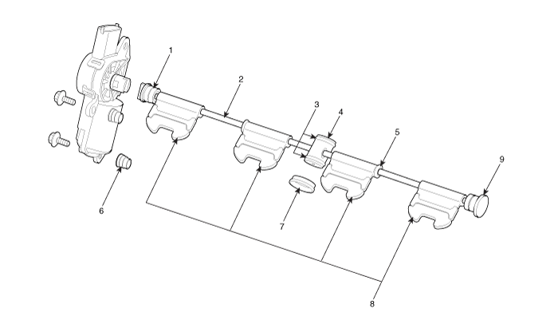

# Atuador de movimento de carga variável (VCMA) — componentes e localização

[Home](../../index.md) / [Manual de Serviço e Reparo](../sportage-482.md) / [Motorização NU](index.md) / Atuador de movimento de carga variável (VCMA) — componentes e localização

## Componentes

| 1. Couplagem 2. Eixo 3. Anel Selante de Estabilização 4. Estabilizador 5. Anel Selante | 6. Conector Interno 7. Cobertura do Estabilizador 8. Válvula 9. Cobertura do Buraco |
| --- | --- |
