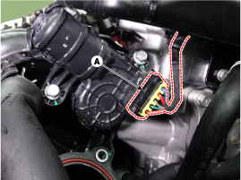
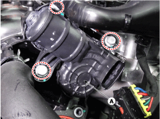

# Kia Sportage SL: Motorização NU / Variable Charge Motion Actuator (VCMA) Repair procedures

[Home](../../index.md) / [Kia Sportage SL Service & Repair Manual](../sportage-482.md) / [Motorização NU](index.md) / Variable Charge Motion Actuator (VCMA) Repair procedures

## Inspeção

1. Desligue o interruptor de ignição.

2. Desconecte o conector do VCMA.

3. Verifique se o VCMA não está obstruído por material estranho.

4. Mede a resistência entre os terminais de controle do motor (+) e (-) do motor.

5. Verifique se a resistência está dentro da especificação.

   ```
   Especificação : Consulte "Especificação"
   ```

6. Mede a resistência entre o terminal de suprimento de tensão e o terminal de massa do sensor de posição.

7. Verifique se a resistência está dentro da especificação.

   ```
   Especificação : Consulte "Especificação"
   ```

## Remoção

1. Desligue o interruptor de ignição e desconecte o cabo negativo (-) da bateria.

2. Desconecte o conector do VCMA (A).

   

3. Remova o VCMA (A) após remover 3 parafusos de instalação.

   

## Instalação

> **Cuidado**
>
> - Instale o componente com as torques especificadas.
> - Tenha em mente que danos internos podem ocorrer se o componente for solto. Neste caso, use após a inspeção.

> **Cuidado**
>
> - O atuador VCM deve ser instalado na posição de fechamento total do vale VCM.
> - Se não for, a conexão do vale VCM do eixo VCM não poderá ser colocada no atuador VCM.

1. A instalação é o inverso da remoção.

   ```
   Parafuso de instalação do atuador de movimento de carregamento variável :
   9,8 ~ 11,8 N.m (1,0 ~ 1,2 kgf.m, 7,2 ~ 8,7 lb-ft)
   ```
