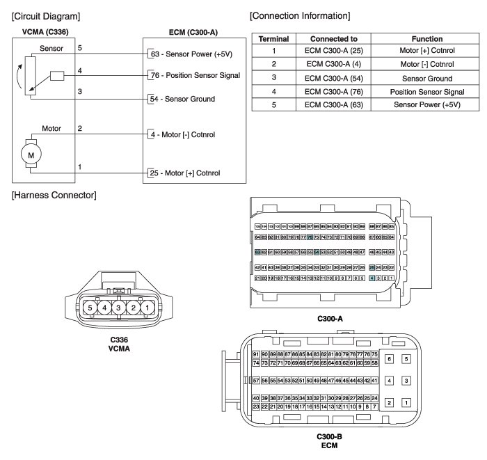

# Kia Sportage SL: Motorização NU / Variable Charge Motion Actuator (VCMA) Schematic Diagrams

[Home](../../index.md) / [Kia Sportage SL Service & Repair Manual](../sportage-482.md) / [Motorização NU](index.md) / Variable Charge Motion Actuator (VCMA) Schematic Diagrams

## Diagrama de circuito

