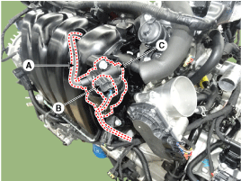

# Atuador do solenoide de admissão variável (VIS) — procedimentos

[Home](../../index.md) / [Manual de Serviço e Reparo](../sportage-482.md) / [Motorização NU](index.md) / Atuador do solenoide de admissão variável (VIS) — procedimentos

## Remoção e Instalação

1. Desconecte a mangueira de vácuo (A).

2. Remova a conexão do solenoide do intumetor variável (VIS) (B) e o atuador (C).

   ```
   Torque de aperto :
   9,8 ~ 11,8N.m (1,0 ~ 1,2kgf.m, 7,2 ~ 8,7lb-ft)
   ```

   

3. Instale na ordem inversa à remoção.
