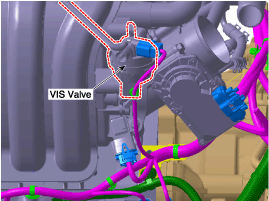
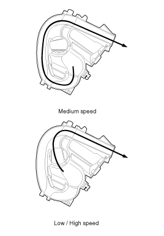

# Válvula solenoide de admissão variável (VIS) — descrição e operação

[Home](../../index.md) / [Manual de Serviço do Kia Sportage NU](index.md) / [Sistema de Controle e Combustível](nu-engine_control_fuel_system-3018.md) / [Sistema de Controle do Motor](nu-engine_control_system-3023.md) / Válvula solenoide de admissão variável (VIS) — descrição e operação

## Descrição

O solenoide do intumetário variável (VIS) está instalado no intumetário. A valvula VIS controla o modulador de vácuo que ativa uma valvula no intumetário. O ECM abre ou fecha esta valvula de acordo com as condições do motor (Consulte a tabela abaixo).

| Condição do Motor | Valvula VIS | Operação |
| --- | --- | --- |
| Velocidade média | Fechada | Aumenta o desempenho do motor em baixa velocidade do motor reduzindo a interferência de admissão entre os cilindros |
| Baixa / Alta velocidade | Aberta | Minimiza a resistência de admissão diminuindo a comprimento do intumetário e aumentando a área de entrada de ar |

