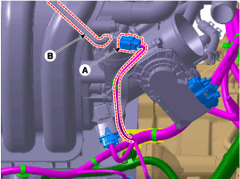

# Válvula solenoide de admissão variável (VIS) — procedimentos

[Home](../../index.md) / [Manual de Serviço e Reparo](../sportage-482.md) / [Motorização NU](index.md) / Válvula solenoide de admissão variável (VIS) — procedimentos

## Inspeção

1. Desligue o interruptor de ignição.

2. Desconecte o conectador da valvula VIS.

3. Mede a resistência entre os terminais 1 e 2 da valvula VIS.

   ```
   Especificação : Consulte a "Especificação"
   ```

## Remoção

1. Desligue o interruptor de ignição e desconecte o cabo negativo (-) da bateria.

2. Desconecte o conectador da valvula de solenoide de admissão variável (A).

3. Desconecte as mangueiras de vácuo (B) da valvula.

4. Remova as varetas de fixação, e então remova a valvula do tanque de surto.

   

## Instalação

> **Cuidado**
>
> - Instale o componente com as torques especificadas.
> - Tenha cuidado com danos internos que podem ocorrer se o componente cair. Neste caso, utilize após a inspeção.

> **Cuidado**
>
> - Cuide para não permitir que materiais estranhos entrem na valvula.

1. A instalação é o inverso da remoção.

   ```
   Varetas de fixação da valvula de solenoide de admissão variável :
   9,8 ~ 11,8 N.m (1,0 ~ 1,2 kgf.m, 7,2 ~ 8,7 lb-ft)
   ```
