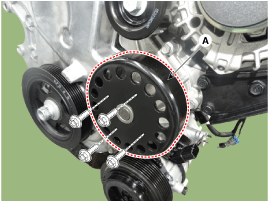
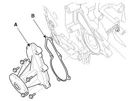

# Bomba d’água — procedimentos

[Home](../../index.md) / [Manual de Serviço e Reparo](../sportage-482.md) / [Motorização NU](index.md) / Bomba d’água — procedimentos

## Remoção e Instalação

1. Drenar o líquido de refrigeração.

   (Consulte o Sistema de Refrigeração - "Líquido de Refrigeração")

2. Remover a correia de transmissão.

   (Consulte o Sistema de Alineamento do Motor - "Correia de Transmissão")

3. Remover o anel de engrenagem da bomba de água (A).

   ```
   Torque de aperto:
   9,8 ~ 11,8 N.m (1,0 ~ 1,2 kgf.m, 7,2 ~ 8,7 lb-ft)
   ```

   

4. Remover a montagem da bomba de água (A) com o selo (B).

   ```
   Torque de aperto:
   9,8 ~ 11,8 N.m (1,0 ~ 1,2 kgf.m, 7,2 ~ 8,7 lb-ft)
   ```

   

5. Instalar na ordem inversa da remoção.

   > **Nota**
   >
   > - Instalar um novo selo da bomba de água.

6. Preencher o líquido de refrigeração do motor.

   (Consulte o Sistema de Refrigeração - "Líquido de Refrigeração")

7. Iniciar o motor e verificar se há vazamentos.

8. Rever o nível do líquido de refrigeração.

## Inspeção

1. Verificar cada parte para rachaduras, danos ou desgaste, e substituir a montagem da bomba de água se necessário.

2. Verificar o rolamento para danos, ruídos anormais e rotação lenta, e substituir a montagem da bomba de água se necessário.

3. Verificar a vazão de líquido de refrigeração. Se houver vazamento de líquido de refrigeração de um orifício, o selo está defeituoso. Substituir a montagem da bomba de água.

   > **Nota**
   >
   > - Uma pequena quantidade de "vazamento" do orifício de descarga é normal.
