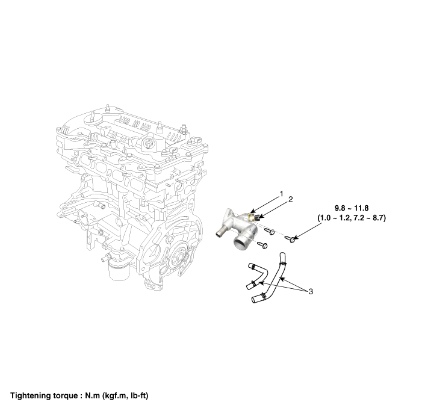

# Conjunto de controle da temperatura da água — componentes e localização

[Home](../../index.md) / [Manual de Serviço e Reparo](../sportage-482.md) / [Motorização NU](index.md) / Conjunto de controle da temperatura da água — componentes e localização

## Componentes

| 1. Conjunto de controle da temperatura do óleo 2. Sensor de temperatura do líquido de refrigeração do motor (se equipado) | 3. Mangote de óleo de refrigeração do corpo de aceleração (se equipado) |
| --- | --- |
