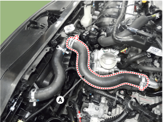
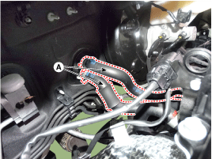
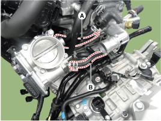
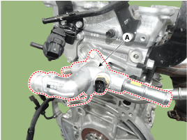

# Conjunto de controle da temperatura da água — procedimentos

[Home](../../index.md) / [Manual de Serviço e Reparo](../sportage-482.md) / [Motorização NU](index.md) / Conjunto de controle da temperatura da água — procedimentos

## Remoção e Instalação

1. Remova a capa do motor.

   (Consulte o Assemblage do Motor e da Transmissão - "Capa do Motor")

2. Derrame o líquido de resfriamento do motor para que o nível esteja abaixo do componente de controle da temperatura da água.

   (Consulte o Sistema de Resfriamento - "Líquido de Resfriamento")

3. Remova a mangueira de ar e a montagem do filtro de ar.

   (Consulte o Sistema de Admissão e Exaustão - "Filtro de Ar")

4. Desconecte a mangueira superior do radiador (A).

   

5. Desconecte as mangueiras do aquecedor (A).

   

6. Desconecte a mangueira de passagem (A) e a mangueira do corpo do acelerador (B) (se equipado).

   

7. Remova o componente de controle da temperatura da água (A) com o anel de vedação.

   ```
   Torque de aperto:
   9,8 ~ 11,8 N.m (1,0 ~ 1,2 kgf.m, 7,2 ~ 8,7 lb-ft)
   ```

   

   > **Nota**
   >
   > - Instale um novo anel de vedação.
   > - Limite a superfície do anel de vedação e instale o anel após umedecer com água.

8. Instale na ordem inversa à remoção.

9. Preencha o líquido de resfriamento do motor.

   (Consulte o Sistema de Resfriamento - "Líquido de Resfriamento")

10. Inicie o motor e verifique por vazamentos.
