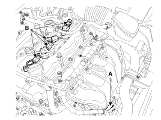
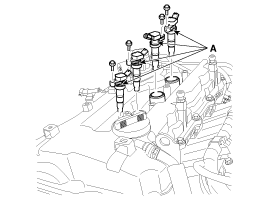

# Kia Sportage: Test de Compresão

[Home](../../index.md) / [Manual de Serviço e Reparo do Kia Sportage SL](../sportage-482.md) / [Sistema Mecânico do Motor](sportage-484.md) / Test de Compresão

## Inspeção da Pressão de Compresão

> **Nota**
>
> - Se houver falta de potência, consumo excessivo de óleo ou economia ruim de combustível, medir a pressão de compresão.

1. Aqueça e pare o motor.

   Permita que o motor aqueça até a temperatura de operação normal.

2. Desconecte o conector de extensão do injetor (A) e os conectores do bobinado de ignição (B).

   

3. Remova as bobinas de ignição (A).

   

4. Remova as bobinas de estalo.

   Usando uma chave de 16mm, remova as 4 bobinas de estalo.

5. Verifique a pressão de compresão do cilindro.

   | (1) | Insira um medidor de compresão no orifício da bobina de estalo. |
   | --- | --- |

   | (2) | Abra completamente a chapa de acelerador. |
   | --- | --- |

   | (3) | Enquanto o motor estiver sendo girado, medir a pressão de compresão. Sempre use uma bateria totalmente carregada para obter uma velocidade de 200 rpm ou mais. |
   | --- | --- |
   | Sempre use uma bateria totalmente carregada para obter uma velocidade de 200 rpm ou mais. | |

   ```
   Repita os passos (1) a (3) para cada cilindro.
   Esta medição deve ser feita em um tempo o mais curto possível.
   Pressão de compresão :
   1078 kPa (11.0 kgf/cm?, 156 psi) / 200 ~ 250 rpm
   Pressão mínima :
   931 kPa (9.5 kgf/cm?, 135 psi)
   Diferença entre cada cilindro :
   100kPa (1.0kgf/cm?, 15psi) ou menos
   ```

   | (5) | Se a compresão do cilindro em 1 ou mais cilindros for baixa,
   jogue uma pequena quantidade de óleo do motor no cilindro através do orifício da bobina de estalo e repita os passos (1) a (3) para cilindros com compresão baixa. • Se adicionar óleo ajudar a compresão, é provável que as anel de pistão e/ou a face do cilindro estejam danificados ou desgastados. • Se a pressão permanecer baixa, um válvula pode estar engasgada ou a alça pode estar posicionada incorretamente, ou pode haver vazamento pela borracha. |
   | --- | --- |
   | • | Se adicionar óleo ajudar a compresão, é provável que as anel de pistão e/ou a face do cilindro estejam danificados ou desgastados. |
   | • | Se a pressão permanecer baixa, um válvula pode estar engasgada ou a alça pode estar posicionada incorretamente, ou pode haver vazamento pela borracha. |

6. Reinstale as bobinas de estalo.

7. Instale as bobinas de ignição.

8. Conecte o conector de extensão do injetor e os conectores do bobinado de ignição.

9. Alguns códigos de diagnóstico (DTC) podem existir após a teste de inspeção e podem precisar ser limpos manualmente com GDS.
