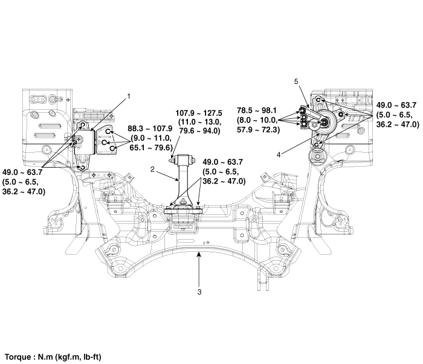

# Kia Sportage: Montagem do Motor: Componentes e Localização dos Componentes

[Home](../../index.md) / [Manual de Serviço e Reparo do Kia Sportage SL](../sportage-482.md) / [Sistema Mecânico do Motor](sportage-484.md) / [Montagem do Motor e Transaxle](sportage-489.md) / Montagem do Motor: Componentes e Localização dos Componentes

## Componentes

| 1. Alçapão de montagem do transaxle 2. Alçapão do rolamento transversal 3. Sub quadro | 4. Alçapão de montagem do motor 5. Alçapão de suporte de montagem do motor |
| --- | --- |
