# Kia Sportage: Montagem do Motor e Transmissão: Procedimentos de Reparo

[Home](../../index.md) / [Manual de Serviço e Reparo do Kia Sportage SL](../sportage-482.md) / [Sistema Mecânico do Motor](sportage-484.md) / [Montagem do Motor e Transmissão](sportage-489.md) / Procedimentos de Reparo da Montagem do Motor e Transmissão

## Remoção

> **Cuidado**
>
> - Use cobertores de para-choque para evitar danificar superfícies pintadas.
> - Para evitar danos, desconecte os conectores de alimentação elétrica cuidadosamente segurando a parte do conector.

> **Observação**
>
> - Marque todos os fios e mangueiras para evitar a conexão incorreta.
> - Para liberar a pressão do sistema de combustível antes de remover a montagem do motor, ligue o motor com o relé do fornecimento de combustível removido. E, então, desligue o interruptor de ignição após o motor parar.

1. Remova a capa do motor.

2. Desconecte as terminais do bocal de bateria (A).

   ```
   Torque de aperto:
   (+) terminal: 7,8 ~ 9,8 N.m (0,8 ~ 1,0 kgf.m, 5,8 ~ 7,2 lb-ft)
   (-) terminal: 4,0 ~ 6,0 N.m (0,4 ~ 0,6 kgf.m, 3,0 ~ 4,4 lb-ft)
   ```

3. Remova o bocal de bateria (B) após remover o suporte de montagem (C).

   ```
   Torque de aperto:
   8,8 ~ 13,7 N.m (0,9 ~ 1,4 kgf.m, 6,5 ~ 10,1 lb-ft)
   ```

   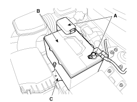

4. Remova a montagem do limpador de ar (A).

   | (1) | Remova o ducto de ar (A). |
   | --- | --- |

   | (2) | Desconecte o mangote de respiração (B), o mangote de recirculação (C) e o mangote de vácuo do potenciador de freio (D). |
   | --- | --- |

   ```
   Desconecte o mangote de entrada de ar (E) e, em seguida, remova a montagem do limpador de ar (F).
   Torque de aperto
   Mangote de aperto:
   2,9 ~ 4,9 N.m (0,3 ~ 0,5 kgf.m, 2,2 ~ 3,6 lb-ft)
   Mangueiras de montagem do limpador de ar:
   7,8 ~ 9,8 N.m (0,8 ~ 1,0 kgf.m, 5,8 ~ 7,2 lb-ft)
   ```

   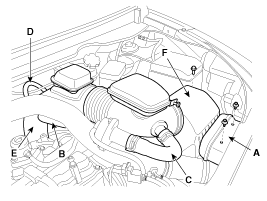

5. Desconecte os conectores (B) e, em seguida, remova a ECM (A). (Consulte o grupo FL)

   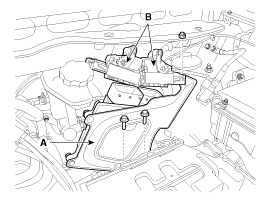

6. Remova a prateleira do bocal de bateria (A).

   ```
   Torque de aperto:
   8,8 ~ 13,7 N.m (0,9 ~ 1,4 kgf.m, 6,5 ~ 10,1 lb-ft)
   ```

   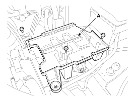

7. Desconecte o conectores do válvula de recirculação (A) e o mangote de vácuo (B), e, em seguida, remova a montagem do intercooler de entrada de ar e mangote (C).

   ```
   Torque de aperto
   Mangote de aperto:
   4,9 ~ 6,9 N.m (0,5 ~ 0,7 kgf.m, 3,6 ~ 5,1 lb-ft)
   Parafuso de montagem do mangote:
   14,7 ~ 19,6 N.m (1,5 ~ 2,0 kgf.m, 10,8 ~ 14,5 lb-ft)
   ```

   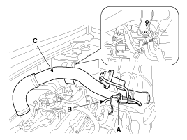

8. Desconecte o conectores do sensor de pressão de boost (A) e, em seguida, remova a montagem do intercooler de saída de ar e mangote (B).

   ```
   Torque de aperto
   4,9 ~ 6,9 N.m (0,5 ~ 0,7 kgf.m, 3,6 ~ 5,1 lb-ft)
   ```

   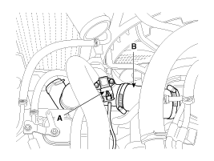

9. Remova a capa inferior (A).

   ```
   Torque de aperto:
   9,8 ~ 11,8 N.m (1,0 ~ 1,2 kgf.m, 7,2 ~ 8,7 lb-ft)
   ```

   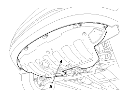

10. Aproveite para soltar o plugue de drenagem e drenar o líquido de refrigeração do motor. Remova a tampa do radiador para drenar com rapidez. (Consulte o sistema de refrigeração neste grupo)

11. Desconecte o mangote superior do radiador (A) e o mangote inferior do radiador (B).

   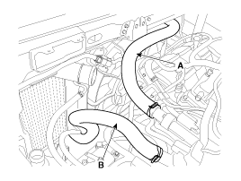

12. Recupere o refrigerante e, em seguida, remova o mangote de alta pressão (A) e o mangote de baixa pressão (B). (Consulte o sistema de ar condicionado no grupo HA.)

   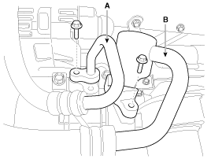

13. Desconecte o cabo de positivo (A) e o conectador (B) da caixa de fusíveis/relé.

   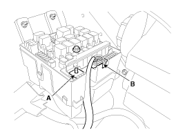

14. Desconecte os conectores de fiação e as pinças do conjunto de mangueiras, e remova os proteutores de fiação do cabeçote do cilindro, do manifolds de admissão e do manifolds de escape.

   | (1) | Desconecte o conectador do válvulo de controle de óleo (OCV) de escapamento (A) e o conectador do sensor de oxigênio (B). |
   | --- | --- |

   | (2) | Desconecte o conectador do interruptor do compressor de ar condicionado (A), o conectador do alternador (B), o conectador do interruptor de pressão do óleo (OPS) & conectador do extensor do injetor (C), o conectador do sensor de estalo (D), o conectador do sensor de pressão absoluta do manifolds (MAPS) & sensor de temperatura do ar de admissão (IATS) (E), o conectador do controlador do acelerador eletrônico (ETC) (F) e o conectador do bomba de vácuo (G). |
   | --- | --- |

   | (3) | Desconecte os conectores do bobinado do ignição (B) e o conectador do bomba de combustível (A). |
   | --- | --- |

   | (4) | Desconecte o conectador do válvulo de controle de óleo (OCV) de admissão (A) e o conectador do sensor de temperatura do óleo (OTS) (B). |
   | --- | --- |

   | (5) | Desconecte o conectador do sensor de posição do cárter do cárabo (CMPS) (A), o conectador da válvula de controle de purga (PCSV) (B), o conectador do sensor de temperatura do líquido de resfriamento do motor (ECTS) (C), o conectador do condensador (D), o conectador do sensor de posição do cárabo (CKPS) (E), o conectador do sensor de posição do cárabo de escapamento (CMPS) (F) e o conectador do atuador do vácuo de escape (G). |
   | --- | --- |

15. Remova os conectores do conjunto de mangueiras de fiação do transaxle (A) e o cabo de controle (B) do transaxle. (Referência ao grupo AT).

   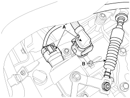

16. Desconecte as mangueiras do resfriador de óleo transmissor (A).

   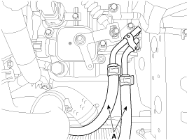

17. Desconecte a mangueira intensificadora (A) e a mangueira de vácuo (B).

   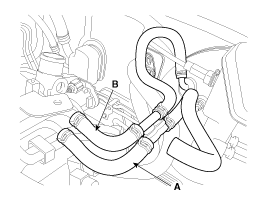

18. Desconecte a mangueira de combustível (A) e a mangueira do válvulo de controle de purga (PCSV) (B).

   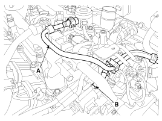

19. Desconecte as mangueiras do aquecedor (A).

   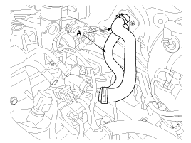

20. Remova a mangueira do silencioso dianteiro (A).

   ```
   Torque de aperto:
   39,2 ~ 58,8 N.m (4,0 ~ 6,0 kgf.m, 28,9 ~ 43,4 lb-ft)
   ```

   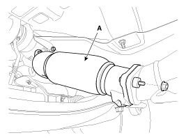

21. Remova o parafuso de montagem do articulador do volante (A). (Referência ao grupo ST)

   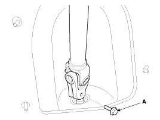

22. Remova as rodas dianteiras.

23. Remova os braços inferiores (A). (Referência ao grupo SS)

   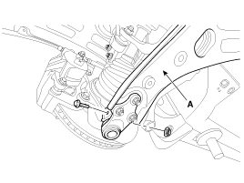

24. Remova os extremos do eixo estabilizador (A). (Referência ao grupo SS)

   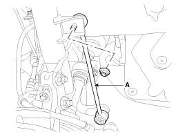

25. Remova os extremos do eixo de direção (A). (Referência ao grupo ST)

   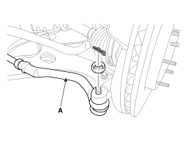

26. Desconecte os eixos de transmissão (A) dos eixos de roda. (Referência ao grupo DS)

   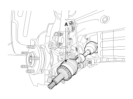

27. Remova o suporte do eixo rolante (A).

   ```
   Torque de aperto:
   Parafuso (B) : 88,3 ~ 107,9 N.m (9,0 ~ 11,0 kgf.m, 65,1 ~ 79,6 lb-ft)
   Parafusos (C) : 49,0 ~ 63,7 N.m (5,0 ~ 6,5 kgf.m, 36,2 ~ 47,0 lb-ft)
   ```

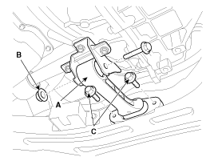

28. Apoie o sub quadro (A) com um guincho de chão, e então remova as parafusos e parafusos de montagem do sub quadro.

   ```
   Torque de aperto:
   176,5 ~ 196,1 N.m (18,0 ~ 20,0 kgf.m, 130,2 ~ 144,7 lb-ft)
   ```

   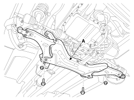

   > **Nota**
   >
   > - Após remover o parafuso de montagem do sub quadro, o conjunto do motor e a transmissão podem cair para baixo, e então apoie-os firmemente com um guincho de chão.
   > - Verifique se os mangotes e conectores estão desconectados antes de remover o conjunto do motor e da transmissão.

29. Desconecte a linha de terra (A), e então remova o suporte de montagem do motor (B).

   ```
   Torque de aperto:
   78,5 ~ 98,1 N.m (8,0 ~ 10,0 kgf.m, 57,9 ~ 72,3 lb-ft)
   ```

   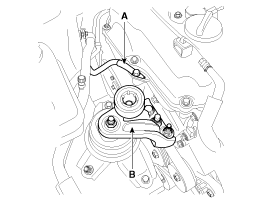

30. Desconecte a linha de terra (A), e então remova o suporte de montagem da transmissão (B).

   ```
   Torque de aperto:
   88,3 ~ 107,9 N.m (9,0 ~ 11,0 kgf.m, 65,1 ~ 79,6 lb-ft)
   ```

   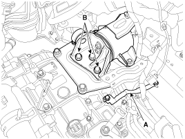

31. Remova o conjunto do motor e da transmissão levantando o veículo.

   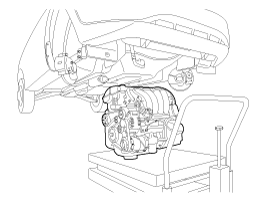

   > **Cautela**
   >
   > - Ao remover o conjunto do motor e da transmissão, tenha cuidado para não danificar qualquer parte circundante ou componentes do corpo.

## Instalação

A instalação deve ser realizada no sentido oposto à remoção.

Realize o seguinte:

| • | Ajuste o cabo de troca de marcha. |
| --- | --- |

| • | Reforneça o motor com óleo de motor. |
| --- | --- |

| • | Reforneça a transmissão com líquido. |
| --- | --- |

| • | Reforneça o radiador e o tanque de reservatório com líquido antifreeze. |
| --- | --- |

| • | Limpe as postas da bateria e os terminais do cabo e monte. |
| --- | --- |

| • | Inspecione para verificar vazamento de combustível. |
| --- | --- |

| – | Após montar a linha de combustível, ligue o interruptor de ignição (não operando o motor) para que o bomba de combustível funcione por aproximadamente dois segundos e a linha de combustível seja pressurizada. |
| --- | --- |

| – | Repita esta operação duas ou três vezes, depois verifique para vazamento em qualquer ponto da linha de combustível. |
| --- | --- |

| • | Descanse o sistema de refrigeração de ar. |
| --- | --- |

| – | Inicie o motor e deixe-o funcionar até aquecer. (até que o ventilador de radiador operar 3 ou 4 vezes.) |
| --- | --- |

| – | Desligue o motor. Verifique o nível no radiador, adicione antifreeze se necessário. Isto permitirá que o ar preso seja removido do sistema de refrigeração. |
| --- | --- |

| – | Coloque a tampa do radiador apertada, depois reinicie o motor e verifique para vazamentos. |
| --- | --- |
