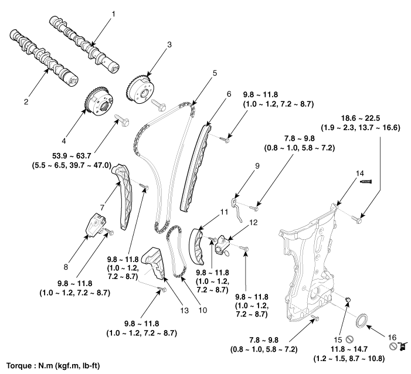

# Kia Sportage: Cadeia de Distribuição: Componentes e Localização dos Componentes

[Home](../../index.md) / [Manual de Serviço e Reparo do Kia Sportage SL](../sportage-482.md) / [Sistema Mecânico do Motor](sportage-484.md) / [Sistema de Distribuição](sportage-492.md) / Cadeia de Distribuição: Componentes e Localização dos Componentes

## Componentes

| 1. Câmbio de admissão 2. Câmbio de exaustão 3. Montagem de CVVT de admissão 4. Montagem de CVVT de exaustão 5. Cadeia de distribuição | 6. Guiador da cadeia de distribuição 7. Braço do regulador de tensão da cadeia de distribuição 8. Regulador de tensão da cadeia de distribuição 9. Jato de óleo da cadeia de distribuição 10. Cadeia do balanço do motor |
| --- | --- | --- |
| 11. Braço do regulador de tensão da cadeia do balanço do motor 12. Regulador de tensão da cadeia do balanço do motor 13. Guiador da cadeia do balanço do motor 14. Cobertura da cadeia de distribuição 15. Parafuso do orifício de serviço 16. Selo de óleo da frente do eixo do crankshaft |
