# Kia Sportage: Cadeia de同步翻译如下：

# Kia Sportage: Cadeia de Distribuição: Procedimentos de Reparo

[Home](../../index.md) / [Manual de Serviço e Reparo do Kia Sportage SL](../sportage-482.md) / [Sistema Mecânico do Motor](sportage-484.md) / [Sistema de Distribuição](sportage-492.md) / Cadeia de Distribuição: Procedimentos de Reparo

## Remoção

> **Cuidado**
>
> - Use cobertores de porta-rodas para evitar danos às superfícies pintadas.
> - Para evitar danos, desconecte cuidadosamente os conectores de fiação segurando a parte do conectores.

> **Nota**
>
> - Marque todas as fivelas e mangueiras para evitar a conexão incorreta.

> **Aviso**
>
> - Em caso de remoção do bomba de injeção de alta pressão, tubo de alta pressão, tubo de entrega e injetor, há risco de lesão causada por vazamento de combustível de alta pressão. Portanto, não faça qualquer trabalho de reparo imediatamente após o motor parar.

1. Remova a capa do motor.

2. Desconecte o terminal negativo da bateria (A).

   

3. Remova a montagem do limpador de filtro de ar.

   | (1) | Remova o dutamento de ar (A). |
   | --- | --- |

   | (2) | Desconecte o tubo de respiração (B), o tubo de recirculação (C) e o tubo de vácuo do booster de freio (D). |
   | --- | --- |

   | (3) | Desconecte o tubo de entrada de ar (E) e, em seguida, remova a montagem do limpador de filtro de ar (F). |
   | --- | --- |

   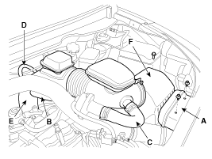

4. Desconecte o conectores do válvula de recirculação (A) e do tubo de vácuo (B), e, em seguida, remova o conjunto de tubos de entrada do intercooler (C).

   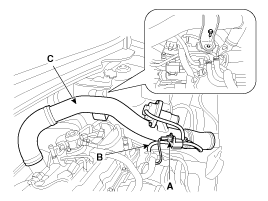

5. Remova a roda dianteira direita.

6. Remova a cobertura inferior (A).

   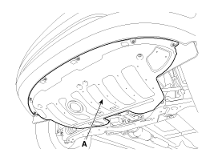

7. Vire o pulley do bucha e alinhe sua vagem com a marca do chain cover de bucha para alinhar o pistão do cilindro número 1 na topo do ciclo de compressão.

   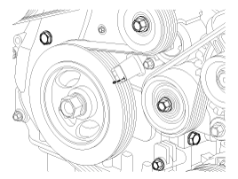

8. Desconecte o conectores da OCV (Valvula de controle de óleo) (A) e do sensor de oxigênio (B).

   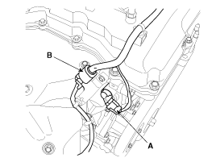

9. Desconecte os conectores do bobina de ignição (B) e do conectores do bomba de injeção (A), e, em seguida, remova a proteção de fiação.

   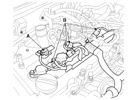

10. Remova as bobinas de ignição (A).

   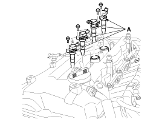

11. Desconecte o tubo de óleo (A) e o tubo do PCSV (Valvula de controle de purga de vácuo) (B).

   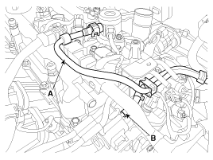

12. Desconecte o conectores do PCSV (Valvula de controle de purga de vácuo) (A) e desloque os parafusos e a rosca de montagem da mangueira de vácuo.

   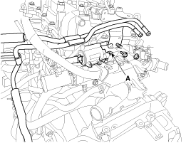

13. Remova o tubo de alta pressão (A). (Consulte o grupo FL)

   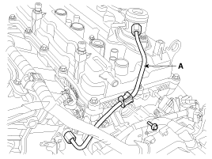

14. Remova a bomba de injeção de alta pressão (A) e o rolamento de tappet (B). (Consulte o grupo FL)

   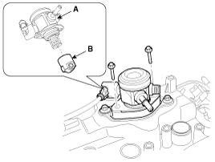

15. Desconecte o tubo de ventilação positiva do câmara de bucha (A) e, em seguida, remova o suporte do motor dianteiro (B).

   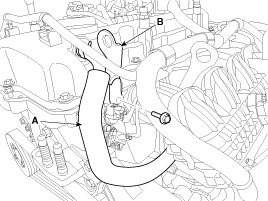

16. Remova a capa do cabeçote do cilindro (A).

   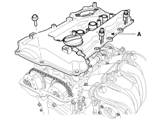

17. Remova a corrente dentada (A) após girar o ajustador de tensão da corrente dentada (B) no sentido horário.

   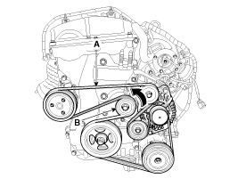

18. Remova os parafusos inferiores do compressor de ar condicionado (A).

   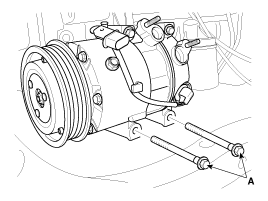

19. Remova o suporte do compressor de ar condicionado (A).

   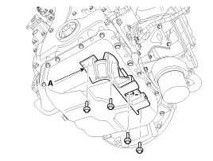

20. Drenagem do óleo do motor.

21. Remova a vassoura de óleo (A). Insira a lâmina do SST (09215-3C000) entre o chassis e a vassoura de óleo. Corte o selante aplicado e remova a vassoura de óleo inferior.

   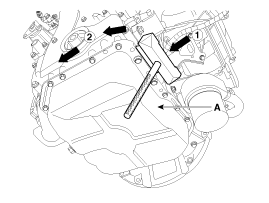

   > **Nota**
   >
   > - Insira o SST entre a vassoura de óleo e o chassis batendo com um martelo de plástico na direção do setor.
   > - Depois de batê-lo com um martelo de plástico na direção do setor mais do que 2/3 do perímetro da vassoura de óleo, remova-o do chassis.
   > - Não vire o SST de repente sem batê-lo. Isso resultará em danos ao SST.
   > - Cuide para não danificar as superfícies de contato do chassis e da vassoura de óleo inferior.

22. Posicione o suporte de roldana entre o chassis.

   > **Nota**
   >
   > - Coloque um bloco de madeira entre o chassis e o suporte de roldana.

   > **Cuidado**
   >
   > - Cuide para não danificar o eixo de equilíbrio e o módulo de bomba de água.

23. Desconecte a linha de terra (A), e então remova o suporte de montagem do motor (B).

   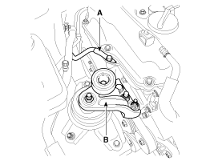

24. Remova o idler (A), a roda de engrenagem da bomba de água (B), a roda de engrenagem do eixo do bucha (C) e a roda de engrenagem do aperto do cinto de transmissão (D).

   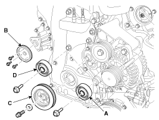

   > **Cuidado**
   >
   > - A roda de engrenagem do aperto do cinto de transmissão é uma rosca de esquerda.

   > **Nota**
   >
   > - Use o SST (Parar do disco de engrenagem, 09231-2B100) (A) para remover o parafuso do bucha do eixo do bucha, após remover o starter.

   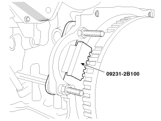

25. Remova o aperto do cinto de transmissão (A).

   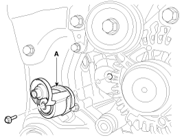

26. Remova o suporte de montagem do motor (A).

   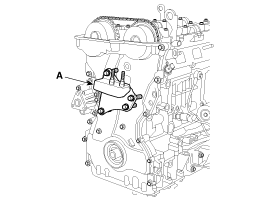

27. Remova a cobertura da corrente de sincronização (A) empurrando suavemente as partes entre o cabeçote do cilindro e a caixa do cilindro.

   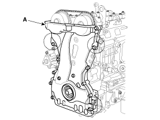

   > **Cuidado**
   >
   > - Cuide para não danificar as superfícies de contato da caixa do cilindro, do cabeçote do cilindro e da cobertura da corrente de sincronização.

28. Certifique-se de que a chave (A) do eixo do bucha esteja alinhada com a superfície de montagem da tampa do principal. Como resultado, o pistão do cilindro número 1 está no topo do centro de compressão.

   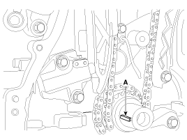

29. Libere o engrenado puxando a haste para baixo usando um fio fino. Comprenda o pistão e então insira um pincoleta (A) na abertura do engrenado para segurar o pistão comprimido. Remova o aperto do cinto de corrente de sincronização (B).

   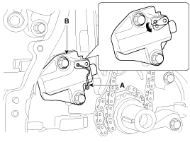

30. Remova o braço do aperto do cinto de corrente de sincronização (A).

   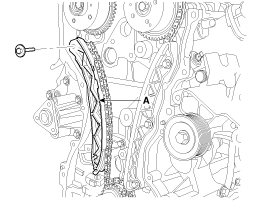

31. Remova a corrente de sincronização (A).

   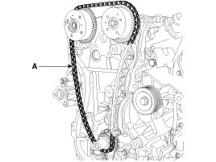

32. Remova o guia da corrente de sincronização (A).

   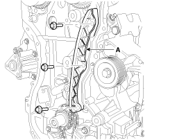

33. Remova o jato de óleo da corrente de sincronização (A) e a engrenagem do eixo do bucha (B).

   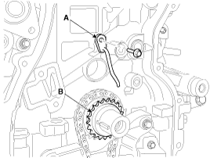

34. Remova a corrente de equilíbrio. (Consulte o sistema de lubrificação neste grupo)

## Inspeção

Sprockets, Ajustador da Cadeia, Guia da Cadeia, Braço do Ajustador da Cadeia

1. Verifique o sprocket do凸轮轴和曲轴sprocket do凸轮轴和曲轴sprockets do凸轮轴和曲轴sprockets do凸轮轴和曲轴凸轮轴和曲轴sprockets do凸轮轴和曲轴sprockets do凸轮轴和曲轴凸轮轴和曲轴sprockets do凸轮轴和曲轴sprockets do凸轮轴和曲轴sprockets do凸轮轴和曲轴sprockets do凸轮轴和曲轴sprockets do凸轮轴和曲轴sprockets do凸轮轴和曲轴sprockets do凸轮轴和曲轴sprockets do凸轮轴和曲轴sprockets do凸轮轴和曲轴sprockets do凸轮轴和曲轴sprockets do凸轮轴和曲轴sprockets do凸轮轴和曲轴sprockets do凸轮轴和曲轴sprockets do凸轮轴和曲轴sprockets do凸轮轴和曲轴sprockets do凸轮轴和曲轴sprockets do凸轮轴和曲轴sprockets do凸轮轴和曲轴sprockets do凸轮轴和曲轴sprockets do凸轮轴和曲轴sprockets do凸轮轴和曲轴sprockets do凸轮轴和曲轴sprockets do凸轮轴和曲轴sprockets do凸轮轴和曲轴sprockets do凸轮轴和曲轴sprockets do凸轮轴和曲轴sprockets do凸轮轴和曲轴sprockets do凸轮轴和曲轴sprockets do凸轮轴和曲轴sprockets do凸轮轴和曲轴sprockets do凸轮轴和曲轴sprockets do凸轮轴和曲轴sprockets do凸轮轴和曲轴sprockets do凸轮轴和曲轴sprockets do凸轮轴和曲轴sprockets do凸轮轴和曲轴sprockets do凸轮轴和曲轴sprockets do凸轮轴和曲轴sprockets do凸轮轴和曲轴sprockets do凸轮轴和曲轴sprockets do凸轮轴和曲轴sprockets do凸轮轴和曲轴sprockets do凸轮轴和曲轴sprockets do凸轮轴和曲轴sprockets do凸轮轴和曲轴sprockets do凸轮轴和曲轴sprockets do凸轮轴和曲轴sprockets do凸轮轴和曲轴sprockets do凸轮轴和曲轴sprockets do凸轮轴和曲轴sprockets do凸轮轴和曲轴sprockets do凸轮轴和曲轴sprockets do凸轮轴和曲轴sprockets do凸轮轴和曲轴sprockets do凸轮轴和曲轴sprockets do凸轮轴和曲轴sprockets do凸轮轴和曲轴sprockets do凸轮轴和曲轴sprockets do凸轮轴和曲轴sprockets do凸轮轴和曲轴sprockets do凸轮轴和曲轴sprockets do凸轮轴和曲轴sprockets do凸轮轴和曲轴sprockets do凸轮轴和曲轴sprockets do凸轮轴和曲轴sprockets do凸轮轴和曲轴sprockets do凸轮轴和曲轴sprockets do凸轮轴和曲轴sprockets do凸轮轴和曲轴sprockets do凸轮轴和曲轴sprockets do凸轮轴和曲轴sprockets do凸轮轴和曲轴sprockets do凸轮轴和曲轴sprockets do凸轮轴和曲轴sprockets do凸轮轴和曲轴sprockets do凸轮轴和曲轴sprockets do凸轮轴和曲轴sprockets do凸轮轴和曲轴sprockets do凸轮轴和曲轴sprockets do凸轮轴和曲轴sprockets do凸轮轴和曲轴sprockets do凸轮轴和曲轴sprockets do凸轮轴和曲轴sprockets do凸轮轴和曲轴sprockets do凸轮轴和曲轴sprockets do凸轮轴和曲轴sprockets do凸轮轴和曲轴sprockets do凸轮轴和曲轴sprockets do凸轮轴和曲轴sprockets do凸轮轴和曲轴sprockets do凸轮轴和曲轴sprockets do凸轮轴和曲轴sprockets do凸轮轴和曲轴sprockets do凸轮轴和曲轴sprockets do凸轮轴和曲轴sprockets do凸轮轴和曲轴sprockets do凸轮轴和曲轴sprockets do凸轮轴和曲轴sprockets do凸轮轴和曲轴sprockets do凸轮轴和曲轴sprockets do凸轮轴和曲轴sprockets do凸轮轴和曲轴sprockets do凸轮轴和曲轴sprockets do凸轮轴和曲轴sprockets do凸轮轴和曲轴sprockets do凸轮轴和曲轴sprockets do凸轮轴和曲轴sprockets do凸轮轴和曲轴sprockets do凸轮轴和曲轴sprockets do凸轮轴和曲轴sprockets do凸轮轴和曲轴sprockets do凸轮轴和曲轴sprockets do凸轮轴和曲轴sprockets do凸轮轴和曲轴sprockets do凸轮轴和曲轴sprockets do凸轮轴和曲轴sprockets do凸轮轴和曲轴sprockets do凸轮轴和曲轴sprockets do凸轮轴和曲轴sprockets do凸轮轴和曲轴sprockets do凸轮轴和曲轴sprockets do凸轮轴和曲轴sprockets do凸轮轴和曲轴sprockets do凸轮轴和曲轴sprockets do凸轮轴和曲轴sprockets do凸轮轴和曲轴sprockets do凸轮轴和曲轴sprockets do凸轮轴和曲轴sprockets do凸轮轴和曲轴sprockets do凸轮轴和曲轴sprockets do凸轮轴和曲轴sprockets do凸轮轴和曲轴sprockets do凸轮轴和曲轴sprockets do凸轮轴和曲轴sprockets do凸轮轴和曲轴sprockets do凸轮轴和曲轴sprockets do凸轮轴和曲轴sprockets do凸轮轴和曲轴sprockets do凸轮轴和曲轴sprockets do凸轮轴和曲轴sprockets do凸轮轴和曲轴sprockets do凸轮轴和曲轴sprockets do凸轮轴和曲轴sprockets do凸轮轴和曲轴sprockets do凸轮轴和曲轴sprockets do凸轮轴和曲轴sprockets do凸轮轴和曲轴sprockets do凸轮轴和曲轴sprockets do凸轮轴和曲轴sprockets do凸轮轴和曲轴sprockets do凸轮轴和曲轴sprockets do凸轮轴和曲轴sprockets do凸轮轴和曲轴sprockets do凸轮轴和曲轴sprockets do凸轮轴和曲轴sprockets do凸轮轴和曲轴sprockets do凸轮轴和曲轴sprockets do凸轮轴和曲轴sprockets do凸轮轴和曲轴sprockets do凸轮轴和曲轴sprockets do凸轮轴和曲轴sprockets do凸轮轴和曲轴sprockets do凸轮轴和曲轴sprockets do凸轮轴和曲轴sprockets do凸轮轴和曲轴sprockets do凸轮轴和曲轴sprockets do凸轮轴和曲轴sprockets do凸轮轴和曲轴sprockets do凸轮轴和曲轴sprockets do凸轮轴和曲轴sprockets do凸轮轴和曲轴sprockets do凸轮轴和曲轴sprockets do凸轮轴和曲轴sprockets do凸轮轴和曲轴sprockets do凸轮轴和曲轴sprockets do凸

## Instalação

1. Instale a corrente de balanço do eixo (Referência ao sistema de lubrificação neste grupo).

2. Instale o anel do eixo do carretel do eixo do carretel (B) e o jato de óleo da corrente de sincronização (A).

   ```
   Torque de aperto:
   7,8 ~ 9,8N.m (0,8 ~ 1,0kgf.m, 5,8 ~ 7,2lb-ft)
   ```

   

3. Alinhe o eixo do carretel com a superfície do capo principal. Posicione a assemblagem do carretel do carburador e do carretel do escape de forma que as marcas TDC (B) dos carretéis do carburador e do escape CVVT estejam alinhadas com a superfície do cabeçote do cilindro. Como resultado, o pistão do cilindro número 1 está no topo do centro durante a compressão.

   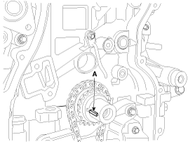

   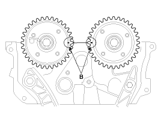

4. Instale o guia da corrente de sincronização (A).

   ```
   Torque de aperto:
   9,8 ~ 11,8N.m (1,0 ~ 1,2kgf.m, 7,2 ~ 8,7lb-ft)
   ```

   

5. Para instalar a corrente de sincronização sem slack entre cada carretel (carburador, carretel do carretel), siga o procedimento abaixo.

   Anel do carretel do carretel (A) > Guia da corrente de sincronização (B) > Carretel do carburador CVVT (C) > Carretel do escape CVVT (D).

   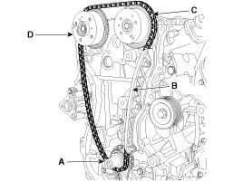

   > **Nota**
   >
   > - As marcas de sincronização de cada carretel devem ser alinhadas com as marcas de sincronização (ligação de cores) da corrente de sincronização durante a instalação da corrente de sincronização.

   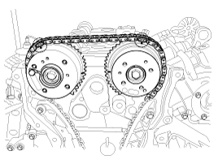

   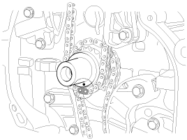

6. Instale o braço do regulador de tensão da corrente de sincronização (A).

   ```
   Torque de aperto:
   9,8 ~ 11,8N.m (1,0 ~ 1,2kgf.m, 7,2 ~ 8,7lb-ft)
   ```

   

7. Instale o regulador de tensão automático da corrente de sincronização (B) e remova o pinho de parada (A).

   ```
   Torque de aperto:
   9,8 ~ 11,8N.m (1,0 ~ 1,2kgf.m, 7,2 ~ 8,7lb-ft)
   ```

   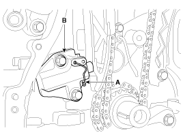

8. Após girar o eixo do carretel 2 revoluções no sentido regular (horário, visto do lado frontal), confirme que as marcas TDC (A) nos carretéis do carburador e do escape CVVT estejam alinhadas com a superfície do cabeçote do cilindro.

   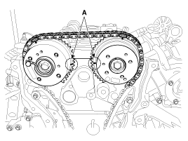

9. Instale o coberto da corrente de sincronização.

   | (1) | Usando um raspador de selante, remova todo o material antigo de preenchimento das superfícies do selante. |
   | --- | --- |

   | (2) | As localizações do selante no coberto da corrente de sincronização e nos componentes correspondentes (cabeçote do cilindro, bloco do cilindro e quadro) devem estar livres de óleo do motor e etc. |
   | --- | --- |

   ```
   Antes de montar o coberto da corrente de sincronização, deve ser aplicado selante líquido Loctite 5900H ou equivalente no intervalo entre o cabeçote do cilindro e o bloco do cilindro. A montagem deve ser realizada dentro de 5 minutos após a aplicação do selante.
   Largura do selante: 3,0mm (0,12in.)
   ```

   ```
   Após aplicar selante líquido Loctite 5900H ou equivalente no coberto da corrente de sincronização.
   A montagem deve ser realizada dentro de 5 minutos após a aplicação do selante. Um selante contínuo deve ser aplicado para prevenir qualquer
   ```

- Caminho de vazamento de óleo.
   - Largura do reboco: 3,0mm (0,12in.)

   ```
   ```
   Os pinos de定位翻译：
   - Os pinos de定位应作为参考，以便在装配定时链盖时确保其精确位置。
  拧紧扭矩：
   螺栓 A (M6x25) :
   7,8 ~ 9,8N.m (0,8 ~ 1,0kgf.m, 5,8 ~ 7,2lb-ft)
   螺栓 B (M8x28) :
   18,6 ~ 22,5N.m (1,9 ~ 2,3kgf.m, 13,7 ~ 16,6lb-ft)
   在定时链盖装配后30分钟内不应进行发动机启动或压力测试。
   ```

10. Instale o suporte de motor (A).

   ```
   Torque de aperto:
   Parafusos M10 :
   39,2 ~ 44,1N.m (4,0 ~ 5,0kgf.m, 28,9 ~ 32,5lb-ft)
   Parafusos M8 :
   19,6 ~ 24,5N.m (2,0 ~ 2,5kgf.m, 14,5 ~ 18,1lb-ft)
   ```

   

11. Instale a vedante do volante do eixo do câmbio (A) usando SST (09214-3K000, 09231-H1100) (B).

   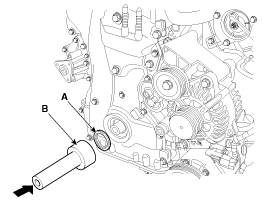

12. Instale o regulador de tensão do cinto de transmissão (A).

   ```
   Torque de aperto :
   53,9 ~ 63,7N.m (5,5 ~ 6,5kgf.m, 39,7 ~ 47,0lb-ft)
   ```

   

13. Instale o rolamento (A), o volante do bomba de água (B), o volante do eixo do câmbio (C) e o volante do regulador de tensão do cinto (D).

   ```
   Torque de aperto :
   Rolamento (A) :
   53,9 ~ 63,7N.m (5,5 ~ 6,5kgf.m, 39,7 ~ 47,0lb-ft)
   Volante do bomba de água (B) :
   7,8 ~ 9,8N.m (0,8 ~ 1,0kgf.m, 5,8 ~ 7,2lb-ft)
   Volante do eixo do câmbio (C) :
   166,6 ~ 176,4N.m (17,0 ~ 18,0kgf.m, 122,9 ~ 130,1lb-ft)
   Volante do regulador de tensão do cinto (D) :
   53,9 ~ 63,7N.m (5,5 ~ 6,5kgf.m, 39,7 ~ 47,0lb-ft)
   ```

   

   > **Cuidado**
   >
   > - O parafuso do volante do regulador de tensão é uma rosca de mão esquerda.

   > **Nota**
   >
   > - Use o SST (Parafuso de parada do anel, 09231-2B100) para remover o parafuso do volante do eixo do câmbio. Instale o starter após instalar o volante do eixo do câmbio.

   

14. Instale o suporte de montagem do motor (B) e conecte a linha de terra (A).

   ```
   Torque de aperto :
   78,5 ~ 98,1 N.m (8,0 ~ 10,0 kgf.m, 57,9 ~ 72,3 lb-ft)
   ```

   

15. Remova o suporte de elevação do quadro do veículo.

16. Instale a caixa de óleo.

   | (1) | Usando um raspador de selante, remova todo o material de selante antigo das superfícies do selante. |
   | --- | --- |

   ```
   Antes de montar a caixa de óleo, deve-se aplicar selante líquido Loctite 5900H, Threebond 1217H ou equivalente na caixa de óleo. A parte deve ser montada dentro de 5 minutos após a aplicação do selante.
   Largura do reboco : 2,5mm (0,10in.)
   Ao aplicar o selante do selante do selante, o selante não deve projetar-se para dentro da caixa de óleo.
   Para prevenir a vazão de óleo, aplique o selante do selante das fendas internas dos buracos das porcas.
   ```

   ```
   Montar a caixa de óleo (A). Ajuste os parafusos uniformemente em várias passadas.
   Torque de aperto
   Parafusos B (M9) :
   30,4 ~ 34,3N.m (3,1 ~ 3,5kgf.m, 22,4 ~ 25,3lb-ft)
   Parafusos C (M6) :

9.8 ~ 11.8N.m (1.0 ~ 1.2kgf.m, 7.2 ~ 8.7lb-ft)
Após a montagem, aguarde pelo menos 30 minutos antes de preencher o motor com óleo.
Sempre use um selo novo do plug de drenagem.

```

17. Instale o suporte do compressor de ar condicionado (A).

   ```
   Torque de aperto:
   19.6 ~ 23.5N.m (2.0 ~ 2.4kgf.m, 14.5 ~ 17.4lb-ft)
   ```

   

18. Instale as varetas de fixação do compressor de ar condicionado (A).

   ```
   Torque de aperto:
   20.0 ~ 33.0N.m (2.04 ~ 3.36kgf.m, 14.8 ~ 24.3lb-ft)
   ```

   

19. Instale a correia do motor (A).

   Pulley do bule do motor > Pulley do compressor de ar condicionado > Pulley do gerador >
   Pulley do idler #1 > Pulley do idler #2 > Pulley do bomba de água > Pulley do regulador de tensão.

   Vire a alça do regulador de tensão da correia (B) no sentido horário, movendo o parafuso da pulley do regulador com uma chave. Após colocar a correia na pulley do regulador, solte lentamente a pulley do regulador.

   

20. Instale a cobertura do cabeçote do cilindro.

   | (1) | O selante endurecido localizado na área superior entre a cobertura da corrente de sincronização e o cabeçote do cilindro deve ser removido antes de montar a cobertura do cabeçote. |
   | --- | --- |

   ```
   Após a aplicação do selante, ele deve ser montado dentro de 5 minutos.
   Largura do selante: 2.5mm (0.10in.)
   ```

   ```
   Instale a cobertura do cabeçote do cilindro (A) apertando os parafusos conforme o método a seguir.
   Torque de aperto
   1º passo: 3.9 ~ 5.9N.m (0.4 ~ 0.6kgf.m, 2.9 ~ 4.3lb-ft)
   2º passo: 7.8 ~ 9.8N.m (0.8 ~ 1.0kgf.m, 5.8 ~ 7.2lb-ft)
   Não reutilize o selo da cobertura do cabeçote.
   O teste de disparo e/ou de expulsão não deve ser realizado dentro de 30 minutos após a montagem da cobertura do cabeçote.
   ```

21. Instale o amortecedor frontal do motor (B) e, em seguida, conecte a mangueira de ventilação positiva do câmara de escape (PCV) (A).

   ```
   Torque de aperto:
   27.5 ~ 31.4N.m (2.8 ~ 3.2kgf.m, 20.3 ~ 23.1lb-ft)
   ```

   

22. Instale o bomba de injeção de alta pressão (A) e o troteiro rolo (B). (Consulte o grupo FL)

   ```
   Torque de aperto:
   12.7 ~ 14.7N.m (1.3 ~ 1.5kgf.m, 9.4 ~ 10.8lb-ft)
   ```

   

   > **Cuidado**
   >
   > - Antes de instalar a bomba de injeção de alta pressão, posicione o troteiro rolo no menor nível (BDC) girando o bule do motor. Caso contrário, os parafusos de instalação podem quebrar devido à tensão da mola da bomba.

   > **Nota**
   >
   > - Não reutilize parafusos já usados.

   > **Nota**
   >
   > - Ao apertar os parafusos de instalação da bomba de injeção de alta pressão, aperte em ordem alternada os parafusos em pequenos passos (0,5 voltas) após apertá-los com torque manual.

   > **Cuidado**
   >
   > - Note que danos internos podem ocorrer se o componente for solto. Neste caso, use após inspeção. 

   > **Nota**
   >
   > - Aplicar óleo de motor ao anel de selo (A) da bomba de injeção de alta pressão, ao troteiro rolo (B) e à projeção (C). Também aplique óleo de motor.

óleo para o sulco onde a projeção está instalada.

   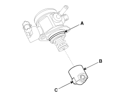

23. Instale a mangueira de alta pressão (A). (Consulte o grupo FL)

   ```
   Torque de aperto:
   Parafuso: 7,8 ~ 11,8N.m (0,8 ~ 1,2kgf.m, 5,8 ~ 8,7lb-ft)
   Parafuso: 26,5 ~ 32,4N.m (2,7 ~ 3,3kgf.m, 19,5 ~ 23,9lb-ft)
   ```

   

   > **Nota**
   >
   > - Não reutilize a mangueira de alta pressão.

24. Conecte o conector do PCSV (Valvula de controle de purga) (A) e aperte os parafusos e a rosca de montagem da mangueira de vácuo.

   

25. Conecte a mangueira de combustível (A) e a mangueira do PCSV (Valvula de controle de purga) (B).

   

26. Instale os bobina de ignição (A).

   ```
   Torque de aperto:
   3,9 ~ 5,9N.m (0,4 ~ 0,6kgf.m, 2,9 ~ 4,3lb-ft)
   ```

   

27. Conecte os conectores da bobina de ignição (B) e o conector da bomba de combustível (A) após instalar o protetor de fiação.

   

28. Conecte o conector do OCV (Valvula de controle de óleo) (A) e o conector do sensor de oxigênio (B).

   

29. Instale o cobertor inferior (A).

   ```
   Torque de aperto:
   7,8 ~ 11,8N.m (0,8 ~ 1,2kgf.m, 5,8 ~ 8,7lb-ft)
   ```

   

30. Instale a mangueira de entrada do intercooler e a montagem (C) e, em seguida, conecte o conector do válvula de recirculação (A) e a mangueira de vácuo (B).

   ```
   Torque de aperto
   Parafuso do elástico de amarração:
   4,9 ~ 6,9 N.m (0,5 ~ 0,7 kgf.m, 3,6 ~ 5,1 lb-ft)
   Parafuso de montagem da mangueira:
   14,7 ~ 19,6 N.m (1,5 ~ 2,0 kgf.m, 10,8 ~ 14,5 lb-ft)
   ```

   

31. Instale a roda dianteira direita (RH) e, em seguida, conecte a mangueira de recirculação (A) e a mangueira de vácuo (B).

32. Instale a montagem do limpador de óleo.

   ```
   Instale a montagem do limpador de óleo (F) e, em seguida, conecte a mangueira de admissão de ar (E).
   Torque de aperto
   Parafuso do elástico de amarração:
   2,9 ~ 4,9N.m (0,3 ~ 0,5kgf.m, 2,2 ~ 3,6lb-ft)
   Parafusos da montagem da montagem do limpador de óleo:
   7,8 ~ 9,8N.m (0,8 ~ 1,0kgf.m, 5,8 ~ 7,2lb-ft)
   ```

   | (2) | Conecte a mangueira de escape (B), a mangueira de recirculação (C) e a mangueira de vácuo do potenciador de freio (D). |
   | --- | --- |

   | (3) | Instale a mangueira de ar (A). |
   | --- | --- |

33. Conecte o terminal negativo da bateria (A).

   ```
   Torque de aperto:
   4,0 ~ 6,0N.m (0,4 ~ 0,6kgf.m, 3,0 ~ 4,4lb-ft)
   ```

   

34. Instale o cobertor do motor.

35. Adicione todos os fluidos necessários e verifique se há vazamentos. Conecte o GDS. Verifique os códigos, faça anotações e limpe-os. Verifique novamente.

   > **Nota**
   >
   > - Preencha o motor com óleo de motor.
   > - Preencha a transmissão com fluido.
   > - Preencha o radiador e a câmara de expansão com líquido de resfriamento do motor.
   > - Limpe as postas e os terminais do cabo da bateria e monte-os.
   > - Verifique se há vazamento de combustível.
   > - Após montar a mangueira de combustível, ligue o interruptor de ignição (não operando o motor) para que a bomba de combustível funcione por aproximadamente dois segundos e a mangueira de combustível seja pressurizada.

> - Repita esta operação duas ou três vezes, depois verifique se há vazamento de combustível em qualquer ponto da linha de combustível.
> - Preencha o radiador e o tanque de reservatório com líquido de refrigeração do motor.
> - Descanse o ar do sistema de refrigeração.
> - Inicie o motor e deixe-o funcionar até que ele aqueça. (até que o ventilador do radiador operue 3 ou 4 vezes.)
> - Desligue o motor. Verifique o nível no radiador, adicione líquido de refrigeração se necessário. Isso permitirá que o ar preso seja removido do sistema de refrigeração.
> - Coloque a tampa do radiador apertada, depois reinicie o motor e verifique se há vazamentos.
