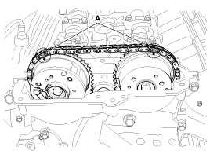
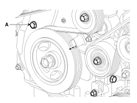
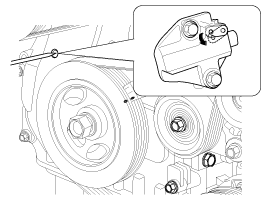
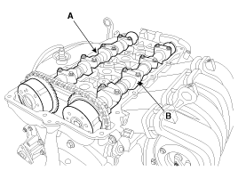
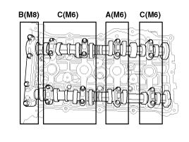
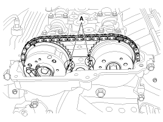
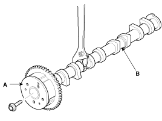

# Kia Sportage: Camisa: Procedimentos de reparo

[Home](../../index.md) / [Manual de Serviço e Reparo do Kia Sportage SL](../sportage-482.md) / [Sistema Mecânico do Motor](sportage-484.md) / [Montagem da Cabeça do Cilindro](sportage-495.md) / Procedimentos de reparo da camisa

## Remoção

A remoção da cobertura do timão não é necessária para este procedimento.

> **Cuidado**
>
> - Use coberturas de para-choque para evitar danos às superfícies pintadas.
> - Para evitar danos à cabeça do cilindro, aguarde até que a temperatura do líquido de refrigeração do motor caia abaixo da temperatura normal antes de removê-la.
> - Para evitar danos, desconecte cuidadosamente os conectores de fiação mantendo a parte do conectador.

> **Nota**
>
> - Marque todas as fiação e mangueiras para evitar a conexão incorreta.
> - Vire o pulley do bugeador para que o pistão nº 1 esteja no topo do centro.

> **Aviso**
>
> - Em caso de remoção do bomba de injeção de alta pressão, tubo de alta pressão, tubo de entrega e injetor, pode haver lesão causada pela vazamento do combustível de alta pressão. Então, não faça qualquer trabalho de reparo imediatamente após a parada do motor.

1. Remova a cobertura da cabeça do cilindro. (Consulte o sistema de sincronização neste grupo)

2. Ajuste o cilindro nº 1 para TDC/compressão.

   | (1) | Vire o pulley do bugeador e alinhe a sua vagem com a marca "T" da cobertura do timão inferior. |
   | --- | --- |

   | (2) | Verifique que as marcas TDC (A) dos engranagens do CVVT estejam em linha reta na superfície da cabeça do cilindro conforme ilustrado. Se não estiverem, vire o bugeador uma revolução (360°). |
   | --- | --- |

3. Marque as correntes de sincronização (A) correspondentes às marcas de sincronização das engranagens do CVVT.

   

4. Vire o pulley do bugeador 15° no sentido horário.

5. Remova os parafusos de serviço (A) da cobertura do timão.

   

   > **Cuidado**
   >
   > - O parafuso não deve ser reutilizado uma vez montado.

6. Remova as tampas de suporte do timão de admissão e exaustão.

7. Libere o rachet do tensador de corrente do timão puxando a ligação para baixo usando um fio fino.

   

8. Após desafinar a corrente do timão, remova a montagem do timão exaustor CVVT & camisa (A) e então a montagem do timão admissor CVVT & camisa (B).

   

   > **Cuidado**
   >
   > - Ao retirar a corrente do timão das engranagens do CVVT, segure a corrente do timão.

9. Amarre a corrente do timão para que ela não se mova.

   > **Cuidado**
   >
   > - Cuide para não deixar nada cair dentro da cobertura do timão.

## Instalação

1. Segure a corrente de sincronização, e coloque a unidade de válvulas variáveis de tempo de abertura (CVVT) e do cárter do pistão do admissão.

2. Coloque a unidade de válvulas variáveis de tempo de abertura (CVVT) e do cárter do pistão do escape após soltar o engrenagem do tensador da corrente de sincronização.

   > **Nota**
   >
   > - As marcas de sincronização de cada sprocket de válvulas variáveis de tempo de abertura devem ser alinhadas com as marcas de sincronização (ligadura pintada) da corrente de sincronização durante a instalação da corrente de sincronização.

   

3. Instale as tampas do cárter do pistão em suas localizações corretas.

   Ordem de aperto

   Grupo A > Grupo B > Grupo C

   ```
   Torque de aperto
   Passo 1
   M6 : 5.9N.m (0.6kgf.m, 4.3lb-ft)
   M8 : 14.7N.m (1.5kgf.m, 10.8lb-ft)
   Passo 2
   M6 : 10.8 ~ 12.7N.m (1.1 ~ 1.3kgf.m, 8.0 ~ 9.4lb-ft)
   M8 : 27.5 ~ 31.4N.m (2.8 ~ 3.2kgf.m, 20.3 ~ 23.1lb-ft)
   ```

   

4. Instale a viga do serviço (A).

   ```
   Torque de aperto :
   11.8 ~ 14.7N.m (1.2 ~ 1.5kgf.m, 8.7 ~ 10.8lb-ft)
   ```

   

5. Vire o eixo do pistão duas voltas na direção de operação (horário), e depois verifique que as marcas de TDC (A) dos sprockets de válvulas variáveis de tempo de abertura estejam alinhadas na superfície do cárter do pistão.

   

6. Instale o cobre do cárter do pistão. (Consulte o sistema de sincronização nesta seção)

## Desmontagem

1. Desmonte a unidade de válvulas variáveis de tempo de abertura (CVVT) e do cárter do pistão (A) e do cárter do pistão (B).

   

   > **Nota**
   >
   > - Ao remover a viga do serviço, evite que o cárter do pistão gire usando uma chave.

## Reinstalação

1. Reinstale a unidade de válvulas variáveis de tempo de abertura (CVVT) e do cárter do pistão (A) e do cárter do pistão (B).

   ```
   Torque de aperto :
   53.9 ~ 63.7N.m (5.5 ~ 6.5kgf.m, 39.7 ~ 47.0lb-ft)
   ```

   

   > **Nota**
   >
   > - Ao instalar a viga do serviço, evite que o cárter do pistão gire usando uma chave.
