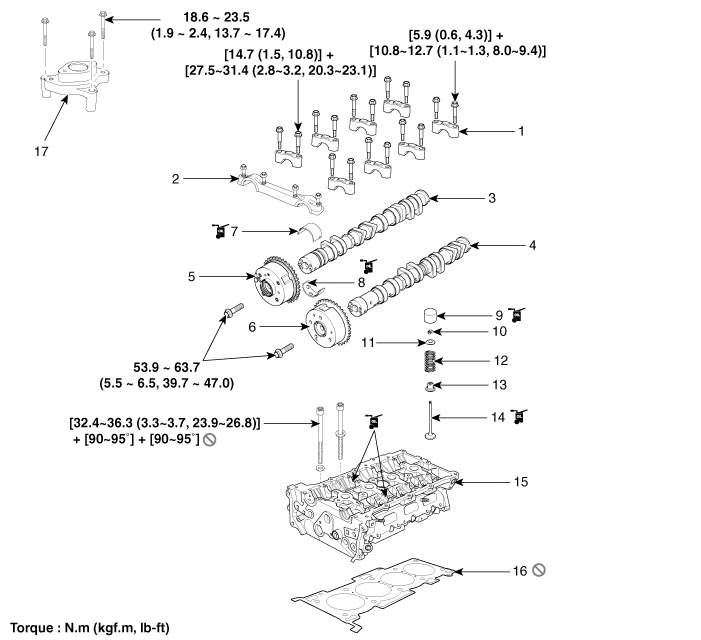

# Cabeçote — Componentes e localização

[Home](../../index.md) / [Manual de Serviço e Reparo](../sportage-482.md) / [Sistema Mecânico do Motor](sportage-484.md) / [Montagem do Cabeçote](sportage-495.md) / Componentes e localização

## Diagrama

## Legenda

| Nº | Componente |
| --- | --- |
| 1 | Cofre do amortecedor do eixo dos rolamentos do cabeçote |
| 2 | Cofre do amortecedor do eixo dos rolamentos do eixo do camaleão frontal |
| 3 | Eixo do camaleão de escape |
| 4 | Eixo do camaleão de admissão |
| 5 | Montagem do CVVT de escape |
| 6 | Montagem do CVVT de admissão |
| 7 | Amortecedor superior do eixo do camaleão de escape |
| 8 | Amortecedor inferior do eixo do camaleão de escape |
| 9 | MLA |
| 10 | Bloqueador de mantenedor |
| 11 | Mantenedor |
| 12 | Amortecedor da válvula |
| 13 | Selo da estaca da válvula |
| 14 | Válvula |
| 15 | Cabeçote |
| 16 | Gasket do cabeçote |
| 17 | Cofre do bomba de combustível |
