# Kia Sportage: Cabeçote do Cilindro: Procedimentos de Reparo

[Home](../../index.md) / [Manual de Serviço e Reparo do Kia Sportage SL](../sportage-482.md) / [Sistema Mecânico do Motor](sportage-484.md) / [Montagem do Cabeçote do Cilindro](sportage-495.md) / Procedimentos de Reparo do Cabeçote do Cilindro

## Remoção

> **Cuidado**
>
> - Use coberturas de para-choque para evitar danos às superfícies pintadas.
> - Aguarde que a temperatura do líquido de resfriamento do motor caia abaixo da temperatura normal antes de removê-lo.
> - Ao manipular uma selagem metálica, tome cuidado para não dobrar a selagem ou danificar a superfície de contato da selagem.
> - Para evitar danos, desconecte cuidadosamente os conectores elétricos mantendo a parte do conectador.

> **Nota**
>
> - Marque todos os cabos elétricos e mangueiras para evitar conexões incorretas.

> **Aviso**
>
> - Ao remover o bomba de injeção de alta pressão, a mangueira de alta pressão, o tubo de entrega e o injetor, há o risco de lesões causadas por vazamento do combustível de alta pressão. Portanto, não faça nenhuma reparação imediatamente após a parada do motor.

1. Remova a capa do motor.

2. Desconecte o terminal negativo da bateria (A).

   

3. Remova a montagem do limpador de carburante e as mangueiras de entrada/saída do intercooler. (Consulte a montagem do motor e da transmissão neste grupo)

4. Remova a roda dianteira direita.

5. Remova a cobertura inferior.

6. Desafine o parafuso de drenagem e drenagem do líquido de resfriamento do motor. Remova
   o capuz do radiador para drenar rapidamente. (Consulte o sistema de resfriamento neste
   grupo)

7. Desconecte a mangueira superior do radiador (A) e a mangueira inferior (B).

   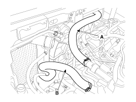

8. Desconecte os conectores elétricos e os engates das correias de proteção, e remova as proteções de cabos do cabeçote do cilindro, do manifold de admissão e do manifold de escape.

   | (1) | Desconecte o conectores do válvulo de controle de óleo (OCV) de escape (A) e o conectores do sensor de oxigênio (B). |
   | --- | --- |

   | (2) | Desconecte o conectores do interruptor do compressor de ar condicionado (A), o conectores do alternador (B), o conectores do interruptor de pressão de óleo (OPS) & extensor do injetor (C), o conectores do sensor de choque (D), o conectores do sensor de pressão absoluta do manifold (MAPS) & sensor de temperatura do ar de admissão (IATS) (E), o conectores do controlador de travessão eletrônico (ETC) (F) e o conectores do bomba de vácuo (G). |
   | --- | --- |

   | (3) | Desconecte os conectores dos coelhos de ignição (B) e o conectores do injetor (A). |
   | --- | --- |

   | (4) | Desconecte a mangueira do PCV (A), o conectores do válvulo de controle de óleo (OCV) de admissão (B) e o conectores do sensor de temperatura do óleo (OTS) (C). |
   | --- | --- |

   | (5) | Desconecte o conectores do sensor de posição do cárter (CMPS) de admissão (A), o conectores do solenoide de controle de purga (PCSV) (B), o conectores do sensor de temperatura do líquido de resfriamento do motor (ECTS) (C), o conectores do condensador (D), o conectores do sensor de posição do cárter (CKPS) (E), o conectores do sensor de posição do cárter (CMPS) de escape (F) e o conectores do atuador do vácuo elétrico (G). |
   | --- | --- |

9. Desconecte a mangueira de combustível (A) e a mangueira do solenoide de controle de purga (PCSV) (B).

   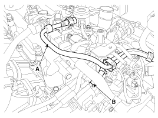

10. Remova a montagem do tubo de vácuo (A).

   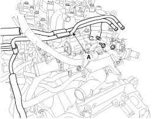

11. Remova o tubo de alta pressão (A). (Consulte o grupo FL)

12. Remova o bomba de combustível sob pressão (A) e o rolamento da tampa (B). (Consulte o grupo FL)

   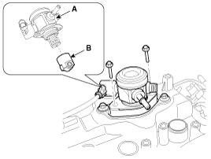

13. Desconecte as mangueiras do aquecedor (A).

   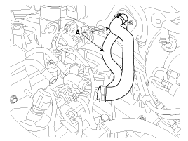

14. Desconecte as mangueiras do radiador de admissão de ar (A).

   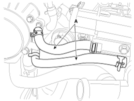

15. Desconecte as mangueiras do radiador de óleo (A).

   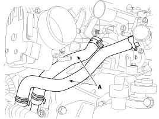

16. Remova a montagem do controle da temperatura da água (A) com a mangueira de entrada de água (B).

   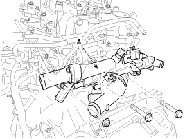

   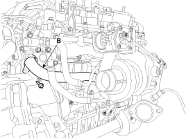

17. Remova a corrente de sincronização. (Consulte o sistema de sincronização neste grupo)

18. Remova o manifold de admissão e de escape. (Consulte o sistema de admissão e escape neste grupo)

19. Remova o suporte da bomba de combustível sob pressão (A).

   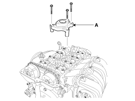

20. Remova a montagem do CVVT de admissão (A) e a montagem do CVVT de escape (B).

   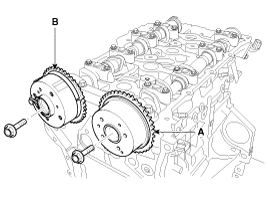

   > **Nota**
   >
   > - Ao remover a viga do parafuso do CVVT, impida a rotação do eixo do cônico usando uma chave na posição A.

   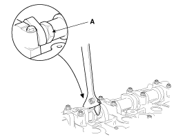

21. Remova o eixo do cônico.

   | (1) | Remova a tampa do eixo do cônico frontal (A) com o rolamento superior (B). |
   | --- | --- |

   | (2) | Remova as tampas do eixo do cônico (A) na sequência indicada. |
   | --- | --- |

   | (3) | Remova os eixos do cônico (A). |
   | --- | --- |

   | (4) | Remova o rolamento inferior do eixo do cônico de escape (A). |
   | --- | --- |

22. Remova o válvula de controle de óleo de admissão (OCV) (A) usando uma chave torx e o sensor de temperatura do óleo (OTS) (B).

   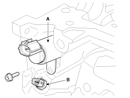

23. Remova a válvula de controle de óleo de escape (OCV) (A) usando uma chave torx.

   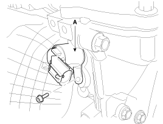

24. Remova o sensor de posição do eixo do cônico de admissão (CMPS) (A).

   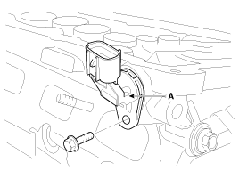

25. Remova o sensor de posição do eixo do cônico de escape (CMPS) (A) após remover o suporte do motor (B).

   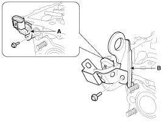

26. Remova o módulo injetor & tubo de alimentação (A). (Consulte o grupo FL)

   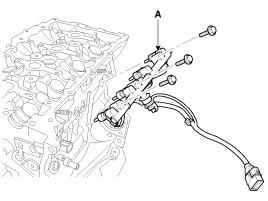

27. Remova o cabeçote do cilindro.

   | (1) | Com uma chave de três quadrados, desloque uniformemente e remova os 10 parafusos do cabeçote do cilindro, em várias passadas, na sequência indicada. Remova os 10 parafusos do cabeçote e as borrachas de amortecimento. A distorção ou fissura do cabeçote do cilindro podem ocorrer se os parafusos forem removidos em uma ordem incorreta. |
   | --- | --- |
   | A distorção ou fissura do cabeçote do cilindro podem ocorrer se os parafusos forem removidos em uma ordem incorreta. | |

   | (2) | Levante o cabeçote do cilindro (A) das vãs do bloco do cilindro e coloque o cabeçote do cilindro em blocos de madeira em uma bancada. Cuide para não danificar as superfícies de contato do cabeçote do cilindro e do bloco do cilindro. |
   | --- | --- |
   | Cuide para não danificar as superfícies de contato do cabeçote do cilindro e do bloco do cilindro. | |

   | (3) | Remova a borracha de vedação do cabeçote (B). |
   | --- | --- |

## Desmontagem

> **Nota**
>
> - Identifique os MLA (Ajustador Mecânico de Vazão), válvulas e molas de válvulas ao removê-los para que cada item possa ser reinstalado em sua posição original.

1. Remova os MLA (A).

   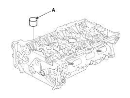

2. Remova as válvulas.

   | (1) | Usando SST (09222-3K000, 09222-3K100), comprima a mola da válvula e remova o anel de vedação. |
   | --- | --- |

   | (2) | Remova o anel de vedação. |
   | --- | --- |

   | (3) | Remova a mola da válvula. |
   | --- | --- |

   | (4) | Remova a válvula. |
   | --- | --- |

   | (5) | Usando pinças de ponta, remova o selo da haste da válvula. Não reutilize selos de haste de válvula antigos. |
   | --- | --- |
   | Não reutilize selos de haste de válvula antigos. | --- |

## Inspeção

Cabeça do Cilindro

1. Inspeção para planímetros.

   Usando um guia retilíneo preciso e uma régua-filheta, medir a superfície que entra em contato com o bloco do cilindro e os manifolds para distorção.

   ```
   Planímetro da superfície do anel de vedação da cabeça do cilindro
   Padrão: Menos de 0,05mm (0,0019in.) para a área total
   Menos de 0,02mm (0,0007in.) para uma seção de 100mm (3,9370in.) x 100mm (3,9370in.)
   Planímetro da superfície de montagem do manifold (Admissão/Exaustão)
   Padrão: Menos de 0,10mm (0,0039in.)
   ```

   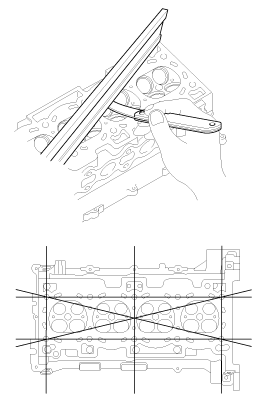

2. Inspeção para rachaduras.

   Verifique a câmara de combustão, os portos de admissão, os portos de exaustão e a superfície do bloco do cilindro para rachaduras. Se houver rachaduras, substitua a cabeça do cilindro.

Valvula e Mola da Valvula

1. Inspeção das estacas das válvulas e das guias.

   ```
   Usando um calibrador, medir o diâmetro interno da guia da válvula.
   Diâmetro interno da guia da válvula
   Admissão / Exaustão: 5,500 ~ 5,512mm (0,21654 ~ 0,21701in.)
   ```

   ```
   Usando um micrômetro, medir o diâmetro da estaca da válvula.
   Diâmetro externo da estaca da válvula
   Admissão: 5,465 ~ 5,480mm (0,21516 ~ 0,21575in.)
   Exaustão: 5,458 ~ 5,470mm (0,214988 ~ 0,21535in.)
   ```

   ```
   Subtraia a medição do diâmetro da estaca da medição do diâmetro interno da guia da válvula.
   Ajuste da estaca na guia
   [Padrão]
   Admissão: 0,020 ~ 0,047mm (0,00078 ~ 0,00185in.)
   Exaustão: 0,030 ~ 0,054mm (0,00118 ~ 0,00212in.)
   [Limite]
   Admissão: 0,070mm (0,00275in.)
   Exaustão: 0,090mm (0,00354in.)
   Se o ajuste for maior que o máximo, substitua a válvula ou a cabeça do cilindro.
   ```

2. Inspeção das válvulas.

   | (1) | Verifique se a válvula foi aferida para o ângulo correto da face da válvula. |
   | --- | --- |

   | (2) | Verifique a superfície da válvula para desgaste. Se a face da válvula estiver desgastada, substitua a válvula. |
   | --- | --- |

   ```
   Verifique a espessura do margem do topo da válvula.
   Espessura do topo da válvula (Margem)
   [Padrão]
   Admissão: 1,02mm (0,0401in.)
   Exaustão: 1,09mm (0,0429in.)
   Se a espessura do margem for menor que o mínimo, substitua a válvula.
   ```

   ```
   Verifique o comprimento da válvula.
   Comprimento da válvula
   [Padrão]
   Admissão: 113,18mm (4,4559in.)
   Exaustão: 105,84mm (4,1669in.)
   [Limite]
   Admissão: 112,93mm (4,4461in.)
   Exaustão: 105,59mm (4,1571in.)
   ```

   | (5) | Verifique a superfície da ponta da estaca da válvula para desgaste. Se a ponta da estaca da válvula estiver desgastada, substitua a válvula. |
   | --- | --- |

3. Inspeção das bases das válvulas.

   | (1) | Verifique a base da válvula para evidências de superaquecimento e contato inadequado com a face da válvula. Substitua a cabeça do cilindro se necessário. |
   | --- | --- |

   | (2) | Verifique a guia da válvula para desgaste. Se a guia da válvula estiver desgastada, substitua a cabeça do cilindro. |
   | --- | --- |

4. Inspeção das molas das válvulas.

   | (1) | Usando um quadrado de aço, medir o desalinhamento da mola da válvula. |
   | --- | --- |

   ```
   Usando um calibrador vernier, medir o comprimento livre da mola da válvula.
   Mola da válvula
   [Padrão]

Altura livre: 47,44mm (1,8677in.)
Desalinhamento: Menos de 1,5°
Se a altura livre não for conforme especificado, substitua a mola da válvula.
```

MLA (Ajustador Mecânico de Largura Livre)

1. Inspecione o MLA.

   Usando um micrômetro, medir o diâmetro exterior do MLA.

   ```
   Diâmetro exterior do MLA:
   31,964 ~ 31,980mm (1,2584 ~ 1,2590in.)
   ```

2. Usando um calibrador, medir o diâmetro interior do orifício do tappet da cabeça do cilindro.

   ```
   Diâmetro interior do orifício do tappet:
   32,000 ~ 32,025mm (1,2598 ~ 1,2608in.)
   ```

3. Subtraia a medida do diâmetro exterior do MLA da medida do diâmetro interior do orifício do tappet.

   ```
   Ajuste do MLA para o orifício do tappet
   [Padrão] : 0,020 ~ 0,061mm (0,00078 ~ 0,00240in.)
   [Limite] : 0,070mm (0,00275in.)
   ```

Cavilho

1. Inspecione as lombas do cavilho.

   Usando um micrômetro, medir a altura das lombas do cavilho.

   ```
   Altura do cavilho
   [Valor padrão]
   Admissão: 44,10 ~ 44,30mm (1,7362 ~ 1,7440in.)
   Exaustão: 44,90 ~ 45,10mm (1,7677 ~ 1,7756in.)
   ```

   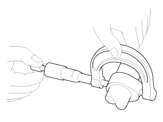

   Se a altura das lombas do cavilho for menor que o padrão, substitua o cavilho.

2. Inspecione o ajuste do orifício do cavilho.

   | (1) | Limpe as cobertas do orifício do cavilho e os cavilhos. |
   | --- | --- |

   | (2) | Posicione os cavilhos na cabeça do cilindro. |
   | --- | --- |

   | (3) | Coloque uma faixa de plastigage em cada orifício do cavilho. |
   | --- | --- |

   | (4) | Instale as cobertas do orifício do cavilho. Não gire o cavilho. |
   | --- | --- |
   | Não gire o cavilho. | |

   | (5) | Remova as cobertas do orifício do cavilho. |
   | --- | --- |

   ```
   Medir o plastigage no ponto mais largo.
   Ajuste do orifício do cavilho
   [Valor padrão]
   Admissão:
   Número 1: 0,022 ~ 0,057mm (0,00087 ~ 0,00224in.)
   Números 2, 3, 4, 5: 0,045 ~ 0,082mm (0,00177 ~ 0,00323in.)
   Exaustão:
   Número 1: 0 ~ 0,032mm (0 ~ 0,00126in.)
   Números 2, 3, 4, 5: 0,045 ~ 0,082mm (0,00177 ~ 0,00323in.)
   [Limite]
   Admissão:
   Número 1: 0,090mm (0,00354in.)
   Números 2, 3, 4, 5: 0,120mm (0,00472in.)
   Exaustão:
   Número 1: 0,090mm (0,00354in.)
   Números 2, 3, 4, 5: 0,120mm (0,00472in.)
   Se o ajuste do orifício do cavilho for maior que o máximo, substitua o cavilho. Se necessário, substitua a cabeça do cilindro.
   ```

   | (7) | Remova completamente o plastigage. |
   | --- | --- |

   | (8) | Remova os cavilhos. |
   | --- | --- |

3. Inspecione o deslocamento final do cavilho.

   | (1) | Posicione os cavilhos. |
   | --- | --- |

   ```
   Usando um indicador de dial, medir o deslocamento final enquanto move o cavilho de um lado para o outro.
   Deslocamento final do cavilho
   [Valor padrão] : 0,04 ~ 0,16mm (0,0016 ~ 0,0063in.)
   [Limite] : 0,20mm (0,0078in.)
   Se o deslocamento final for maior que o máximo, substitua o cavilho. Se necessário, substitua a cabeça do cilindro.
   ```

   | (3) | Remova os cavilhos. |
   | --- | --- |

Cavilho da Exaustão

1. Verifique a marca do orifício do cilindro na cabeça do cilindro.

   Marca de Identificação do Orifício da Cabeça do Cilindro

   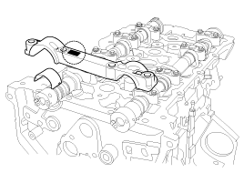

   Especificações da Cabeça do Cilindro

| Classe | Marca | Diâmetro Interno do Buraco da Cabeça do Cilindro (Exaustão) No.1 |
| --- | --- | --- |
| a | A | 40,000 ~ 40,008mm (1,57480 ~ 1,5751in.) |
| b | B | 40,008 ~ 40,016mm (1,57511 ~ 1,57543in.) |
| c | C | 40,016 ~ 40,021mm (1,57543 ~ 1,57563in.) |

2. Selecione a classe do rolamento do eixo do cárter do mesmo modo que a classe da cabeça do cilindro, conforme mostrado na tabela abaixo.

   Marca de Identificação do Rolamento do Eixo do Cárter Exaustão

   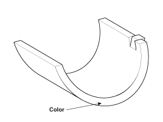

   Especificações do Rolamento do Eixo do Cárter Exaustão

   | Classe do Buraco da Cabeça do Cilindro | Classe do Rolamento para Instalação (Cor) | Espessura do Rolamento |
   | --- | --- | --- |
   | a (A) | C (Verde) | 1,996~2,000mm (0,07858~0,07874in.) |
   | b (B) | B (Sem cor) | 2,000~2,004mm (0,07874~0,07890in.) |
   | c (C) | A (Preto) | 2,004~2,008mm (0,07890~0,07905in.) |

   ```
   Ajuste de óleo: 0 ~ 0,032mm (0 ~ 0,00126in.)
   ```

Montagem da Ajustagem Variável Contínua do Tempo de Abertura da Valvula (CVVT)

1. Verifique a CVVT para garantir que roda suavemente.

   | (1) | Fixe o eixo do cárter usando um vise. Cuide para não danificar as lóbulos e os eixos do cárter no vise. |
   | --- | --- |

   | (2) | Verifique se a CVVT está travada girando-a no sentido horário ou anti-horário. Ela não deve girar. |
   | --- | --- |

   | (3) | CVVT de Adiantamento do Intalador: Cobre uma das duas entradas de adiantamento no eixo do cárter com fita adesiva. CVVT de Atraso do Exaustão: Cobre uma das duas entradas de atraso no eixo do cárter com fita adesiva. [Adiantamento] [Atraso] |
   | --- | --- |

   | (4) | CVVT de Adiantamento do Intalador: Aplicar aproximadamente 150 kPa (1,5 kgf/cm?, 21 psi) de ar comprimido na entrada de adiantamento não coberta para liberar a travagem. CVVT de Atraso do Exaustão: Aplicar aproximadamente 150 kPa (1,5 kgf/cm?, 21 psi) de ar comprimido na entrada de atraso não coberta para liberar a travagem. Cobrir os caminhos de óleo com um pedaço de pano ao aplicar ar comprimido para prevenir a projeção de óleo. |
   | --- | --- |
   | Cobrir os caminhos de óleo com um pedaço de pano ao aplicar ar comprimido para prevenir a projeção de óleo. | |

   ```
   CVVT de Adiantamento do Intalador: Com ar comprimido aplicado, gire a CVVT no sentido do adiantamento (anti-horário) dentro do intervalo de ajuste e verifique que a CVVT gira suavemente.
   CVVT de Atraso do Exaustão: Com ar comprimido aplicado, gire a CVVT no sentido do atraso (horário) e verifique que a CVVT gira suavemente.
   Intervalo de ajuste da CVVT
   Intalador: 22,5°±1° (do posicionamento mais atrasado ao posicionamento mais adiantado)
   Exaustão: 20°±1° (do posicionamento mais adiantado ao posicionamento mais atrasado)
   ```

   | (6) | CVVT de Adiantamento do Intalador: Gire a CVVT para o posicionamento mais atrasado (horário) e então verifique se a CVVT está travada. CVVT de Atraso do Exaustão: Gire a CVVT para o posicionamento mais adiantado (anti-horário) e então verifique se a CVVT está travada. |
   | --- | --- |

## Reajuste

> **Nota**
>
> - Limpe todos os componentes a serem reajustados.
> - Antes de instalar os componentes, aplique óleo de motor fresco em todas as superfícies deslizantes e rotativas.
> - Substitua as selas de óleo por novas.

1. Instale as válvulas.

   | (1) | Usando SST(09222-4A000), empurre uma nova selagem de óleo. Não reutilize selas de estaca de válvula velhas. Uma instalação incorreta da selagem pode resultar em vazamento de óleo pelas guias de válvula. |
   | --- | --- |
   | Não reutilize selas de estaca de válvula velhas. Uma instalação incorreta da selagem pode resultar em vazamento de óleo pelas guias de válvula. | |

   | (2) | Instale a válvula, a mola da válvula e o retenedor da mola. Posicione as molas da válvula de modo que o lado revestido com enamel fique voltado para o retenedor da mola e, em seguida, instale o retenedor. |
   | --- | --- |
   | Posicione as molas da válvula de modo que o lado revestido com enamel fique voltado para o retenedor da mola e, em seguida, instale o retenedor. | |

   | (3) | Usando SST(09222-3K000, 09222-3K100), comprima a mola e instale os travantes. Após a instalação das válvulas, assegure-se de que os travantes estejam corretamente em seu lugar antes de liberar o compressor da mola. |
   | --- | --- |

   | (4) | Bate leve o final de cada estaca de válvula duas ou três vezes com o cabo de madeira de um martelo para assegurar o posicionamento correto da válvula e do travante. |
   | --- | --- |

2. Instale as MLAs após aplicar óleo de motor.

   Verifique que a MLA roda suavemente à mão.

   

   > **Nota**
   >
   > - A MLA pode ser reutilizada em sua posição original.
   > - No entanto, as varas de válvula devem ser verificadas e ajustadas de acordo antes de a tampa do cilindro ser instalada no bloco do cilindro.
   > - Consulte as informações gerais na seção EM para o procedimento de verificação e ajuste das varas de válvula.

## Instalação

> **Nota**
>
> - Limpe todos os componentes a serem montados.
> - Sempre use um novo selo de cabeçote e selo de manifolds.
> - O selo de cabeçote é um selo metálico. Cuide para não dobrá-lo.
> - Rotacione o eixo do crankshaft, alinhe o pistão número 1 no TDC.

1. Instale o selo de cabeçote (A) no bloco do cilindro.

   > **Nota**
   >
   > - Cuide para não errar a direção de instalação.
   > - Aplicar selante líquido (Loctite 5900H ou equivalente) na borda do selo de cabeçote, tanto de cima quanto de baixo. (Na posição "B")
   > - Após aplicar o selante, monte o cabeçote no bloco do cilindro em cinco minutos.

   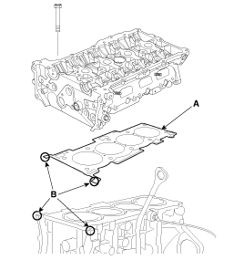

2. Posicione o cabeçote com cuidado para não danificar o selo com a parte inferior.

3. Instale os parafusos do cabeçote.

   | (1) | Não aplique óleo do motor nos parafusos do cabeçote. |
   | --- | --- |

   | (2) | Usando o SST(09221-4A000), aperte os parafusos do cabeçote e as lâminas de amortecimento, em várias passadas, na sequência mostrada. |
   | --- | --- |

   ```
   Torque de aperto:
   32.4~36.3Nm (3.3~3.7kgf.m, 23.9~26.8lb-ft) + 90~95° + 90~95°
   ```

   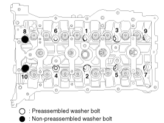

   > **Cautela**
   >
   > - Sempre use novos parafusos do cabeçote.

4. Instale o módulo injetor e tubo de alimentação (A). (Consulte o grupo FL)

   Pre-aperte os parafusos e, em seguida, aperte-os com a torquagem especificada na sequência mostrada.

   ```
   Torque de aperto:
   18.6~23.5N.m (1.9~2.4kgf.m, 13.7~17.4lb-ft)
   ```

   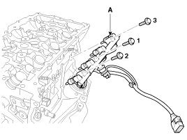

5. Instale o sensor de posição do camisa (Camshaft position sensor) (A).

   ```
   Torque de aperto:
   9.8 ~ 11.8N.m (1.0 ~ 1.2kgf.m, 7.2 ~ 8.7lb-ft)
   ```

   

6. Instale o sensor de posição do camisa de escape (Camshaft position sensor) (A) e o amortecedor do motor (B).

   ```
   Torque de aperto:
   Parafuso do sensor: 9.8 ~ 11.8N.m (1.0 ~ 1.2kgf.m, 7.2 ~ 8.7lb-ft)
   Parafuso do amortecedor: 27.5 ~ 31.4N.m (2.8 ~ 3.2kgf.m, 20.3 ~ 23.1lb-ft)
   ```

   

7. Instale o válvula de controle de óleo (Oil control valve) (A) e o sensor de temperatura do óleo (Oil temperature sensor) (B).

   ```
   Torque de aperto:
   Válvula de controle de óleo: 9.8 ~ 11.8N.m (1.0 ~ 1.2kgf.m, 7.2 ~ 8.7lb-ft)
   Sensor de temperatura do óleo: 19.6 ~ 23.5N.m (2.0 ~ 2.4kgf.m, 14.5 ~ 17.4lb-ft)
   ```

   

8. Instale a válvula de controle de óleo de escape (Oil control valve) (A).

   ```
   Torque de aperto:
   9.8 ~ 11.8N.m (1.0 ~ 1.2kgf.m, 7.2 ~ 8.7lb-ft)
   ```

   

   > **Cautela**
   >
   > - Não reutilize a válvula de controle de óleo se cair.
   > - Manter a válvula de controle de óleo e o filtro limpos.
   > - Não segure a parte do tubo da válvula de controle de óleo durante a manutenção.
   > - Quando a válvula de controle de óleo é instalada no motor, não mova o motor segurando a parte do tubo da válvula de controle de óleo.

   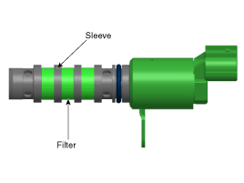

9. Instale os cames.

   > **Nota**
   >
   > - Aplicar uma fina camada de óleo do motor nos eixos dos cames.

   | (1) | Instale o cárter inferior do camisa de escape (A). |
   | --- | --- |

| (2) | Instale os cárteres dos cintos (A). |
   | --- | --- |

   | (3) | Instale o cárter superior do cárter do cinto de escape (A) na capa do cárter frontal. |
   | --- | --- |

   ```
   Instale os cárteres dos cárteres (A) em suas localizações corretas.
   Ordem de aperto
   Grupo A > Grupo B > Grupo C.
   Torque de aperto:
   Passo 1
   M6 : 5.9N.m (0.6kgf.m, 4.3lb-ft)
   M8 : 14.7N.m (1.5kgf.m, 10.8lb-ft)
   Passo 2
   M6 : 10.8 ~ 12.7N.m (1.1 ~ 1.3kgf.m, 8.0 ~ 9.4lb-ft)
   M8 : 27.5 ~ 31.4N.m (2.8 ~ 3.2kgf.m, 20.3 ~ 23.1lb-ft)
   ```

10. Instale a montagem do CVVT de admissão (A) e a montagem do CVVT de escape (B).

   ```
   Torque de aperto:
   53.9 ~ 63.7N.m (5.5 ~ 6.5kgf.m, 39.7 ~ 47.0lb-ft)
   ```

   

   > **Nota**
   >
   > - Ao instalar a viga do CVVT, evite que o cinto gire usando uma chave em posição A.

   

11. Instale o suporte do bomba de injeção de alta pressão (A).

   ```
   Torque de aperto:
   18.6 ~ 23.5N.m(1.9 ~ 2.4kgf.m, 13.7 ~ 17.4lb-ft)
   ```

   

12. Instale o manifolds de admissão e de escape. (Consulte o sistema de admissão e escape nesta seção)

13. Instale a corrente de sincronização. (Consulte o sistema de sincronização nesta seção)

14. Verifique e ajuste a abertura dos válvulas. (Consulte as informações gerais nesta seção)

15. Instale a montagem de controle da temperatura da água (A) com a mangueira de entrada de água (B).

   ```
   Torque de aperto:
   Válvulas : 14.7 ~ 19.6N.m (1.5 ~ 2.0kgf.m, 10.8 ~ 14.5lb-ft)
   Parafuso : 18.6 ~ 23.5N.m (1.9 ~ 2.4kgf.m, 13.7 ~ 17.4lb-ft)
   ```

   

   ```
   Torque de aperto:
   9.8 ~ 11.8N.m (1.0 ~ 1.2kgf.m, 7.2 ~ 8.7lb-ft)
   ```

   

   > **Nota**
   >
   > - Montar a montagem de controle da temperatura da água e a mangueira de entrada de água na montagem da bomba de água antes dos parafusos para a montagem da mangueira de entrada de água serem apertados.
   > - Inserir após umedecer o anel de selo ou superfície interna do corpo do termostato.
   > - Sempre usar um novo anel de selo.

16. Instale a cobertura do cabeçote do cilindro.

   | (1) | O selante endurecido localizado na área superior entre a cobertura da corrente de sincronização e o cabeçote do cilindro deve ser removido antes de se montar a cobertura do cabeçote. |
   | --- | --- |

   ```
   Após aplicar o selante (Loctite 5900H ou equivalente), deve ser montado dentro de 5 minutos.
   Largura do selante: 2.5mm (0.10in.)
   ```

   ```
   Instale a cobertura do cabeçote do cilindro (A) apertando as válvulas conforme o método a seguir.
   Torque de aperto:
   Passo 1 : 3.9 ~ 5.9N.m(0.4 ~ 0.6kgf.m, 2.9 ~ 4.3lb-ft)
   Passo 2 : 7.8 ~ 9.8N.m(0.8 ~ 1.0kgf.m, 5.8 ~ 7.2lb-ft)
   Não reutilizar a gasketa da cobertura do cabeçote.
   O teste de disparo e/ou expulsão não deve ser realizado dentro de 30 minutos após a montagem da cobertura do cabeçote.
   ```

17. Conecte as mangueiras de resfriamento da corrente de óleo (A).

   

18. Conecte as mangueiras de resfriamento do corpo de comando do acelerador (A).

   

19. Conecte as mangueiras do aquecedor (A).

   

20. Instale a bomba de combustível sobressalente (A) e o rolamento da vela (B). (Consulte o grupo FL)

   ```
   Torque de aperto:
   12,7 ~ 14,7N.m (1,3 ~ 1,5kgf.m, 9,4 ~ 10,8lb-ft)
   ```

   

   > **Cuidado**
   >
   > - Antes de instalar a bomba de combustível sobressalente, posicione o
   rolamento da vela no menor posicionamento (BTDC) girando o eixo do
   pistão. Caso contrário, os parafusos de instalação podem quebrar devido à
   tensão da mola da bomba.

   > **Nota**
   >
   > - Não reutilize parafusos já usados.

   > **Nota**
   >
   > - Ao apertar os parafusos de instalação da bomba de combustível sobressalente, aperte-os em ordem, passo a passo (0,5 voltas) após apertá-los com a chave de aperto manual.

   > **Cuidado**
   >
   > - Note que danos internos podem ocorrer se o componente cair. Neste caso, use-o após inspeção.

   > **Nota**
   >
   > - Lubrifique o anel de vedação (A) da bomba de combustível sobressalente, o rolamento da vela (B) e a projeção (C). Lubrifique também o trilho onde a projeção é instalada.

   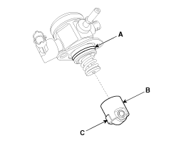

21. Instale a mangueira de alta pressão (A). (Consulte o grupo FL)

   ```
   Torque de aperto:
   Parafuso: 7,8 ~ 11,8N.m (0,8 ~ 1,2kgf.m, 5,8 ~ 8,7lb-ft)
   Parafuso e bucha: 26,5 ~ 32,4N.m (2,7 ~ 3,3kgf.m, 19,5 ~ 23,9lb-ft)
   ```

   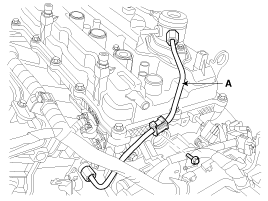

   > **Nota**
   >
   > - Não reutilize a mangueira de alta pressão.

22. Instale a montagem da mangueira de vácuo (A).

   ```
   Torque de aperto:
   Parafuso e bucha: 7,8 ~ 9,8N.m (0,8 ~ 1,0kgf.m, 5,8 ~ 7,2lb-ft)
   ```

   

23. Conecte a mangueira de combustível (A) e a mangueira do PCSV (Valvula de controle de purga) (B).

   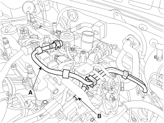

24. Conecte os conectores e os cabos de fixação, e instale
    os proteutores de cabos na cabeça do cilindro, o tubo de admissão e o
    tubo de escape.

   | (1) | Conecte o conectores do interruptor do OCV (Valvula de controle de óleo) (A) e o conectores do sensor de oxigênio (B). |
   | --- | --- |

   | (2) | Conecte o conectores do interruptor do compressor de ar condicionado (A), o conectores do gerador (B), o interruptor do OPS (Interruptor de pressão de óleo) (C) e o conectores do injetor (C), o conectores do sensor de estalo (D), o conectores do sensor de pressão absoluta do tubo de admissão (E) e a temperatura do ar de entrada (E), o conectores do controlador do acelerador eletrônico (F) e o conectores do bomba de vácuo (G). |
   | --- | --- |

   | (3) | Conecte o conectores da mangueira PCV (Valvula de retorno de carga) (A), o conectores do OCV (Valvula de controle de óleo) (B) e o conectores do sensor de temperatura do óleo (C). |
   | --- | --- |

   | (4) | Conecte os conectores dos bobinas de ignição (B) e o conectores da bomba de combustível (A). |
   | --- | --- |

   | (5) | Conecte os conectores do sensor de posição do cárter (A), o conectores do PCSV (Valvula de controle de purga) (B), o conectores do ECTS (Controlador de acelerador eletrônico) (C) |

(Transdutor do sensor de temperatura do líquido de resfriamento) (C), o conectador do condensador (D), o conectador do sensor de posição do crankshaft (CKPS) (E), o conectador do sensor de posição do camshaft (CMPS) (F) e o conectador do atuador do vácuo de escape elétrico (G). |
| --- | --- |

25. Conecte a mangueira superior do radiador (A) e a mangueira inferior (B).


26. Instale o capô inferior.

27. Remova a roda dianteira direita.

28. Instale as mangueiras de entrada/saída do intercooler e a montagem do filtro de ar. (Consulte a montagem do motor e do transmissão neste grupo)

29. Conecte o terminal negativo da bateria (A).

```
Torque de aperto:
4,0 ~ 6,0 N.m (0,4 ~ 0,6 kgf.m, 3,0 ~ 4,4 lb-ft)
```


30. Instale o capô do motor.

Realize as seguintes ações:

- Ajuste o cabo de transferência.
- Reforne o motor com óleo de motor.
- Reforne o transmissão com fluido.
- Reforne o radiador e o tanque de expansão com líquido de resfriamento.
- Limpe as postas e os terminais da bateria e monte.
- Inspeção de vazamento de combustível.
- Após montar a linha de combustível, ligue o interruptor de ignição (não operando o motor) para que o bomba de combustível funcione por aproximadamente dois segundos e pressione a linha de combustível. 
- Repita essa operação duas ou três vezes, depois verifique para vazamento na linha de combustível em qualquer ponto.
- Descarte de ar no sistema de resfriamento.
- Inicie o motor e deixe-o funcionar até aquecer. (até que o ventilador do radiador operar 3 ou 4 vezes.)
- Desligue o motor. Verifique o nível no radiador, adicione líquido de resfriamento se necessário. Isso permitirá que o ar preso seja removido do sistema de resfriamento.
- Coloque a tampa do radiador apertada, depois reinicie o motor e verifique para vazamentos.
| --- | --- |
