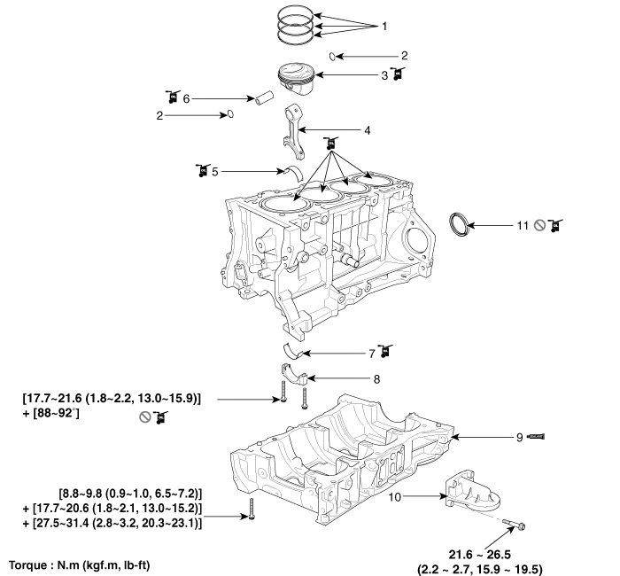
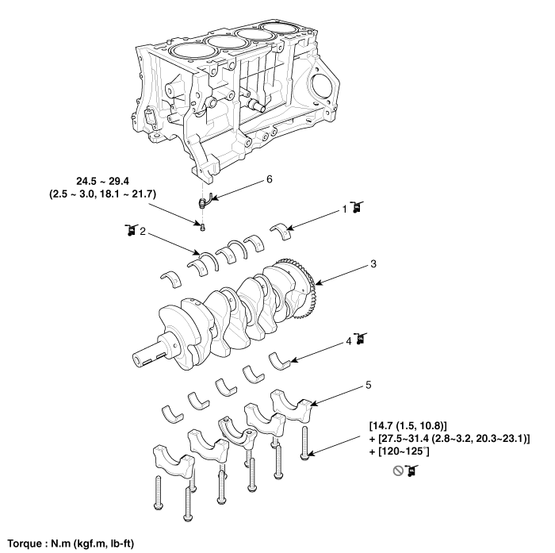

# Bloco de Cilindros — Componentes e localização

[Home](../../index.md) / [Manual de Serviço e Reparo](../sportage-482.md) / [Sistema Mecânico do Motor](sportage-484.md) / [Bloco de Cilindros](sportage-500.md) / Componentes e localização

## Diagrama — Componentes

## Legenda — Componentes

| Nº | Componente |
| --- | --- |
| 1 | Anel de pistão |
| 2 | Anel de segurança |
| 3 | Pistão |
| 4 | Conector |
| 5 | Conector superior do eixo de conector |
| 6 | Pinho de pistão |
| 7 | Conector inferior do eixo de conector |
| 8 | Capa do eixo de conector |
| 9 | Estrutura de grade |
| 10 | Aro do filtro de óleo |
| 11 | Selo de óleo do eixo traseiro do crankshaft |

## Diagrama — Componentes

## Legenda — Componentes

| Nº | Componente |
| --- | --- |
| 1 | Suporte superior do eixo do crankshaft |
| 2 | Suporte de deslizamento |
| 3 | Eixo do crankshaft |
| 4 | Suporte inferior do eixo do crankshaft |
| 5 | Capa do suporte principal |
| 6 | Jato de óleo para resfriamento do pistão |
