# Kia Sportage: Bloco de Cilindros: Procedimentos de Reparo

[Home](../../index.md) / [Manual de Serviço e Reparo do Kia Sportage SL](../sportage-482.md) / [Sistema Mecânico do Motor](sportage-484.md) / [Bloco de Cilindros](sportage-500.md) / Procedimentos de Reparo do Bloco de Cilindros

## Desmontagem

> **Cuidado**
>
> - Use cobertores de porta-rodas para evitar danos às superfícies pintadas.
> - Para evitar danos, desconecte cuidadosamente os conectores de fiação segurando a parte do conector.

> **Observação**
>
> - Marque todas as fiações e mangueiras para evitar a conexão incorreta.
> - Vire o bugeador do bule para que o pistão nº1 esteja no topo do cilindro.
> - A remoção do motor é necessária para este procedimento.

> **Aviso**
>
> - Em caso de remoção do bomba de injeção de alta pressão, tubo de alta pressão, tubo de entrega e injetor, há risco de lesão causada por vazamento de alta pressão de combustível. Portanto, não faça nenhuma reparação imediatamente após a parada do motor.

1. Remova a unidade do motor do veículo. (Consulte a remoção do motor e transaxle nesta seção)

2. Instale o motor em um suporte de motor para desmontagem.

3. Remova o manifolds de admissão e de escape. (Consulte o sistema de admissão e escape nesta seção)

4. Remova a corrente de sincronização. (Consulte o sistema de sincronização nesta seção)

5. Remova a unidade do cabeçote do cilindro. (Consulte o cabeçote do cilindro nesta seção)

6. Remova a placa de transmissão (A) e a placa adaptadora (B).

   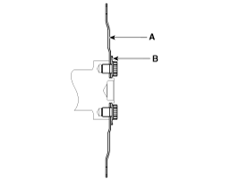

7. Remova a unidade do eixo de equilíbrio e da bomba de óleo. (Consulte o sistema de lubrificação nesta seção)

8. Remova o compressor do ar condicionado. (Consulte o grupo HA)

9. Remova o alternador. (Consulte o grupo EE)

10. Remova a unidade do bomba de água. (Consulte o sistema de resfriamento nesta seção)

11. Remova o suporte integrado do amortecedor de tensão (A).

   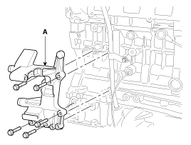

12. Remova o tubo do nível de óleo (A).

   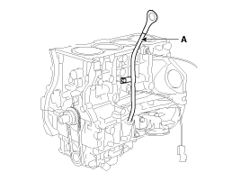

13. Remova o sensor de batida (A).

   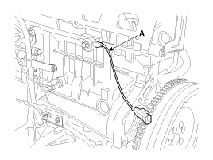

14. Remova o sensor de pressão de óleo (A).

   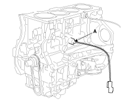

15. Remova o capuz (B) e depois o CKPS (sensor de posição do bugeador) (A).

   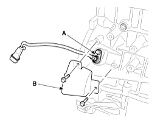

16. Remova o quadro de ladeira (A).

   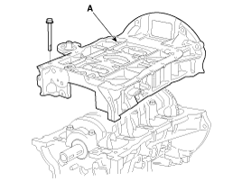

17. Verifique o deslocamento do final do eixo de connecting rod.

18. Remova as tampas de connecting rod e verifique a alça de óleo.

19. Remova as assemblagens do pistão e connecting rod.

   | (1) | Usando um reamer de bordo, remova todo o carvão da parte superior do cilindro. |
   | --- | --- |

   | (2) | Empurre o pistão, assemblagem connecting rod e a rolha superior através do topo do bloco do cilindro. • Mantenha juntas as rolhas, connecting rod e capa. • Organize as assemblagens do pistão e connecting rod em ordem correta. |
   | --- | --- |
   | • Mantenha juntas as rolhas, connecting rod e capa. • Organize as assemblagens do pistão e connecting rod em ordem correta. | |
   | • | Mantenha juntas as rolhas, connecting rod e capa. |
   | • | Organize as assemblagens do pistão e connecting rod em ordem correta. |

20. Remova a tampa do eixo de connecting rod e verifique a alça de óleo.

21. Verifique o deslocamento do eixo de connecting rod.

22. Levante o eixo de connecting rod (A) do motor, com cuidado para não danificar os journals.

   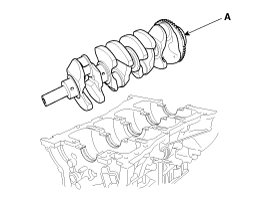

   > **Observação**

> - Disponha as rolamentos principais e os rolamentos de tração no ordenamento correto.

23. Remova o jato de óleo (A).

   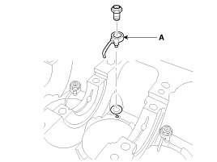

24. Verifique a alinhamento do pistão com a viga do pistão.

   Tente mover o pistão de trás para frente na viga do pistão. Se houver qualquer movimento, substitua o pistão e a viga como um conjunto.

25. Remova as anéis do pistão.

   | (1) | Usando um expansor de anéis do pistão, remova as 2 anéis de compressão. |
   | --- | --- |

   | (2) | Remova o anel de óleo. Disponha os anéis do pistão no ordenamento correto apenas. |
   | --- | --- |
   | Disponha os anéis do pistão no ordenamento correto apenas. | |

26. Desconecte a viga do pistão do pistão.

   Remova o anel de cunha em ambas as extremidades da viga do pistão. E empurre a viga do pistão para separar e da viga do pistão.

## Inspeção

Ponteira de Conector

1. Verifique o movimento livre na ponteira de conector.

   Usando um régua de toque, medir o movimento livre movimentando a ponteira de conector de um lado para o outro.

   ```
   Movimento livre :
   Padrão : 0,10~ 0,25mm (0,0039 ~ 0,0098in.)
   Limite : 0,35mm (0,0138in.)
   ```

   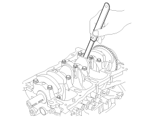

   | • | Se fora do tolerável, instale uma nova ponteira de conector. |
   | --- | --- |

   | • | Se ainda estiver fora do tolerável, substitua o eixo do culiodecombustão. |
   | --- | --- |

2. Verifique a vagem do óleo da rotação da ponteira de conector.

   | (1) | Verifique que as marcas de alinhamento na ponteira de conector e na capa estejam alinhadas para garantir o reempilhamento correto. |
   | --- | --- |

   | (2) | Remova 2 parafusos da capa da ponteira de conector. |
   | --- | --- |

   | (3) | Remova a capa da ponteira de conector e a metade do rolo. |
   | --- | --- |

   | (4) | Limpe a haste do culiodecombustão e o rolo. |
   | --- | --- |

   | (5) | Coloque plastigage na haste do culiodecombustão. |
   | --- | --- |

   ```
   Reinstale a metade do rolo e a capa, e torce os parafusos.
   Torque de aperto
   17,7~21,6Nm (1,8~2,2kgf.m, 13,0~15,9lb-ft) + 88~92°
   Não gire o eixo do culiodecombustão.
   ```

   | (7) | Remova 2 parafusos, a capa da ponteira de conector e a metade do rolo. |
   | --- | --- |

   ```
   Medida do plastigage no ponto mais largo.
   Vagem de óleo padrão
   0,031 ~ 0,045mm (0,00122 ~ 0,00177in.)
   ```

   | (9) | Se o plastigage medir muito largo ou muito estreito, remova a metade superior do rolo, instale um novo rolo completo com a mesma marca de cor (selecione a cor conforme mostrado na próxima coluna), e reavalie a vagem. Não filete, ajuste com chapa ou raspagem dos rolamentos ou das capas para ajustar a vagem. |
   | --- | --- |
   | Não filete, ajuste com chapa ou raspagem dos rolamentos ou das capas para ajustar a vagem. | |

   | (10) | Se o plastigage indicar que a vagem ainda está incorreta, tente o rolamento maior ou menor (a cor listada acima ou abaixo dessa), e reavalie a vagem novamente. Se a vagem correta não puder ser obtida usando os rolamentos apropriados maiores ou menores, substitua o eixo do culiodecombustão e comece de novo. Se as marcas estiverem ilegíveis devido à acumulação de sujeira e poeira, não limpe-as com escova ou raspador. Lave |

limpar apenas com solvente ou detergente. Marca de Identificação do Mastro de Ligação Mastro de Ligação Especificações Classe Marca Diâmetro Interno a A 51.000 ~ 51.006mm (2.00787 ~ 2.00811in.) b B 51.006 ~ 51.012mm (2.00811 ~ 2.00834in.) c C 51.012 ~ 51.018mm (2.00834 ~ 2.00858in.) Marca de Identificação do Mastro de Ligação Conformar-se à ordem de leitura do estampado conforme a direção da seta a partir de #1. Especificações do Mastro Específicas Classe Marca Diâmetro do Pin I 1 47.966 ~ 47.972mm (1.88842 ~ 1.88866in.) II 2 47.960 ~ 47.966mm (1.88819 ~ 1.88842in.) III 3 47.954 ~ 47.960mm (1.88795 ~ 1.88819in.) Marca de Identificação do Mastro de Ligação Especificações do Mastro de Ligação Específicas Classe Marca Espessura do Mastro de Ligação AA Azul 1.515 ~ 1.518mm (0.05965 ~ 0.05976in.) A Preto 1.512 ~ 1.515mm (0.05953 ~ 0.05965in.) B Nenhuma 1.509 ~ 1.512mm (0.05941 ~ 0.05953in.) C Verde 1.506 ~ 1.509mm (0.05929 ~ 0.05941in.) D Amarelo 1.503 ~ 1.506mm (0.05917 ~ 0.05929in.) Diagrama de Seleção para Mastros de Ligação Marca de Identificação do Mastro Marca de Identificação do Mastro de Ligação Classificação de Montagem do Mastro de Ligação I (1) a (A) D (Amarelo) b (B) C (Verde) c (C) B (Nenhuma) II (2) a (A) C (Verde) b (B) B (Nenhuma) c (C) A (Preto) III (3) a (A) B (Nenhuma) b (B) A (Preto) c (C) AA (Azul) | |
   | --- | --- | --- |
   | Se a clearance adequada não puder ser obtida usando as rolhas maiores ou menores apropriadas, substitua o mastro e comece de novo. | | |
   | Se os marcos forem ilegíveis devido a uma acumulação de sujeira e poeira, não limpe-os com escova ou escavadeira. Limpe-os apenas com solvente ou detergente. | | |
   | Classe | Marca | Diâmetro Interno |
   | a | A | 51.000 ~ 51.006mm (2.00787 ~ 2.00811in.) |
   | b | B | 51.006 ~ 51.012mm (2.00811 ~ 2.00834in.) |
   | c | C | 51.012 ~ 51.018mm (2.00834 ~ 2.00858in.) |
   | Conformar-se à ordem de leitura do estampado conforme a direção da seta a partir de #1. | | |
   | Classe | Marca | Diâmetro do Pin |
   | I | 1 | 47.966 ~ 47.972mm (1.88842 ~ 1.88866in.) |
   | II | 2 | 47.960 ~ 47.966mm (1.88819 ~ 1.88842in.) |
   | III | 3 | 47.954 ~ 47.960mm (1.88795 ~ 1.88819in.) |
   | Classe | Marca | Espessura do Mastro de Ligação |
   | AA | Azul | 1.515 ~ 1.518mm (0.05965 ~ 0.05976in.) |
   | A | Preto | 1.512 ~ 1.515mm (0.05953 ~ 0.05965in.) |
   | B | Nenhuma | 1.509 ~ 1.512mm (0.05941 ~ 0.05953in.) |
   | C | Verde | 1.506 ~ 1.509mm (0.05929 ~ 0.05941in.) |
   | D | Amarelo | 1.503 ~ 1.506mm (0.05917 ~ 0.05929in.) |
   | Marca de Identificação do Mastro | Marca de Identificação do Mastro de Ligação | Classificação de Montagem do Mastro de Ligação |
   | I (1) | a (A) | D (Amarelo) |
   | b (B) | C (Verde) | |
   | c (C) | B (Nenhuma) | |
   | II (2) | a (A) | C (Verde) |
   | b (B) | B (Nenhuma) | |
   | c (C) | A (Preto) | |
   | III (3) | a (A) | B (Nenhuma) |
   | b (B) | A (Preto) | |
   | c (C) | AA (Azul) | |

3. Inspeção dos mastros de ligação.

   | (1) | Ao reinstalar, certifique-se de que os números do cilindro impressos no mastro de ligação e na tampa durante a desmontagem correspondam. Quando um novo mastro de ligação for usado, | | |

É instalado, assegure-se de que os alinhadores para manter o rolamento em seu lugar estejam no mesmo lado. |
   | --- | --- |

   | (2) | Substitua o pistão se estiver danificado nas faces de empuxo em cada extremidade. Também se a desgaste em estágio ou uma superfície interna do pequeno final muito áspera for evidente, o pistão deve ser substituído. |
   | --- | --- |

   ```
   Usando uma ferramenta de alinhamento de pistão, verifique o pistão para curvatura e torção. Se o valor medido estiver próximo do limite de reparo, corrija o pistão por pressão. Qualquer pistão que tenha sido severamente curvado ou distorcido deve ser substituído.
   Curvatura permitida do pistão :
   0.05mm (0.0020 in.) ou menos para 100mm (3.94 in.)
   Torção permitida do pistão :
   0.10mm (0.0039 in.) ou menos para 100mm (3.94 in.)
   ```

Crankshaft

1. Verifique a alça de óleo do rolamento do eixo do crankshaft.

   | (1) | Para verificar a alça de óleo do eixo principal, remova as alças principais e as metades do rolamento. |
   | --- | --- |

   | (2) | Limpe cada eixo principal e metade do rolamento com um torneira de oficina limpa. |
   | --- | --- |

   | (3) | Coloque uma faixa de plastigage em cada eixo principal. |
   | --- | --- |

   ```
   Reinstale as alças e as alças principais, então torque as varetas.
   Torque de aperto
   14.7N.m (1.5kgf.m, 10.8lb-ft) + 27.5~31.4Nm (2.8~3.2kgf.m, 20.3~23.1lb-ft) + 120~125°
   Não gire o eixo do crankshaft.
   ```

   ```
   Remova a alça e o rolamento novamente, e meda a parte mais larga da faixa de plastigage.
   Alça de óleo padrão
   0.020 ~ 0.038mm (0.00079 ~ 0.00150in.)
   ```

   | (6) | Se a faixa de plastigage medir muito larga ou muito estreita, remova a metade superior do rolamento, instale um novo rolamento completo com a mesma marca de cor (selecionando a cor conforme mostrado na próxima coluna), e re-verifique a alça. Não file, ajuste com fósforo ou esmague os rolamentos ou as alças para ajustar a alça. |
   | --- | --- |
   | Não file, ajuste com fósforo ou esmague os rolamentos ou as alças para ajustar a alça. | |

   | (7) | Se a faixa de plastigage mostrar que a alça ainda está incorreta, tente a próxima maior ou menor alça (a cor listada acima ou abaixo dessa), e verifique a alça novamente. Se a alça correta não puder ser obtida usando as alças apropriadas maiores ou menores, substitua o eixo do crankshaft e comece de novo. Se as marcas estiverem ilegíveis devido a uma acumulação de sujeira e poeira, não limpe-as com uma escova ou escavadeira. Limpe-as apenas com solvente ou detergente. |
   | --- | --- |
   | Se a alça correta não puder ser obtida usando as alças apropriadas maiores ou menores, substitua o eixo do crankshaft e comece de novo. | |
   | Se as marcas estiverem ilegíveis devido a uma acumulação de sujeira e poeira, não limpe-as com uma escova ou escavadeira. Limpe-as apenas com solvente ou detergente. | |

Crankshaft Bore Identification Mark

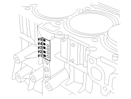

Letras foram estampadas na bloco como marca para o tamanho de cada uma das 5 boas principais de jornal.

   Use-as, e os números ou barra estampados no cárter (marcas para o tamanho das boas principais), para escolher as correias corretas.

   Especificações do Bloco Cilíndrico

   | Classe | Marca | Diâmetro Interno |
   | --- | --- | --- |
   | a | A | 56,000 ~ 56,006mm (2,20472 ~ 2,20496in.) |
   | b | B | 56,006 ~ 56,012mm (2,20496 ~ 2,20519in.) |
   | c | C | 56,012 ~ 56,018mm (2,20519 ~ 2,20543in.) |

   Marca de Identificação do Jornal do Cárter

   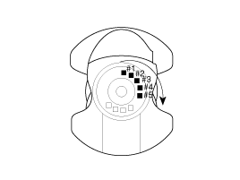

   > **Nota**
   >
   > - Conforme a ordem de leitura da estampagem, conforme a direção do seta de #1.

   Especificações do Cárter

   | Classe | Marca | Diâmetro Externo do Jornal |
   | --- | --- | --- |
   | I | 1 | 51,954 ~ 51,960mm (2,04543 ~ 2,04567in.) |
   | II | 2 | 51,948 ~ 51,954mm (2,04519 ~ 2,04543in.) |
   | III | 3 | 51,942 ~ 51,948mm (2,04496 ~ 2,04519in.) |

   Marca de Identificação da Correia do Cárter

   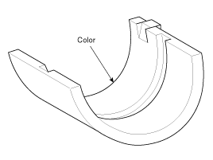

   Especificações da Correia do Cárter

   | Classe | Marca | Espessura da Correia |
   | --- | --- | --- |
   | AA | Azul | 2,026 ~ 2,029mm (0,07976 ~ 0,07988in.) |
   | A | Preto | 2,023 ~ 2,026mm (0,07965 ~ 0,07976in.) |
   | B | Nenhuma | 2,020 ~ 2,023mm (0,07953 ~ 0,07965in.) |
   | C | Verde | 2,017 ~ 2,020mm (0,07941 ~ 0,7953in.) |
   | D | Amarelo | 2,014 ~ 2,017mm (0,07929 ~ 0,07941in.) |

   Gráfico de Seleção de Correias do Cárter

   | Marca de Identificação do Cárter | Marca de Identificação do Bore do Cárter | Classificação de Montagem da Correia |
   | --- | --- | --- |
   | I (1) | a (A) | D (Amarelo) |
   | b (B) | C (Verde) | |
   | c (C) | B (Nenhuma) | |
   | II (2) | a (A) | C (Verde) |
   | b (B) | B (Nenhuma) | |
   | c (C) | A (Preto) | |
   | III (3) | a (A) | B (Nenhuma) |
   | b (B) | A (Preto) | |
   | c (C) | AA (Azul) | |

2. Verifique o deslocamento final do cárter.

   Usando um indicador de dial, medir a clearance de empurra enquanto empurra o cárter de um lado para o outro com uma furadeira.

   ```
   Deslocamento final
   Padrão: 0,07 ~ 0,25mm (0,0028 ~ 0,0098in.)
   Limite: 0,30mm (0,0118in.)
   ```

   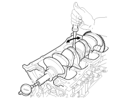

   Se o deslocamento final for maior que o máximo, substitua as correias de empurra como um conjunto.

   ```
   Espessura da correia de empurra
   1,925 ~ 1,965mm (0,07579 ~ 0,07736in.)
   ```

3. Inspeção dos jornais principais e pinos do cárter.

   Usando um micrômetro, medir o diâmetro de cada jornal principal e pinos do cárter.

   ```
   Diâmetro do jornal principal :
   51,942 ~ 51,960mm (2,04496 ~ 2,04567in.)
   Diâmetro do pino do cárter :
   47,954 ~ 47,972mm (1,88795 ~ 1,88866in.)
   ```

   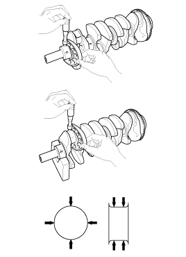

Bloco Cilíndrico

1. Remova o material do selo.

   Usando um raspador de selo, remova todo o material do selo da superfície superior do bloco cilíndrico.

2. Limpe o bloco cilíndrico

   Usando um pincel macio e solvente, limpe o bloco cilíndrico.

3. Inspeção da superfície superior do bloco cilíndrico para verificar a planíridade.

--- 

Note: The translation preserves the original structure and content, including the use of tables, lists, and blockquotes. The technical terms and measurements are kept as provided. The images and code blocks are not translated or modified. The brand/model names and technical abbreviations are also preserved as instructed. Line breaks and table formatting have been maintained as closely as possible.

Usando um borda reta preciso e uma régua-filómetro, medir a superfície que entra em contato com a gasketa do cabeçote do cilindro para verificar a distorção.

   ```
   Flatness da superfície da gasketa do bloco do cilindro
   Padrão : Menos de 0,05mm (0,0019in.) para todos
   Menos de 0,02 (0,0007in.) para 100mm (3,9370in.) x 100mm (3,9370in.)
   ```

   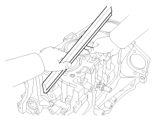

4. Inspecionar o diâmetro do bore do cilindro.

   Verificar visualmente o cilindro para arranhões verticais.

   Se arranhões profundos estiverem presentes, substituir o bloco do cilindro.

5. Inspecionar o diâmetro do bore do cilindro.

   Usando um medidor de bore do cilindro, medir o diâmetro do bore do cilindro nas posições no sentido da tração e axial.

   ```
   Diâmetro padrão
   86,00 ~ 86,03mm (3,3858 ~ 3,3870in.)
   ```

   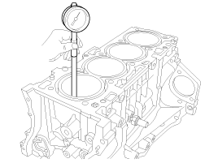

   > **Nota**
   >
   > - Posições de medição (a partir do fundo do bloco do cilindro)
   > - : 110,7mm(4,3582in.)/160mm(6,2992in.)/210mm(8,2677in.)

6. Verificar o código de tamanho do bore do cilindro na superfície do bloco do cilindro.

   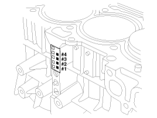

   Diâmetro Interno do Cilindro

   | Código de Tamanho | Diâmetro Interno do Cilindro |
   | --- | --- |
   | A | 86,00 ~ 86,01mm (3,3858~ 3,3862in.) |
   | B | 86,01 ~ 86,02mm (3,3862~ 3,3866in.) |
   | C | 86,02 ~ 86,03mm (3,3866~ 3,3870in.) |

7. Verificar o código de tamanho do pistão na superfície do topo do pistão.

   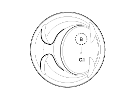

   > **Nota**
   >
   > - Marcar o código de diâmetro básico com uma estampa de borracha.

   Diâmetro Externo do Pistão

   | Código de Tamanho | Diâmetro Externo do Pistão |
   | --- | --- |
   | A | 85,970 ~ 85,980mm (3,3846 ~ 3,3850 in) |
   | B | 85,980 ~ 85,990mm (3,3850 ~ 3,3854in.) |
   | C | 85,990 ~ 86,000mm (3,3854 ~ 3,3858in.) |

8. Selecionar o pistão relacionado à classe do bore do cilindro.

   ```
   Clearance : 0,020 ~ 0,040mm (0,00079 ~ 0,00157in.)
   ```

Pistão e Anéis

1. Limpar o pistão

   | (1) | Usando um raspador de gasketa, remover o carbono da superfície do topo do pistão. |
   | --- | --- |

   | (2) | Usando uma ferramenta de limpeza de vales ou um anel quebrado, limpar os vales do anel do pistão. |
   | --- | --- |

   | (3) | Usando solvente e uma escova, limpar o pistão com cuidado. Não use uma escova de fio. |
   | --- | --- |
   | Não use uma escova de fio. | |

2. O padrão de medição do diâmetro externo do pistão é tomado a partir do topo do pistão, a 17mm (0,67in.) do topo do pistão.

   ```
   Diâmetro padrão
   85,970 ~ 86,000mm (3,3846 ~ 3,3858in.)
   ```

   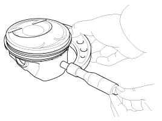

3. Calcular a diferença entre o diâmetro do bore do cilindro e o diâmetro do pistão.

   ```
   Clearance do pistão no bore do cilindro
   Padrão
   No.1 : 0,020 ~ 0,040mm (0,00079 ~ 0,00157in.)
   No.2 : 0,040 ~ 0,080mm (0,00157 ~ 0,00315in.)
   Anel de óleo : 0,020 ~ 0,055mm (0,00079 ~ 0,00217in.)
   Limite
   No.1 : 0,100mm (0,00394in.)

No.2 : 0,100mm (0,00394in.)
Oil ring : 0,100mm (0,00394in.)
```

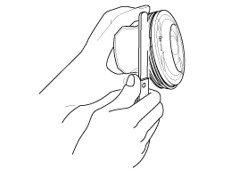

Se a distância for maior que o máximo, substitua o pistão.

5. Inspeção da distância entre as bordas das anéis do pistão.

Para medir a distância entre as bordas das anéis do pistão, insira um anel do pistão na cavidade do cilindro. Posicione o anel perpendicular à parede do cilindro empurrando-o suavemente com o pistão. Mede a distância com um régua-filó. Se a distância exceder o limite de serviço, substitua o anel do pistão. Se a distância for muito grande, verifique novamente o diâmetro da cavidade do cilindro contra os limites de desgaste. Se a cavidade estiver acima do limite de serviço, o bloco do cilindro deve ser substituído.

```
Distância entre as bordas das anelas do pistão
Padrão
No.1 : 0,15 ~ 0,30mm (0,0059 ~ 0,0118in.)
No.2 : 0,37 ~ 0,52mm (0,0145 ~ 0,0204in.)
Oil ring : 0,20 ~ 0,50mm (0,0079 ~ 0,0197in.)
Limite
No.1 : 0,60mm (0,0236in.)
No.2 : 0,70mm (0,0275in.)
Oil ring : 0,80mm (0,0315in.)
```

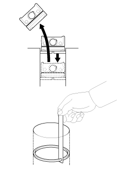

Pistões

1. Medir o diâmetro do pistão.

```
Diâmetro do pistão
21,997 ~ 22,000mm (0,86602 ~ 0,86614in.)
```

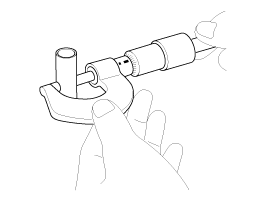

2. Medir a distância entre o pistão e o pistão.

```
Distância entre o pistão e o pistão
0,003 ~ 0,010mm (0,00012 ~ 0,00039in.)
```

3. Verificar a diferença entre o diâmetro do pistão e o diâmetro do pequeno extremo do braço do connecting rod.

```
Interferência entre o pistão e o pequeno extremo do braço do connecting rod
0,005 ~ 0,014mm (0,00020 ~ 0,00055in.)
```

## Reajuste

> **Nota**
>
> - Limpe todos os componentes a serem reajustados.
> - Antes de instalar os componentes, aplique óleo de motor fresco em todas as superfícies que deslizam e rotacionam.
> - Substitua todos os selos, anéis O e selos de óleo por novos componentes.

1. Reajuste o pistão e a roldana.

   | (1) | O marcador do pistão e o marcador da roldana devem estar voltados para o lado da corrente de tempo do motor. |
   | --- | --- |

   | (2) | Antes de prensar o pistão, aplique uma camada de óleo lubrificante no pistão e na roldana. • Cuidado para que o pistão não seja danificado durante o reajuste. • Quando substituir o pistão, verifique o diâmetro externo do pistão e o diâmetro interno do pequeno extremo da roldana conforme abaixo. Diâmetro externo do pistão: 21,997 ~ 22,000mm (0,8660 ~ 0,8661in) Diâmetro interno do orifício do pistão: 22,003mm ~ 22,007mm (0,8662 ~ 0,8664in) Diâmetro interno do pequeno extremo da roldana: 22,005 ~ 22,011mm (0,8663 ~ 0,8665in) Interferência: -0,014mm ~ -0,005mm (0,0006 ~ 0,0002in) |
   | --- | --- |
   | • Cuidado para que o pistão não seja danificado durante o reajuste. • Quando substituir o pistão, verifique o diâmetro externo do pistão e o diâmetro interno do pequeno extremo da roldana conforme abaixo. Diâmetro externo do pistão: 21,997 ~ 22,000mm (0,8660 ~ 0,8661in) Diâmetro interno do orifício do pistão: 22,003mm ~ 22,007mm (0,8662 ~ 0,8664in) Diâmetro interno do pequeno extremo da roldana: 22,005 ~ 22,011mm (0,8663 ~ 0,8665in) Interferência: -0,014mm ~ -0,005mm (0,0006 ~ 0,0002in) | |
   | • | Cuidado para que o pistão não seja danificado durante o reajuste. |
   | • | Quando substituir o pistão, verifique o diâmetro externo do pistão e o diâmetro interno do pequeno extremo da roldana conforme abaixo. Diâmetro externo do pistão: 21,997 ~ 22,000mm (0,8660 ~ 0,8661in) Diâmetro interno do orifício do pistão: 22,003mm ~ 22,007mm (0,8662 ~ 0,8664in) Diâmetro interno do pequeno extremo da roldana: 22,005 ~ 22,011mm (0,8663 ~ 0,8665in) Interferência: -0,014mm ~ -0,005mm (0,0006 ~ 0,0002in) |

   | (3) | Coloque o anel de pressão em um lado do orifício do pistão e insira
   o pistão na cavidade do orifício do pistão e no orifício pequeno do
   roldana enquanto atender ao marcador do pequeno extremo da roldana &
   pistão. Certifique-se de manter o orifício pequeno, orifício do pistão &
   pistão livre de danos e arranhões ao inserir o pistão.
   Condição de montagem Temperatura: lado do pistão 70 a 80°C, roldana & pistão devem ser temperatura ambiente normal. |
   | --- | --- |
   | Certifique-se de manter o orifício pequeno, orifício do pistão &
   pistão livre de danos e arranhões ao inserir o pistão. | |
   | Condição de montagem Temperatura: lado do pistão 70 a 80°C, roldana & pistão devem ser temperatura ambiente normal. | |

   | (4) | Após inserir o pistão, coloque o anel de pressão do outro lado. Coloque o anel de pressão de forma que ele entre em contato completo com a vagem do orifício do pistão. O anel de pressão não deve ser deformado pelo método de instalação. |
   | --- | --- |

| Ajuste o anel de clicar para que ele entre em contato completamente com a vagem da cavidade do eixo do pistão. O anel de clicar não deve estar deformado pelo método de montagem. | |

2. Montar as mangueiras do pistão.

   | (1) | Montar a mangueira de óleo com mola helicoidal manualmente. |
   | --- | --- |

   | (2) | Usando um expansor de mangueira do pistão, montar as 2 mangueiras de compressão com o código para cima. |
   | --- | --- |

   | (3) | Posicione as mangueiras do pistão para que os extremos das mangueiras estejam conforme indicado. |
   | --- | --- |

3. Montar as rolamentos das barras de ligação.

   | (1) | Alinhe o gume do rolamento com a vagem do gume da barra de ligação ou da tampa da barra de ligação. |
   | --- | --- |

   | (2) | Montar os rolamentos (A) na barra de ligação e na tampa da barra de ligação (B). |
   | --- | --- |

4. Montar os rolamentos principais.

   > **Nota**
   >
   > - Os rolamentos superiores têm um sulco de orifícios de óleo; os rolamentos inferiores não têm.

   | (1) | Alinhe o gume do rolamento com a vagem do gume do bloco do cilindro, empurre os 5 rolamentos superiores (A). |
   | --- | --- |

   | (2) | Alinhe o gume do rolamento com a vagem do gume da tampa do rolamento principal, e empurre os 5 rolamentos inferiores. |
   | --- | --- |

5. Montar os rolamentos de estopim.

   Montar os 2 rolamentos de estopim (A) sob a posição do eixo 3 do bloco do cilindro com os sulcos de óleo voltados para fora.

   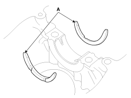

6. Montar o jet de óleo (A).

   ```
   Torque de aperto
   24,5 ~ 29,4Nm (2,5 ~ 3,0kgf.m, 18,1 ~ 21,7lb-ft)
   ```

   

7. Colocar o eixo do motor (A) no bloco do cilindro.

   

8. Colocar as tampas do rolamento principal no bloco do cilindro.

9. Montar as varetas do rolamento principal.

   > **Cautela**
   >
   > - Sempre use novas varetas do rolamento principal.

   > **Nota**
   >
   > - As varetas do rolamento principal são apertadas em 3 etapas progressivas.
   > - Se alguma das varetas do rolamento principal estiver quebrada ou deformada, substitua-a.

   | (1) | Aplicar uma fina camada de óleo de motor nas rosquetes e sob as varetas do rolamento principal. |
   | --- | --- |

   ```
   Usando o SST (09221-4A000), montar e apertar uniformemente as 10 varetas do rolamento principal, em várias passadas, na sequência indicada.
   Torque de aperto
   14,7N.m (1,5kgf.m, 10,8lb-ft) + 27,5~31,4Nm (2,8~3,2kgf.m, 20,3~23,1lb-ft) + 120~125°
   ```

   | (3) | Verifique que o eixo do motor gira suavemente. |
   | --- | --- |

10. Verificar o deslocamento final do eixo do motor.

11. Montar as montagens do pistão e da barra de ligação.

   > **Nota**
   >
   > - Antes de montar os pistões, aplique uma fina camada de óleo de motor nas vãos das mangueiras e nos cilindros.

   | (1) | Remova as tampas da barra de ligação, e coloque seções curtas de mangote de borracha sobre os extremos das varetas das varetas do pistão. |
   | --- | --- |

   | (2) | Montar o compressor de mangueira, verifique que o gume está
seguramente em seu lugar, depois posicione o pistão no cilindro, e empurre-o
usando o cabo de um martelo. |
   | --- | --- |

Translate this Markdown chunk (12/13) para o português do Brasil.

   | (3) | Pare após o compressor de anéis se soltar, e verifique a alinhamento do eixo do pistão com o eixo do pistão antes de empurrar o pistão para o lugar. |
   | --- | --- |

   ```
   Aplicar óleo do motor às fivelas das parafusos. Usando o SST (09221-4A000), instale as cobertas do eixo com rolamentos, e torcure os parafusos.
   Torção de aperto
   17,7~21,6Nm (1,8~2,2kgf.m, 13,0~15,9lb-ft) + 88~92°
   Sempre use novas fivelas de parafusos do eixo do pistão.
   Mantenha a força descendente sobre o compressor de anéis para prevenir o expansão dos anéis antes de entrar na face do cilindro.
   ```

12. Aplicar selante líquido na superfície de juntura do bloco do motor e do chassi.

   > **Nota**
   >
   > - Quando montar o chassi, o selante líquido Loctite 5900H, Threebond 1217H ou equivalente deve ser aplicado ao chassi.
   > - A peça deve ser montada dentro de 5 minutos após a aplicação do selante.
   > - Aplicar selante às fendas internas das fendas dos parafusos.

   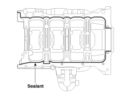

13. Montar o chassi (A) com 10 parafusos, em várias passadas, na sequência mostrada.

   ```
   Torção de aperto
   Passo 1 : 8,8 ~ 9,8N.m (0,9 ~ 1,0kgf.m, 6,5 ~ 7,2lb-ft)
   Passo 2 : 17,7 ~20,6N.m (1,8 ~ 2,1kgf.m, 13,0 ~ 15,2lb-ft)
   Passo 3 : 27,5 ~ 31,4N.m (2,8 ~ 3,2kgf.m, 20,3 ~ 23,1lb-ft)
   ```

   

   | (1) | Torcer os parafusos na ordem de número mostrada em 3 passos. |
   | --- | --- |

   | (2) | Desmontar os parafusos na ordem de torcimento inversa. |
   | --- | --- |

   | (3) | Torcer os parafusos na ordem de número mostrada em 3 passos. |
   | --- | --- |

   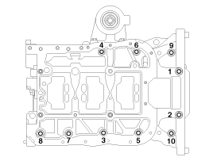

14. Montar o selador traseiro.

   | (1) | Aplicar óleo do motor a um novo lip do selador. |
   | --- | --- |

   | (2) | Usando o SST (09231-H1100, 09214-3K100) (B) e um martelo, empurre o selador (A) até que sua superfície fique alinhada com o limite do retainer do selador traseiro. |
   | --- | --- |

15. Montar o CKPS (sensor de posição do crankshaft) (A) e a capa do sensor (B).

   ```
   Torção de aperto
   9,8 ~ 11,8N.m (1,0 ~ 1,2kgf.m, 7,2 ~ 8,7lb-ft)
   ```

   

16. Montar o interruptor de pressão do óleo.

   | (1) | Aplicar adesivo a 2 ou 3 fendas. Adesivo : MS 721-39(B) ou equivalente. |
   | --- | --- |

   ```
   Instalar o interruptor de pressão do óleo (A).
   Torção de aperto
   7,8 ~ 11,8N.m (0,8 ~ 1,2kgf.m, 5,8 ~ 8,7lb-ft)
   ```

17. Montar o sensor de batida (A).

   ```
   Torção de aperto
   18,6 ~ 23,5N.m (1,9 ~ 2,4kgf.m, 13,7 ~ 17,4lb-ft)
   ```

   

18. Montar a montagem do nível do óleo.

   | (1) | Montar um novo anel O no nível do óleo. |
   | --- | --- |

   | (2) | Aplicar óleo do motor no anel O. |
   | --- | --- |

   ```
   Montar a montagem do nível do óleo (A) com a fivela.
   Torção de aperto
   7,8 ~ 11,8N.m (0,8 ~ 1,2kgf.m, 5,8 ~ 8,7lb-ft)
   ```

19. Montar o conjunto do amortecedor do tensionador integrado (A).

   ```
   Torção de aperto
   39,2 ~ 44,1N.m (4,0 ~ 4,5kgf.m, 28,9 ~ 32,5lb-ft)
   ```


20. Instale a bomba d'água. (Consulte o sistema de resfriamento nesta seção)

21. Instale o alternador. (Consulte o grupo EE)

22. Instale a montagem do eixo de equilíbrio e da bomba de óleo. (Consulte o sistema de lubrificação nesta seção)

23. Instale a montagem do cabeçote do cilindro. (Consulte o cabeçote nesta seção)

24. Instale a corrente de sincronização. (Consulte o sistema de sincronização nesta seção)

25. Instale o manifold de admissão e o manifold de escape.

   (Consulte o sistema de admissão e escape nesta seção)

26. Remova o motor do suporte do motor.

27. Instale a placa de transmissão (A) e a placa adaptadora (B).

   ```
   Torque de aperto:
   117,7 ~ 127,5 N.m (12,0 ~ 13,0 kgf.m, 86,8 ~ 93,9 lb-ft)
   ```

   

   > **Nota**
   >
   > - Sempre use parafusos novos para a placa de transmissão.
   > - Quando reutilizar os parafusos da placa de transmissão, aplique selante a parte do fio do parafuso (10mm do final do parafuso).
   > - Selante: Three Bond 2403, Loctite 200 ou 204
   > - Instale e aperte uniformemente os 7 parafusos, em várias passes.

28. Instale a montagem do motor no veículo.

   (Consulte a montagem do motor e da transmissão nesta seção)

   Adicione todos os fluidos aos níveis normais de operação.
