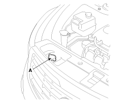
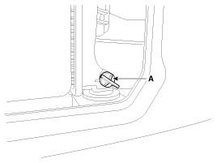

# Kia Sportage: Corante: Procedimentos de reparo

[Início](../../index.md) / [Manual de Serviço e Reparo do Kia Sportage SL](../sportage-482.md) / [Sistema Mecânico do Motor](sportage-484.md) / [Sistema de Refrigeração](sportage-503.md) / Corante: Procedimentos de reparo

## Preenchimento e Descarga

> **Aviso**
>
> - Nunca remova a tampa do radiador enquanto o motor estiver quente. Pode ocorrer um escaldamento sério devido a líquido quente sob pressão alta escapar do radiador.

> **Cautela**
>
> - Ao derramar líquido de refrigeração do motor, certifique-se de fechar a tampa do caixa de relé e não permita que o líquido de refrigeração escorra nas partes elétricas ou na pintura. Se o líquido de refrigeração escorrer, lave-o imediatamente.

1. Certifique-se de que o motor e o radiador estão frios ao toque.

2. Remova a tampa do radiador (A).

   

3. Desloque o parafuso de descarga (A) e derrame o líquido de refrigeração.

   

4. Torne o parafuso de descarga do radiador firme novamente.

5. Após derramar o líquido de refrigeração no tanque de reservatório, limpe o tanque.

6. Preencha o radiador com água através da tampa do radiador e aperte a tampa.

   > **Nota**
   >
   > - Para expelir o ar de forma mais eficaz, derrame a água lentamente e pressione as mangueiras de radiador superior/inferior.

7. Inicie o motor e permita que ele atinja a temperatura de operação normal. Aguarde que os ventiladores de resfriamento sejam ativados várias vezes. Acelere o motor para auxiliar na purga do ar preso. Desligue o motor.

8. Aguarde que o motor esfrie.

9. Repita os passos 1 a 8 até que a água derramada esteja clara.

10. Preencha a mistura de fluido com líquido de refrigeração e água (55~60%) (exceto para América do Norte, Europa e China: 45~50%) lentamente através da tampa do radiador. Empurre as mangueiras de radiador superior/inferior para facilitar a expulsão do ar.

   > **Nota**
   >
   > - Use apenas antifreeze/líquido de refrigeração genuíno.
   > - Para a melhor proteção contra corrosão, a concentração do líquido de refrigeração deve ser mantida em 55% (exceto para América do Norte, Europa e China: 45%) ao longo do ano.
   > - Concentrações de líquido de refrigeração abaixo de 55% (exceto para América do Norte, Europa e China: 45%) podem não fornecer proteção suficiente contra corrosão ou congelamento.
   > - Concentrações de líquido de refrigeração acima de 60% comprometerão a eficiência de resfriamento e não são recomendadas.

   > **Cautela**
   >
   > - Não misture marcas diferentes de antifreeze/líquido de refrigeração.
   > - Não use aditivos adicionais de proteção contra ferrugem ou anticorrosão; eles podem não ser compatíveis com o líquido de refrigeração.

11. Inicie o motor e deixe-o rodar até que o líquido de refrigeração circule.

   Quando o ventilador de resfriamento opera e o líquido de refrigeração circula, preencha o líquido de refrigeração através da tampa do radiador.

12. Repita 11 até que o ventilador de resfriamento opere 3 ~ 5 vezes e expulse o ar suficientemente do sistema de resfriamento.

13. Instale a tampa do radiador e preencha o tanque de reservatório até a linha "MAX" (ou "F") com líquido de refrigeração.

14. Ligue o veículo em idle até que o ventilador de resfriamento opere 2 ~ 3 vezes.

15. Desligue o motor e aguarde que o líquido de refrigeração esfrie.

16. Repita 10 a 15 até que o nível do líquido de refrigeração não caia mais, expulse o ar do sistema de resfriamento.

   > **Nota**
   >
   > - Leva tempo para expelir todo o ar do sistema de resfriamento.
    Preencha o líquido de refrigeração quando o líquido de refrigeração esfriar completamente, quando verificar o nível do líquido de refrigeração no tanque de reservatório 2~3 dias após substituir o líquido de refrigeração.

Capacidade de antifreeze :
6,7~6,8L (1,77~1,80 gal. dos EUA, 7,08~7,19 pt. de gal. dos EUA, 5,90~5,98 pt. de gal. imperial)
