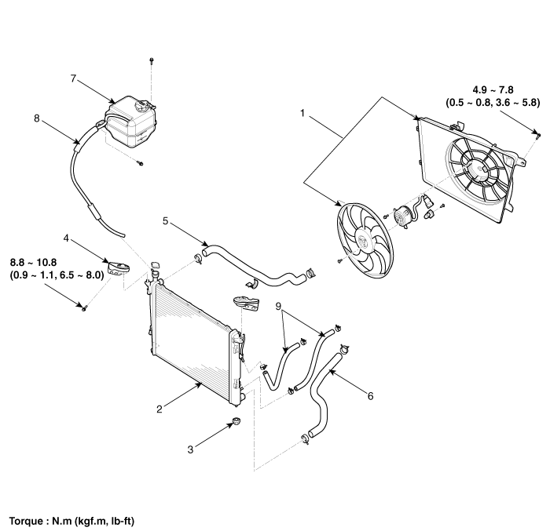

# Kia Sportage: Radiador: Componentes e Localização dos Componentes

[Home](../../index.md) / [Manual de Serviço e Reparo do Kia Sportage SL](../sportage-482.md) / [Sistema Mecânico do Motor](sportage-484.md) / [Sistema de Refrigeração](sportage-503.md) / Radiador: Componentes e Localização dos Componentes

## Componentes

| 1. Conjunto do ventilador de resfriamento 2. Conjunto do radiador 3. Isolador de montagem 4. Suporte de montagem do radiador 5. Suporte do radiador superior | 6. Suporte do radiador inferior 7. Tanque de reservatório 8. Mangote de descarga 9. Mangotes do resfriador do líquido de transmissão automática (ATF) |
| --- | --- |
