# Kia Sportage: Radiador: Procedimentos de Reparo

[Home](../../index.md) / [Manual de Serviço e Reparo do Kia Sportage SL](../sportage-482.md) / [Sistema Mecânico do Motor](sportage-484.md) / [Sistema de Refrigeração](sportage-503.md) / Procedimentos de Reparo do Radiador

## Inspeção

Teste da Tampa do Radiador

1. Remova a tampa do radiador, umedeca-a com líquido de refrigeração do motor e, em seguida, instale-a em um teste de pressão.

   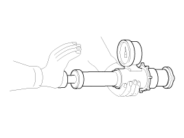

2. Aplique uma pressão de 93,16 ~ 122,58kPa (0,95 ~ 1,25kgf/cm?, 13,51 ~ 17,78psi).

3. Verifique se houve uma queda na pressão.

4. Se a pressão diminuir, substitua a tampa.

Teste de Perda de Líquido de Refrigeração

1. Aguarde que o motor esfrie, depois remova cuidadosamente a tampa do radiador e preencha o radiador com líquido de refrigeração do motor, em seguida, instale-a no teste de pressão (A).

   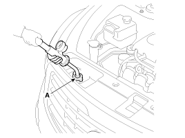

2. Aplique um teste de pressão ao radiador e aplique uma pressão de 93,16 ~ 122,58kPa (0,95 ~ 1,25kgf/cm?, 13,51 ~ 17,78psi).

3. Inspeção para vazamentos de líquido de refrigeração e queda de pressão.

4. Remova o teste de pressão e reinstale a tampa do radiador.

   > **Nota**
   >
   > - Verifique se há óleo do motor no líquido de refrigeração e/ou líquido de refrigeração no óleo do motor.

## Remoção e Instalação

1. Desconecte as terminais do bocal da bateria. (Consulte a montagem do motor e da transmissão neste grupo)

2. Remova a montagem do limpador de carburante e as mangas de entrada/saída do intercooler. (Consulte a montagem do motor e da transmissão neste grupo)

3. Remova a bateria e a traseira da bateria. (Consulte a montagem do motor e da transmissão neste grupo)

4. Remova a guarda superior do radiador (A). (Consulte o grupo BD)

   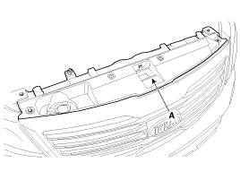

5. Remova a cobertura superior do radiador (A).

   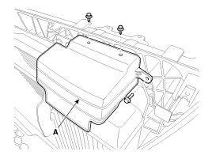

6. Remova o suporte do buzina (A). (Consulte o grupo BE)

7. Remova a guarda frontal do radiador (B).

8. Separe o condensador (C) do radiador.

   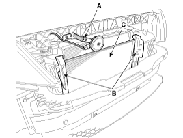

9. Desconecte a mangueira de derrame (A) do radiador.

   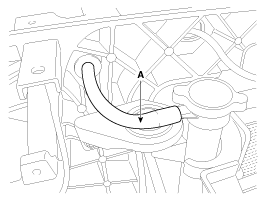

10. Remova as montantes de fixação do radiador (A).

    ```
    Torque de aperto:
    8,8 ~ 10,8 N.m (0,9 ~ 1,1 kgf.m, 6,5 ~ 8,0 lb-ft)
    ```

   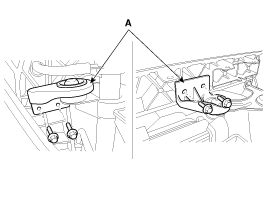

11. Desconecte o conector do motor do ventilador (A).

   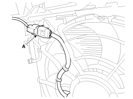

12. Remova a montagem do ventilador de resfriamento (A).

    ```
    Torque de aperto:
    4,9 ~ 7,8 N.m (0,5 ~ 0,8 kgf.m, 3,6 ~ 5,8 lb-ft)
    ```

   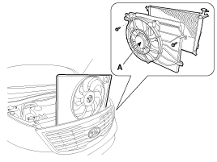

13. Remova a capa inferior. (Consulte a montagem do motor e da transmissão neste grupo)

14. Desafine o plug de drenagem e drenagem do líquido de refrigeração do motor. Remova a tampa do radiador para drenar com rapidez.

15. Desconecte as mangueiras de entrada superior (A) e inferior (B) do radiador.

   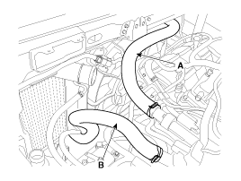

16. Desconecte as mangueiras do resfriador do ATF. (Consulte o grupo AT)

   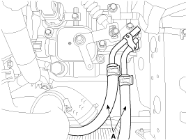

17. Remova a montagem do radiador (A).

   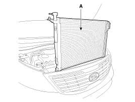

18. A instalação deve ser feita na ordem inversa da remoção.

19. Preencha o radiador com líquido de refrigeração e verifique se há vazamentos.

   > **Nota**
   >
   > - Descarte o ar do sistema de refrigeração.
   > - Inicie o motor e deixe-o funcionar até aquecer. (Até que o ventilador de resfriamento operar 3 ou 4 vezes.)
   > - Desligue o motor. Verifique o nível do líquido de refrigeração e adicione líquido se necessário. Isto permitirá que o ar preso seja removido do sistema de refrigeração.
   > - Coloque a tampa do radiador apertada, depois reinicie o motor e verifique se há vazamentos.
