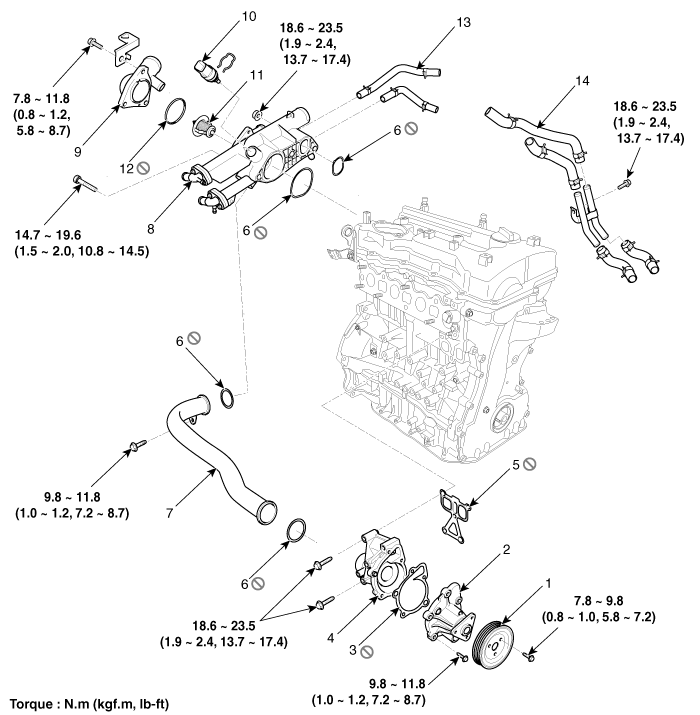

# Kia Sportage: Bomba d'água: Componentes e Localização dos Componentes

[Home](../../index.md) / [Manual de Serviço e Reparo do Kia Sportage SL](../sportage-482.md) / [Sistema Mecânico do Motor](sportage-484.md) / [Sistema de Refrigeração](sportage-503.md) / Componentes e Localização da Bomba d'Água

## Componentes

| 1. Pulley da bomba d'água 2. Sub-assembly da bomba d'água 3. Selo da bomba d'água 4. Cobertura da bomba d'água 5. Selo da cobertura da bomba d'água | 6. Aro de borracha 7. Tubo de entrada de água 8. Montagem de controle de temperatura da água 9. Conector de entrada de água 10. Sensor de temperatura do líquido de refrigeração do motor | 11. Termostato 12. Selo do termostato 13. Mangotes de refrigeração do corpo de comando de válvula de abertura da admissão 14. Mangotes de refrigeração do radiador de óleo |
