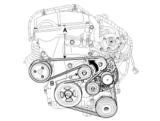
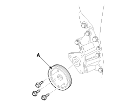
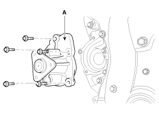
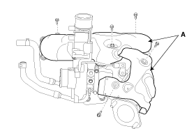
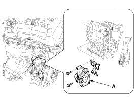
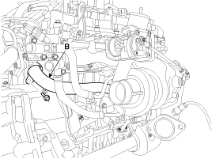

# Kia Sportage: Bomba d'água: Procedimentos de reparo

[Home](../../index.md) / [Manual de Serviço e Reparo do Kia Sportage SL](../sportage-482.md) / [Sistema Mecânico do Motor](sportage-484.md) / [Sistema de Refrigeração](sportage-503.md) / Procedimentos de reparo da bomba d'água

## Remoção e Instalação

1. Desloque o chumbo de descarga e, em seguida, descarte o líquido de refrigeração do motor. Remova a tampa do radiador para descarregar com rapidez.

2. Remova a correia (A) após girar o regulador de tensão da correia (B) no sentido horário.

   

3. Remova a engrenagem da bomba d'água (A).

   ```
   Torque de aperto :
   7,8 ~ 9,8N.m (0,8 ~ 1,0kgf.m, 5,8 ~ 7,2lb-ft)
   ```

   

4. Remova a montagem da bomba d'água (A) com a borracha de vedação.

   ```
   Torque de aperto :
   9,8 ~ 11,8N.m (1,0 ~ 1,2kgf.m, 7,2 ~ 8,7lb-ft)
   ```

   

5. Remova os protetores térmicos do escape (A).

   ```
   Torque de aperto :
   7,8 ~ 11,8N.m (0,8 ~ 1,2kgf.m, 5,8 ~ 8,7lb-ft)
   ```

   

6. Remova a cobertura da bomba d'água (A) com a borracha de vedação e a tubulação de entrada de água (B).

   ```
   Torque de aperto :
   18,6 ~ 23,5N.m (1,9 ~ 2,4kgf.m, 13,7 ~ 17,4lb-ft)
   ```

   

   ```
   Torque de aperto :
   9,8 ~ 11,8N.m (1,0 ~ 1,2kgf.m, 7,2 ~ 8,7lb-ft)
   ```

   

7. A instalação deve ser feita na ordem inversa da remoção, com uma nova borracha de vedação da bomba d'água.

8. Preencha o líquido de refrigeração do motor.

9. Inicie o motor e verifique se há vazamentos.

10. Verifique novamente o nível do líquido de refrigeração.

## Inspeção

1. Verifique cada parte para rachaduras, danos ou desgaste, e substitua a montagem da bomba d'água se necessário.

2. Verifique o rolamento para danos, ruídos anormais e rotação lenta, e substitua a montagem da bomba d'água se necessário.

3. Verifique para vazamentos de líquido de refrigeração. Se o líquido de refrigeração estiver vazando de um orifício, a vedação está defeituosa. Substitua a montagem da bomba d'água.

   > **Nota**
   >
   > - Uma pequena quantidade de "vazamento" do orifício de descarga é normal.
