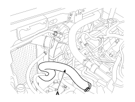
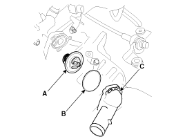
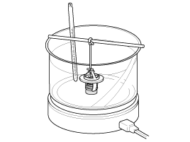

# Kia Sportage: Termostato: Procedimentos de reparo

[Home](../../index.md) / [Manual de Serviço e Reparo do Kia Sportage SL](../sportage-482.md) / [Sistema Mecânico do Motor](sportage-484.md) / [Sistema de Refrigeração](sportage-503.md) / Procedimentos de reparo do termostato

## Remoção e Instalação

> **Observação**
>
> - A desmontagem do termostato teria um efeito adverso, causando uma redução na eficiência de resfriamento. Não remova o termostato, mesmo se o motor tende a superaquecer.

1. Drenar o líquido de refrigeração do motor para que o nível esteja abaixo do termostato.

2. Desconectar a mangueira inferior do radiador (A).

   

3. Remover a conexão de entrada de água (C), selante (B) e termostato (A).

   ```
   Torque de aperto :
   7,8 ~ 11,8N.m (0,8 ~ 1,2kgf.m, 5,8 ~ 8,7lb-ft)
   ```

   

4. A instalação deve ser feita na ordem inversa da remoção.

   > **Cuidado**
   >
   > - Instale o termostato com a válvula de balanço voltada para cima.
   > - Ao montar o termostato, posicione o termostato na caixa com a projeção do termostato alinhada com a vagem da caixa e instale o selante e a conexão de entrada. Cuide para que o termostato não saia da vagem na caixa.

5. Preencher o líquido de refrigeração do motor.

6. Iniciar o motor e verificar vazamentos.

7. Revisar o nível do líquido de refrigeração.

## Inspeção

1. Immerger o termostato em água aquecida a mais de 95°C (203°F), então aquecer por pelo menos 3 minutos para verificar o movimento da válvula.

   

   > **Observação**
   >
   > - Não use água abaixo de 95°C (203°F).
   > - Não aqueça diretamente o termostato, pois isso pode danificá-lo.

2. Verificar a temperatura de abertura da válvula.

   ```
   Temperatura de abertura da válvula: 82 ± 1,5°C (179,6 ± 2,7°F)
   Temperatura de abertura completa: 95°C (203°F)
   ```

   Se a temperatura de abertura da válvula não for conforme especificado, substitua o termostato.

3. Verificar o movimento da válvula.

   ```
   Movimento da válvula: 8mm (0,3in.) ou mais a 95°C (203°F)
   ```

   Se o movimento da válvula não for conforme especificado, substitua o termostato.
