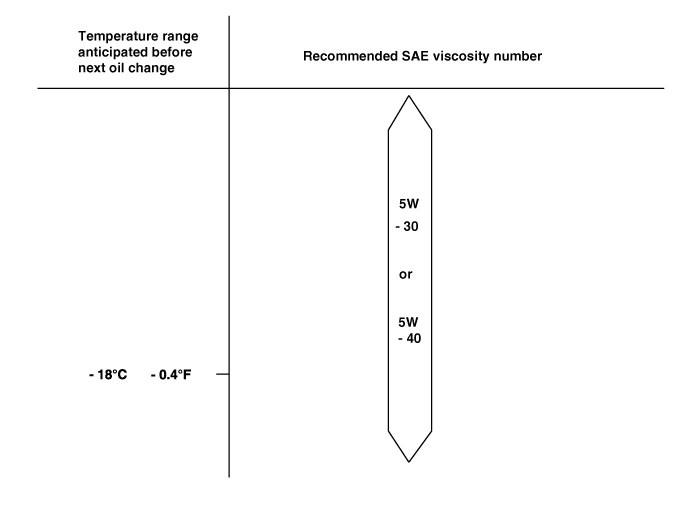

# Kia Sportage: Óleo do Motor: Procedimentos de Reparo

[Home](../../index.md) / [Manual de Serviço e Reparo do Kia Sportage SL](../sportage-482.md) / [Sistema Mecânico do Motor](sportage-484.md) / [Sistema de Lubrificação](sportage-513.md) / Procedimentos de Reparo do Óleo do Motor

## Troca de Óleo e Filtro

> **Cuidado**
>
> - O contato prolongado e repetido com óleo mineral pode remover os ácidos naturais da pele, causando secagem, irritação e dermatite. Além disso, o óleo de motor usado contém contaminantes potencialmente prejudiciais que podem causar câncer de pele.
> - Tenha cuidado para minimizar o contato da pele com óleo usado. Use roupas e luvas protetoras. Lave a pele com sabão e água ou use limpador de mãos sem água para remover qualquer óleo de motor usado. Não use gasolina, dissolventes ou solventes.
> - Para preservar o meio ambiente, o óleo de motor usado e o filtro de óleo usado devem ser descartados apenas em locais de descarte apropriados.

1. Estacione o carro em terreno nivelado.

   Inicie o motor e deixe-o aquecer.

2. Drenagem do óleo do motor.

   | (1) | Remova o tampão do aditivo de óleo. |
   | --- | --- |

   | (2) | Após levantar o carro, remova o parafuso de drenagem (A) e drenagem do óleo em um recipiente. |
   | --- | --- |

3. Troque o filtro de óleo (B).

   | (1) | Remova o filtro de óleo. |
   | --- | --- |

   | (2) | Verifique e limpe a superfície de instalação do filtro de óleo. |
   | --- | --- |

   | (3) | Verifique se o número de parte do novo filtro de óleo é o mesmo que o antigo. |
   | --- | --- |

   | (4) | Aplicar óleo de motor limpo na borracha do novo filtro de óleo. |
   | --- | --- |

   | (5) | Enrosque o filtro de óleo suavemente, e aperte até que a borracha entre em contato com a assento. |
   | --- | --- |

   ```
   Aperte com a torção abaixo.
   Torção de aperto :
   11,8 ~ 15,7N.m (1,2 ~ 1,6kgf.m, 8,7 ~ 11,6lb-ft)
   ```

4. Instale o parafuso de drenagem com uma nova borracha.

   ```
   Torção de aperto :
   34,3 ~ 44,1N.m (3,5 ~ 4,5kgf.m, 25,3 ~ 32,5lb-ft)
   ```

5. Preencha com novo óleo do motor, após remover o indicador do nível do óleo do motor.

   ```
   Capacidade :
   Total : 5,5 L (1,45 U.S.gal., 5,81 U.S.qt., 4,84 lmp.qt.)
   Pan do óleo : 4,2 L (1,11 U.S.gal., 4,44 U.S.qt., 3,70 lmp.qt.)
   Drenagem e recarga incluindo filtro de óleo :
   4,6 L (1,22 U.S.gal., 4,86 U.S.qt., 4,05 lmp.qt.)
   ```

6. Instale o tampão do aditivo de óleo.

7. Inicie o motor e verifique se há vazamentos de óleo e verifique o indicador do nível do óleo ou a luz para indicar a pressão do óleo.

8. Verifique novamente o nível do óleo do motor.

## Inspeção

1. Verifique a qualidade do óleo do motor.

   Verifique a deterioração do óleo, entrada d'água e descoloração ou afinamento. Se a qualidade for visivelmente ruim, troque o óleo.

2. Verifique o nível do óleo do motor.

   Após aquecimento do motor, pare o motor e aguarde 5 minutos. Em seguida, verifique o nível do óleo. O nível do óleo deve estar entre as marcas "L" e "F" no palito do nível. Se o nível estiver baixo, verifique se há vazamento e adicione óleo até a marca "F".

   > **Nota**
   >
   > - Não preencha com óleo do motor acima da marca "F".

Seleção do Óleo do Motor

Recomendação: 5W-30 ACEA A5 (Se não disponível, consulte a classificação recomendada API ou ILSAC)

Classificação API: SL, SM ou superior

Classificação ILSAC: GF3, GF4 ou superior

Classificação ACEA: A3 ou A5

Grado de viscosidade SAE: Consulte o número de viscosidade SAE recomendado



> **Nota**
>
> - Para o melhor desempenho e proteção máxima em todas as operações, selecione apenas aqueles lubrificantes que:
> - Satisfazam a exigência da classificação API ou ILSAC.
> - Tenham o número de grau SAE apropriado para a faixa de temperatura ambiente esperada.
> - Lubrificantes que não tenham tanto um número de grau SAE e uma classificação de serviço API ou ILSAC na embalagem não devem ser utilizados.
