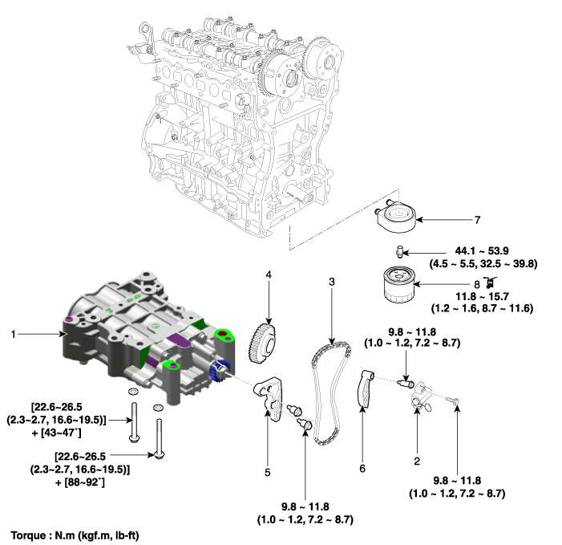

# Kia Sportage: Eixo de Balanceamento e Bomba de Óleo: Componentes e Localização dos Componentes

[Home](../../index.md) / [Manual de Serviço e Reparo do Kia Sportage SL](../sportage-482.md) / [Sistema Mecânico do Motor](sportage-484.md) / [Sistema de Lubrificação](sportage-513.md) / Eixo de Balanceamento e Bomba de Óleo: Componentes e Localização dos Componentes

## Componentes

| 1. Eixo de balanceamento e conjunto da bomba de óleo 2. Ajustador da tensão da corrente do eixo de balanceamento 3. Corrente do eixo de balanceamento 4. Rolamento do eixo de balanceamento | 5. Guiador da corrente do eixo de balanceamento 6. Braço do ajustador da tensão da corrente do eixo de balanceamento 7. Resfriador de óleo 8. Filtro de óleo |
