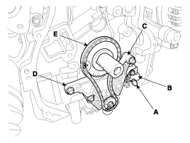
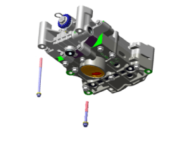
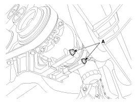
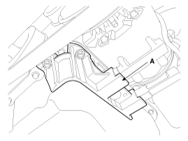
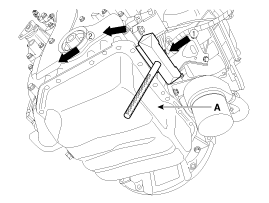
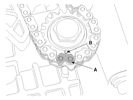
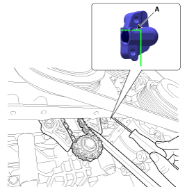
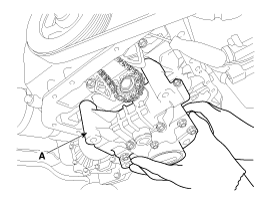
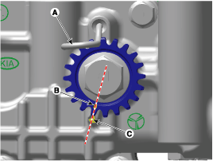
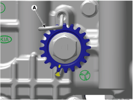

# Kia Sportage: Balance Shaft & Oil Pump: Procedimentos de Reparo

[Home](../../index.md) / [Manual de Serviço e Reparo do Kia Sportage SL](../sportage-482.md) / [Sistema Mecânico do Motor](sportage-484.md) / [Sistema de Lubrificação](sportage-513.md) / Procedimentos de Reparo do Balance Shaft & Oil Pump

## Remoção

Sistema da Cadeia do Balance Shaft Module (BSM)

1. Remova a corrente do timing.

   (Consulte o Sistema de Timing nesta seção)

2. Instale um pinho de parada (A) após comprimir o amortecedor da tensão da cadeia do balance shaft.

3. Remova o amortecedor da tensão da cadeia do balance shaft (B).

4. Remova o braço do amortecedor da tensão da cadeia do balance shaft (C).

5. Remova a guia da cadeia do balance shaft (D).

6. Remova a cadeia do balance shaft (E).

   

7. Remova o BSM (Balance Shaft Module) após remover os parafusos de montagem do BSM.

   

   > **Nota**
   >
   > - Não desmonte o BSM (Balance Shaft Module).

BSM (Balance Shaft Module)

1. Remova o cobrebaixo.

2. Remova a roda dianteira direita (RH).

3. Descarte a óleo do motor.

4. Remova os parafusos de montagem do compressor de ar condicionado inferior (A).

   

5. Remova o suporte do compressor de ar condicionado (A).

   

6. Remova a pan da óleo após remover os parafusos.

   Insira a lâmina do SST (09215-3C000) entre o quadro de ladeira e a pan. Corte o selante aplicado e remova a pan inferior.

   

   > **Nota**
   >
   > - Insira o SST entre a pan e o quadro de ladeira, batendo-o com um martelo de plástico na direção do seta.
   > - Depois de batê-lo com um martelo de plástico na direção do seta mais do que 2/3 do contorno da pan, remova-o do quadro de ladeira.
   > - Não vire apan abruptamente sem batê-la. Isso pode resultar em danos ao SST.

7. Defina o cilindro 1 no TDC/compressão.

   | (1) | Vire o pulley do crânio e alinhe a sua vagem com a marca "T" da capa da corrente do timing. |
   | --- | --- |

   | (2) | Confirme que a marca do timing do sprocket do BSM (A) está alinhada visualmente com o centro da fenda de timing do alinhamento do sprocket (B). |
   | --- | --- |

8. Faça um marco na corrente do timing (A) correspondente à marca do timing do sprocket (B).

   

9. Insira um pinho de parada (A) no orifício no amortecedor após comprimir o pistão do amortecedor da tensão da cadeia do balance shaft.

   

10. Remova os parafusos de montagem do BSM.

    

11. Remova o BSM (Balance Shaft Module) (A) ao retirar a cadeia do sprocket.

    

    > **Nota**
    >
    > - Não desmonte o BSM (Balance Shaft Module).

## Instalação

BSM (Balance Shaft Module) Chain System

1. O chave do eixo do crankshaft deve estar alinhado com a face de encaixe da tampa do principal. Como resultado, o pistão do cilindro 1 está posicionado no topo do centro de compressão.

2. Insira um pinho de parada (A) no BSM para manter a corrente no posicionamento de referência com o sinal de sincronização (B) alinhado com o sinal de sincronização (C).

   

   > **Aviso**
   >
   > - O novo BSM já foi instalado com um pinho de parada no posicionamento de referência.

3. Instale o BSM (Balance Shaft Module).

   | (1) | Aperte os parafusos com torque de assentamento 29.4 N.m (3.0kgf.m, 21.7 lb-ft) e, em seguida, solte os parafusos. |
   | --- | --- |

   ```
   Usando o SST (Adaptador de Torque e Ângulo, 09221-4A000), aperte os parafusos com o torque e o ângulo especificados.
   Torque de aperto
   Parafusos (A) (M9x181.5) : 22.6 ~ 26.5 N.m (2.3 ~ 2.7 kgf.m, 16.6 ~ 19.5 lb-ft) + 88° ~ 92°
   Parafusos (B) (M9x100) : 22.6 ~ 26.5 N.m (2.3 ~ 2.7 kgf.m, 16.6 ~ 19.5 lb-ft) + 43° ~ 47°
   Não reutilize os parafusos do BSM.
   ```

4. Instale a corrente do balance shaft (E).

   > **Nota**
   >
   > - Os sinais de sincronização do sprocket do BSM e do sprocket do eixo do crankshaft devem estar alinhados com os sinais de sincronização (ligação de cores) da corrente do balance shaft.

5. Instale o guia da corrente do balance shaft (D).

   ```
   Torque de aperto :
   9.8 ~ 11.8 N.m (1.0 ~ 1.2 kgf.m, 7.2 ~ 8.7 lb-ft)
   ```

6. Instale o braço do aparelho de tensão da corrente do balance shaft (C).

   ```
   Torque de aperto :
   9.8 ~ 11.8 N.m (1.0 ~ 1.2 kgf.m, 7.2 ~ 8.7 lb-ft)
   ```

7. Instale o aparelho de tensão da corrente do balance shaft (B) e remova o pinho de parada (A).

   ```
   Torque de aperto :
   9.8 ~ 11.8 N.m (1.0 ~ 1.2 kgf.m, 7.2 ~ 8.7 lb-ft)
   ```

   

8. Remova o pinho de parada (A) do BSM.

   

9. Após girar o eixo do crankshaft 2 revoluções no sentido regular (horário, visto do lado frontal), confirme que o sinal de sincronização e o sinal de notação estão alinhados no posicionamento de referência.

10. Instale as outras partes na ordem inversa à remoção.

BSM (Balance Shaft Module)

1. Insira um pinho de parada (A) no BSM para manter a corrente no posicionamento de referência com o sinal de sincronização (B) alinhado com o sinal de notação (C).

   

   > **Aviso**
   >
   > - O novo BSM já foi instalado com um pinho de parada no posicionamento de referência.

2. Instale o BSM (Balance Shaft Module) (A).

   

   > **Nota**
   >
   > - O sinal de sincronização do sprocket do BSM deve estar alinhado com o sinal pintado da corrente de sincronização.

   

3. Instale os parafusos de montagem do BSM.

   | (1) | Aperte os parafusos com torque de assentamento 29.4 N.m (3.0kgf.m, 21.7 lb-ft) e, em seguida, solte os parafusos. |
   | --- | --- |

   ```

Usando o SST (Adaptador de Torque Angulado, 09221-4A000), apertar os parafusos com a torque e o ângulo especificados.
   Torque de aperto
   Parafusos (A) (M9x181.5) : 22.6 ~ 26.5 N.m (2.3 ~ 2.7 kgf.m, 16.6 ~ 19.5 lb-ft) + 88° ~ 92°
   Parafusos (B) (M9x100) : 22.6 ~ 26.5 N.m (2.3 ~ 2.7 kgf.m, 16.6 ~ 19.5 lb-ft) + 43° ~ 47°
   Não reutilizar os parafusos BSM.

4. Remova a viga de parada (A) do BSM.

   

5. Remova a viga de parada (A) do amortecedor.

   

6. Confirme a marca de tempo do BSM.

   | (1) | Vire o buge e alinhe a vã desta com a marca de tempo "T" da cobertura da corrente de tempo. |
   | --- | --- |

   | (2) | Confirme que a marca de tempo do rolete (A) está alinhada visualmente com o centro da vã de alinhamento do tempo (B) adjacente. |
   | --- | --- |

7. Instale a vaso de óleo.

   | (1) | Usando um raspador de gasket, remova todo o material antigo de selagem das superfícies do gasket. |
   | --- | --- |

   ```
   Antes de montar a vaso de óleo, deve-se aplicar selante líquido Loctite 5900H, Threebond 1217H ou equivalente nas superfícies do gasket.
   A montagem deve ser realizada dentro de 5 minutos após a aplicação do selante.
   Largura da cinta: 2.5 mm (0.10 in.)
   Ao aplicar o selante gasket, não deve haver projeção do selante para dentro do interior do vaso de óleo.
   Para prevenir a vazão de óleo, aplique o selante gasket nas fendas internas dos orifícios dos parafusos.
   ```

   ```
   Instale a vaso de óleo (A). Ajuste os parafusos uniformemente em várias passadas.
   Torque de aperto
   Parafusos B (M9) : 26.5 ~ 30.4 N.m (2.7 ~ 3.1 kgf.m, 19.5 ~ 22.4 lb-ft)
   Parafusos C (M6) : 9.8 ~ 11.8 N.m (1.0 ~ 1.2 kgf.m, 7.2 ~ 8.7 lb-ft)
   Após a montagem, aguarde pelo menos 30 minutos antes de preencher o motor com óleo.
   Sempre use um novo gasket do plug de drenagem.
   ```

8. Instale o suporte do compressor de ar condicionado (A).

   ```
   Torque de aperto :
   19.6 ~ 23.5 N.m (2.0 ~ 2.4 kgf.m, 14.5 ~ 17.4 lb-ft)
   ```

   

9. Remova os parafusos de montagem inferior do compressor de ar condicionado (A).

   ```
   Torque de aperto :
   19.6 ~ 24.5 N.m (2.0 ~ 2.5 kgf.m, 14.5 ~ 18.1 lb-ft)
   ```

   

10. Refilone com óleo do motor.

11. Instale a roda dianteira direita.

12. Instale o cobertor inferior.
