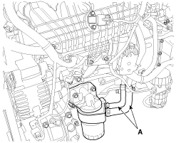
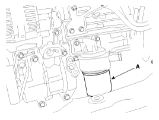
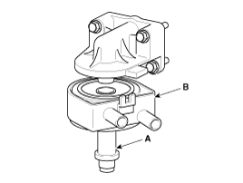
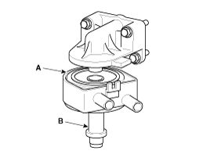
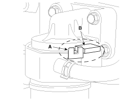
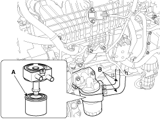

# Kia Sportage: Resfriador de Óleo: Procedimentos de Reparo

[Home](../../index.md) / [Manual de Serviço e Reparo do Kia Sportage SL](../sportage-482.md) / [Sistema Mecânico do Motor](sportage-484.md) / [Sistema de Lubrificação](sportage-513.md) / Procedimentos de Reparo do Resfriador de Óleo

## Remoção

1. Desloque o buge de drenagem e drenagem do líquido de resfriamento. Remova a tampa do radiador para acelerar a drenagem.

2. Desconecte as mangueiras de resfriamento do cooler de óleo (A).

   

3. Remova o filtro de óleo (A).

   

4. Desloque o parafuso de montagem (A) e remova a montagem do cooler de óleo (B).

   

## Instalação

1. Aplicar uma fina camada de óleo de motor na superfície de vedação do cooler de óleo (A), e então instale o cooler de óleo com parafuso fixador (B).

   ```
   Torque de aperto:
   44.1 ~ 53.9 N.m (4.5 ~ 5.5 kgf.m, 32.5 ~ 39.8 lb-ft)
   ```

   

   > **Cuidado**
   >
   > - Posicione a posição fixa do parafuso de parada do cooler de óleo (A) onde o cooler de óleo resiste na parada do quadro de ladeira (B).

   

2. Aplicar uma fina camada de óleo de motor na superfície de vedação do filtro de óleo (A), e então instale o filtro de óleo.

   ```
   Torque de aperto:
   11.8 ~ 15.7 N.m (1.2 ~ 1.6 kgf.m, 8.7 ~ 11.6 lb-ft)
   ```

3. Conecte as mangueiras de resfriamento do cooler de óleo (B).

   

4. Preencha o radiador com líquido de resfriamento e verifique por vazamentos.
