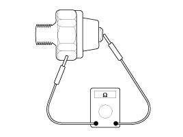
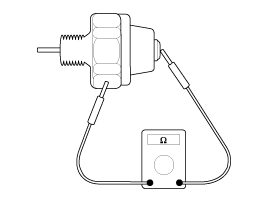

# Kia Sportage: Interruptor de Pressão do Óleo: Procedimentos de Reparo

[Home](../../index.md) / [Manual de Serviço e Reparo do Kia Sportage SL](../sportage-482.md) / [Sistema Mecânico do Motor](sportage-484.md) / [Sistema de Lubrificação](sportage-513.md) / Procedimentos de Reparo do Interruptor de Pressão do Óleo

## Inspeção

1. Verifique a continuidade entre o terminal e o corpo com um ohmmetro.

   Se não houver continuidade, substitua o interruptor de pressão do óleo.

   

2. Verifique a continuidade entre o terminal e o corpo quando
   o fio fino for pressionado. Se houver continuidade mesmo quando o fio fino
   for pressionado, substitua o interruptor.

3. Se não houver continuidade quando uma pressão de 50kPa (0,50kgf/cm?, 7,25psi) for aplicada através do orifício do óleo, o interruptor está operando corretamente.

   Verifique a presença de vazamento de ar. Se houver vazamento de ar, o diapasão está quebrado. Substitua-o.

   
