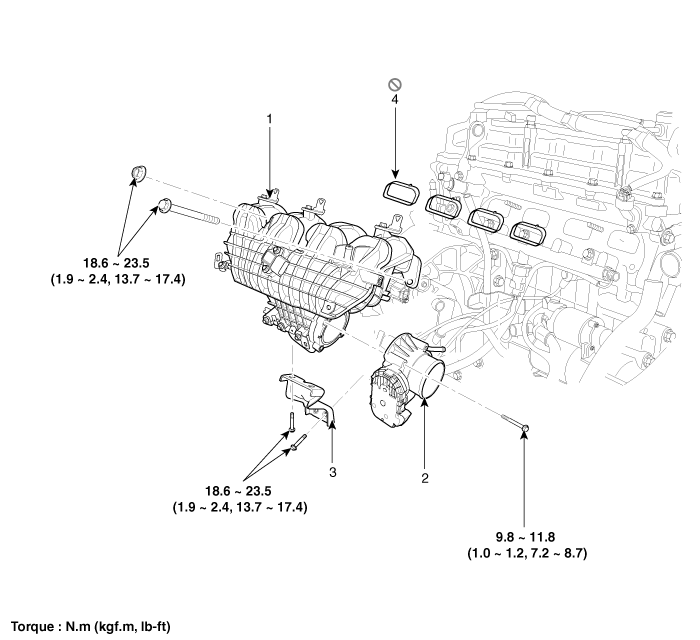

# Kia Sportage: Manifoldo de Admissão: Componentes e Localização dos Componentes

[Home](../../index.md) / [Manual de Serviço e Reparo do Kia Sportage SL](../sportage-482.md) / [Sistema Mecânico do Motor](sportage-484.md) / [Sistema de Admissão e Exaustão](sportage-519.md) / Manifoldo de Admissão: Componentes e Localização dos Componentes

## Componentes

| 1. Manifoldo de admissão 2. Corpo de acelerador eletrônico | 3. Manifoldo de admissão (manifold stay) 4. Selo de manifolodo de admissão |
| --- | --- |
