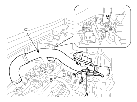
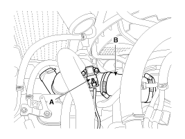
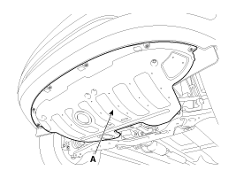
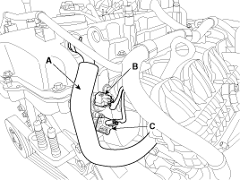
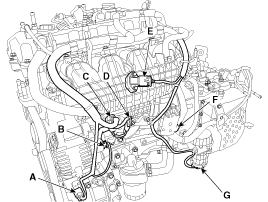
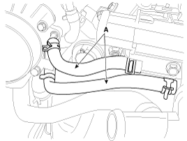
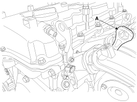
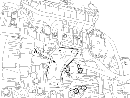
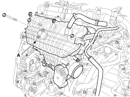
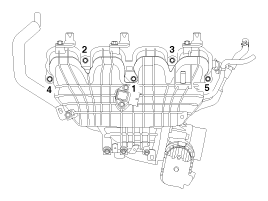

# Kia Sportage: Manifoldo de Admissão: Procedimentos de Reparo

[Home](../../index.md) / [Manual de Serviço e Reparo do Kia Sportage SL](../sportage-482.md) / [Sistema Mecânico do Motor](sportage-484.md) / [Sistema de Admissão e Exaustão](sportage-519.md) / Manifoldo de Admissão: Procedimentos de Reparo

## Remoção e Instalação

1. Remova a capa do motor.

2. Desconecte o terminal negativo da bateria (A).

   ```
   Torque de aperto
   4,0 ~ 6,0 N.m (0,4 ~ 0,6 kgf.m, 3,0 ~ 4,4 lb-ft)
   ```

   

3. Remova a montagem do limpador de ar.

   | (1) | Remova o dutamento de ar (A). |
   | --- | --- |

   | (2) | Desconecte o tubo de respiração (B), o tubo de recirculação (C) e o tubo de vácuo do potenciador de freio (D). |
   | --- | --- |

   ```
   Desconecte o tubo de entrada de ar (E) e, em seguida, remova a montagem do limpador de ar (F).
   Torque de aperto
   Parafuso do elástico de amarração:
   2,9 ~ 4,9 N.m (0,3 ~ 0,5 kgf.m, 2,2 ~ 3,6 lb-ft)
   Parafusos dos parafusos da montagem do limpador de ar:
   7,8 ~ 9,8 N.m (0,8 ~ 1,0 kgf.m, 5,8 ~ 7,2 lb-ft)
   ```

4. Desconecte o conector do válvula de recirculação (A) e o
   tubo de vácuo (B), e, em seguida, remova a montagem do intercooler de entrada e tubos (C).

   ```
   Torque de aperto
   Parafuso do elástico de amarração:
   4,9 ~ 6,9 N.m (0,5 ~ 0,7 kgf.m, 3,6 ~ 5,1 lb-ft)
   Parafuso de montagem do tubo:
   14,7 ~ 19,6 N.m (1,5 ~ 2,0 kgf.m, 10,8 ~ 14,5 lb-ft)
   ```

   

5. Desconecte o conector do sensor de pressão de boost (A) e, em seguida, remova a montagem do intercooler de saída e tubos (B).

   ```
   Torque de aperto
   4,9 ~ 6,9 N.m (0,5 ~ 0,7 kgf.m, 3,6 ~ 5,1 lb-ft)
   ```

   

6. Remova a cobertura inferior (A).

   ```
   Torque de aperto:
   9,8 ~ 11,8 N.m (1,0 ~ 1,2 kgf.m, 7,2 ~ 8,7 lb-ft)
   ```

   

7. Solte o plug de drenagem e drenagem do líquido do motor. Remova a tampa do radiador para drenagem com rapidez. (Consulte o sistema de resfriamento nesta seção)

8. Desconecte o tubo de PCV (A), o conector do OCV (Valvula de controle de óleo) (B) e o conector do sensor de temperatura do óleo (C).

   

9. Desconecte o conector do interruptor do compressor de ar condicionado (A), o conector do alternador (B), o conector do sensor de pressão do óleo (OPS) (C) & conector do extensor do injetor (C), o conector do sensor de estalo (D), o conector do sensor de pressão absoluta do manifólio (MAPS) & sensor de temperatura do ar de entrada (IATS) (E), o conector do controle de acelerador eletrônico (ETC) (F) e o conector do bomba de vácuo (G).

   

10. Desconecte as mangueiras de ar de refrigeração do corpo de comando (A).

   

11. Remova o indicador de nível de óleo (A).

   

12. Remova o suporte do manifólio de entrada (A).

   ```
   Torque de aperto:
   18,6 ~ 23,5 N.m (1,9 ~ 2,4 kgf.m, 13,7 ~ 17,4 lb-ft)
   ```

   

13. Remova o manifólio de entrada (A) após desconectar as mangueiras de vácuo.

   ```
   Torque de aperto:
   18,6 ~ 23,5 N.m (1,9 ~ 2,4 kgf.m, 13,7 ~ 17,4 lb-ft)
   ```

   

   > **Nota**
   >
   > - Ao instalar, substitua por novos selos.

   Ao instalar o manifólio de entrada, aperte os parafusos e

parafusos e螺母先预紧固，然后再按照规定扭矩和所示顺序拧紧螺栓和螺母。



14. A instalação é na ordem inversa do remoção.
