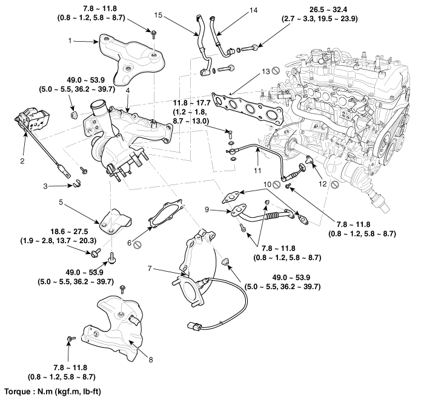

# Manifold de Exaustão — Componentes e localização

[Home](../../index.md) / [Manual de Serviço e Reparo](../sportage-482.md) / [Sistema Mecânico do Motor](sportage-484.md) / [Sistema de Admissão e Exaustão](sportage-519.md) / Componentes e localização

## Diagrama

## Legenda

| Nº | Componente |
| --- | --- |
| 1 | Protetor auditivo |
| 2 | EWGA (Atuador Elétrico de Porta de Resíduos) |
| 3 | Anel C |
| 4 | Módulo do manifold turbo |
| 5 | Aço de manutenção do turbo |
| 6 | Selo adaptador do turbo |
| 7 | Adaptador do turbo |
| 8 | Proteção térmica do adaptador do turbo |
| 9 | Assemblagem da tubulação de drenagem de óleo |
| 10 | Selo de drenagem de óleo do turbo |
| 11 | Assemblagem da tubulação de alimentação de óleo & mangote |
| 12 | Selo de drenagem de óleo |
| 13 | Selo de manifold de exaustão |
| 14 | Mangote de alimentação de água do turbo |
| 15 | Mangote de drenagem de água do turbo |
