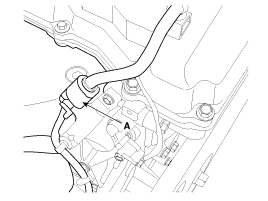
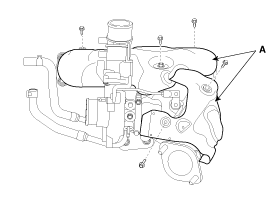
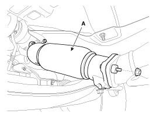
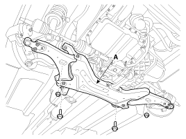
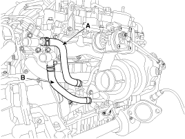
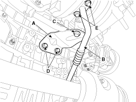
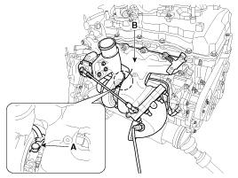
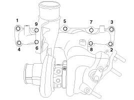
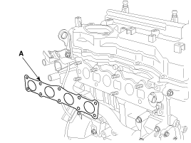

# Kia Sportage: Manifoldo de Exaustão: Procedimentos de Reparo

[Home](../../index.md) / [Manual de Serviço e Reparo do Kia Sportage SL](../sportage-482.md) / [Sistema Mecânico do Motor](sportage-484.md) / [Sistema de Admissão e Exaustão](sportage-519.md) / Manifoldo de Exaustão: Procedimentos de Reparo

## Remoção e Instalação

1. Remova a capa do motor.

2. Desconecte o terminal negativo da bateria (A).

   ```
   Torque de aperto
   4,0 ~ 6,0 N.m (0,4 ~ 0,6 kgf.m, 3,0 ~ 4,4 lb-ft)
   ```

   

3. Desconecte o conectador do sensor de oxigênio (A).

   

4. Remova os protetores térmicos do manifold de escape (A).

   ```
   Torque de aperto :
   7,8 ~ 11,8 N.m (0,8 ~ 1,2 kgf.m, 5,8 ~ 8,7 lb-ft)
   ```

   

   > **Cuidado**
   >
   > - Verifique se o motor está frio o suficiente para trabalhar.

5. Remova o silencioso frontal (A).

   ```
   Torque de aperto:
   39,2 ~ 58,8 N.m (4,0 ~ 6,0 kgf.m, 28,9 ~ 43,4 lb-ft)
   ```

   

6. Suporte o sub quadro (A) com um carregador de chão, e então remova as parafusos e parafusos de fixação do sub quadro.

   ```
   Torque de aperto:
   176,5 ~ 196,1 N.m (18,0 ~ 20,0 kgf.m, 130,2 ~ 144,7 lb-ft)
   ```

   

   > **Nota**
   >
   > - Após remover o parafuso de fixação do sub quadro, a unidade do motor e do transmissor podem cair para baixo, então suporte-os seguramente com um carregador de chão.
   > - Verifique se as mangueiras e conectores estão desconectados antes de remover a unidade do motor e do transmissor.

7. Desconecte a mangueira de alimentação de água do turbocharger (A) e a mangueira de drenagem de água (B).

   

8. Remova o suporte do turbocharger (A) e, em seguida, desconecte a mangueira de drenagem de óleo (B) e o selo.

   ```
   Torque de aperto :
   Parafusos (C) :18,6 ~ 27,5 N.m (1,9 ~ 2,8 kgf.m, 13,7 ~ 20,3 lb-ft)
   Parafusos (D) : 49,0 ~ 53,9 N.m (5,0 ~ 5,5 kgf.m, 36,2 ~ 39,8 lb-ft)
   Parafusos (E) : 7,8 ~ 11,8 N.m (0,8 ~ 1,2 kgf.m, 5,8 ~ 8,7 lb-ft)
   ```

   

   > **Nota**
   >
   > - Ao instalar, limpe a superfície do selo e substitua o selo da mangueira de drenagem de óleo por um novo.

9. Desconecte a mangueira de alimentação de óleo (A) e, em seguida, remova o módulo do manifold do turbocharger (B).

   ```
   Torque de aperto
   Mangueira de alimentação de óleo (A) eye bolt:
   11,8 ~ 17,7 N.m (1,2 ~ 1,8 kgf.m, 8,7 ~ 13,0 lb-ft)
   Nós do módulo do manifold do turbocharger (B):
   49,0 ~ 53,9 N.m (5,0 ~ 5,5 kgf.m, 36,2 ~ 39,7 lb-ft)
   ```

   

   > **Cuidado**
   >
   > - Ao instalar a mangueira de alimentação de óleo e a mangueira, certifique-se de que o tampão (A) não toque na caixa do compressor.
   > - Cuide para não dobrar ou comprimir a mangueira e a mangueira.

   > **Nota**
   >
   > - Ao instalar, certifique-se de que os anéis de óleo dos parafusos do olho estejam completamente instalados em ambos os orifícios da mangueira de alimentação de óleo.

   > **Nota**
   >
   > - Ao instalar, substitua o selo.

   Ao instalar o módulo do manifold do turbocharger, aperte os nós com torque pré-definido primeiro, e então aperte os nós com o torque especificado na sequência mostrada.

   

10. Remova o selo do módulo do manifold do turbocharger (A).

   

11. A instalação deve ser feita na ordem inversa da remoção.

   > **Nota**

> - Sempre use o novo módulo do manifold turbo e as borrachas de vedação dos parafusos do turbo adapter quando for substituí-lo.
> - Sempre use novos parafusos do turbocharger e parafusos do manifold de escape quando estes forem removidos.
> - Preste atenção se a mangueira e o tubo de alimentação de óleo e sua montagem estão interferindo com o manifold turbo ou com qualquer outra peça circundante.
> - Se a mangueira e o tubo de alimentação de óleo estiverem danificados, o óleo do motor não será suprido de maneira suficiente ao turbocharger, o que pode danificá-lo. Se a mangueira e o tubo de drenagem de óleo estiverem danificados e obstruídos, o óleo do motor não será drenado adequadamente, o que pode causar vazamentos do turbocharger. Cuide para que a mangueira e o tubo de alimentação de óleo não sejam danificados (torcidos, comprimidos, rasgados ou rachados).
