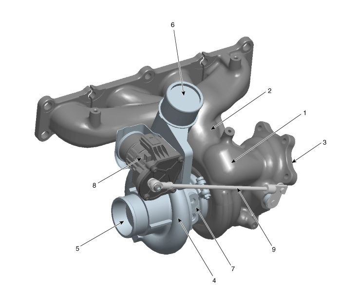

# Turbo Charger — Componentes e localização

[Home](../../index.md) / [Manual de Serviço e Reparo](../sportage-482.md) / [Sistema Mecânico do Motor](sportage-484.md) / [Sistema de Admissão e Exaustão](sportage-519.md) / Componentes e localização

## Diagrama

## Legenda

| Nº | Componente |
| --- | --- |
| 1 | Caixa de Turbina |
| 2 | Entrada de Turbina |
| 3 | Saída de Turbina |
| 4 | Caixa de Compressor |
| 5 | Entrada de Compressor |
| 6 | Saída de Compressor |
| 7 | Caixa Central |
| 8 | EWGA (Atuador Elétrico de Válvula de Descarga de Resíduos) |
| 9 | Barrilha de Atuador |
