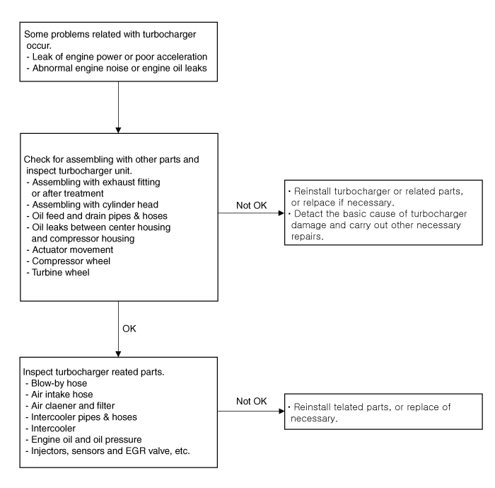

# Kia Sportage: Turbo Charger: Procedimentos de Reparo

[Início](../../index.md) / [Manual de Serviço e Reparo do Kia Sportage SL](../sportage-482.md) / [Sistema Mecânico do Motor](sportage-484.md) / [Sistema de Admissão e Exaustão](sportage-519.md) / Procedimentos de Reparo do Turbo Charger

## Inspeção no Veículo

Fluxo de Diagnóstico do Turbocharger

Se ocorrer qualquer problema relacionado ao turbocharger, como falta de potência do motor, aceleração fraca, ruído do motor anormal ou vazamento de óleo, verifique o turbocharger conforme o procedimento a seguir.

1. Verifique a montagem do turbocharger e da conexão de escape (ou do tratamento posterior).

   | – | Verifique se um selo foi instalado. |
   | --- | --- |

   | – | Verifique se as varetas de montagem (ou parafusos) estão apertadas corretamente. |
   | --- | --- |

   | – | Verifique se há vazamento de gás. |
   | --- | --- |

   | – | Verifique se há qualquer danos, como rachaduras, nas peças. |
   | --- | --- |

   Se ocorrer vazamento de gás devido a selo não instalado ou varetas de montagem (ou parafusos) não apertados corretamente, pode causar ruído do motor anormal.

   Se a causa do problema for identificada, aperte novamente as varetas de montagem (ou parafusos) com a torque especificada ou substitua o selo ou as peças danificadas por novas, se necessário.

2. Verifique a montagem do manifolds de escape e do cabeçote do cilindro.

   | – | Verifique se um selo foi instalado. |
   | --- | --- |

   | – | Verifique se as varetas de montagem (ou parafusos) estão apertadas corretamente. |
   | --- | --- |

   | – | Verifique se há vazamento de gás. |
   | --- | --- |

   Se ocorrer vazamento de gás devido a selo não instalado ou varetas de montagem (ou parafusos) não apertados corretamente, pode causar ruído do motor anormal.

   Se a causa do problema for identificada, aperte novamente as varetas de montagem (ou parafusos) com a torque especificada ou instale um novo selo, se necessário.

3. Verifique as mangueiras e cabos do turbocharger de alimentação de óleo e drenagem de óleo.

   | – | Verifique se um selo foi instalado. |
   | --- | --- |

   | – | Verifique se as varetas de montagem estão apertadas corretamente. |
   | --- | --- |

   | – | Verifique se os engates estão posicionados corretamente. |
   | --- | --- |

   | – | Verifique se as mangueiras e cabos de óleo estão danificados (dobrados, comprimidos, rasgados ou rachados). |
   | --- | --- |

   Se ocorrer vazamento de gás devido a selo não instalado ou varetas de montagem não apertadas corretamente, pode causar vazamento de óleo.

   Se a mangueira de alimentação de óleo e cabos estiver danificada, o óleo do motor não será suprido suficientemente ao turbocharger, o que pode danificar o turbocharger. Se a mangueira de drenagem de óleo e cabos estiver danificada e entupida, o óleo do motor não será drenado adequadamente, o que pode causar vazamento de óleo do turbocharger.

   Se a causa do problema for identificada, aperte novamente as varetas de montagem (ou parafusos) com a torque especificada ou substitua o selo ou as peças danificadas por novas, se necessário.

4. Verifique vazamentos de óleo entre a câmara central e a câmara do compressor.

   | – | Verifique se as varetas de montagem estão apertadas corretamente. |
   | --- | --- |

   | – | Verifique se há vazamento de óleo. |
   | --- | --- |

   Se o anel de vedação (selo) entre a câmara central e a câmara do compressor estiver danificado, pode causar vazamento de óleo.

Se uma fuga de óleo for detectada, substitua o turbocharger por um novo.

5. Verifique o atuador do turbocharger.

   | – | Atuador eletrônico: Verifique o movimento do pistão do atuador
   quando o modo de operação forçado do atuador é realizado pelo GDS. (Consulte o guia de DTC) |
   | --- | --- |

   Se o atuador do turbocharger estiver danificado, isso pode causar falta de potência do motor e aceleração ruim.

   Se o pistão não se mover, substitua o turbocharger por um novo.

6. Verifique a roda compressor do turbocharger.

   | – | Verifique se a roda compressor está danificada (distorcida ou deformada). |
   | --- | --- |

   | – | Verifique se a roda compressor roda suavemente. EX) |
   | --- | --- |

   Se a roda compressor estiver danificada, isso pode causar ruído anormal do turbocharger e aceleração ruim.

   Se a roda compressor estiver danificada ou deformada, substitua o turbocharger por novos.

7. Verifique a roda turbinadora do turbocharger.

   | – | Verifique se a roda turbinadora está danificada. |
   | --- | --- |

   | – | Verifique se a roda turbinadora roda suavemente. EX) |
   | --- | --- |

   Se a roda turbinadora estiver danificada, isso pode causar ruído anormal do turbocharger e aceleração ruim.

   Se a roda turbinadora estiver danificada ou deformada, substitua o turbocharger por novos.

Se nenhum problema for detectado no turbocharger, verifique as partes relacionadas ao turbocharger conforme o procedimento a seguir.

.

1. Verifique a mangueira de escape. (Consulte o grupo FL)

   | – | Verifique se a mangueira de escape está danificada (distorcida, obstruída). |
   | --- | --- |

   | – | Verifique se o válvula de ventilação positiva do casco do motor (PCV) está obstruída. |
   | --- | --- |

   Se a mangueira de escape estiver distorcida ou obstruída, a pressão interna do motor aumenta e o óleo do motor não é suprido
   de forma adequada ao turbocharger. Isso pode causar danos ao turbocharger e fuga de óleo.

   Se a causa do problema for detectada, substitua a mangueira de escape ou as partes relacionadas por novas.

2. Verifique a mangueira de admissão conectada ao turbocharger.

   | – | Verifique se a mangueira de admissão está danificada (distorcida, comprimida, descolada ou rasgada). |
   | --- | --- |

   Se a seção transversal da mangueira diminuir à medida que a mangueira de admissão é distorcida ou comprimida, a admissão de ar ao turbocharger diminui e a pressão na frente do turbocharger diminui. Isso pode causar danos ao
   turbocharger e fuga de óleo. Se a mangueira de admissão estiver descolada ou rasgada, um subproduto entra no turbocharger e causa danos a ele.

   Se a mangueira de admissão estiver danificada, substitua-a por uma nova.

3. Verifique o filtro de ar.

   | – | Verifique o estado de sujeira do filtro de ar. |
   | --- | --- |

   | – | Verifique se houve infiltração de água no filtro de ar. |
   | --- | --- |

   | – | Verifique a sujeira da capa do filtro de ar. |
   | --- | --- |

   | – | Verifique se o filtro de ar é um componente original. |
   | --- | --- |

   Se o filtro de ar estiver molhado ou sujo

Se o ar de entrada para o turbocharger for reduzido devido a uma operação excessiva ou a uma peça não genuína ser utilizada, a pressão na frente do turbocharger diminui. Isso pode causar danos ao turbocharger e vazamentos de óleo.

   Se o filtro do limpador de ar estiver molhado ou sujo de forma excessiva, substitua-o por um novo.

   > **Nota**
   >
   > - Substitua o filtro do limpador de ar de acordo com o cronograma de manutenção.

4. Verifique as mangueiras e tubos do intercooler.

   | – | Verifique se as mangueiras e tubos do intercooler estão conectados corretamente. |
   | --- | --- |

   | – | Verifique se as mangueiras e tubos do intercooler estão danificados (curvados, descolados ou rasgados). |
   | --- | --- |

   | – | Verifique se há danos, como rachaduras, nos tubos do intercooler. |
   | --- | --- |

   | – | Verifique se os engates estão posicionados no lugar correto. |
   | --- | --- |

   Se as mangueiras e tubos do intercooler estiverem danificados ou
   desconectados, vazamentos de óleo podem ocorrer nas mangueiras e tubos e o
   turbocharger pode ultrapassar a velocidade permitida, então isso pode causar danos
   ao turbocharger.

   Se as mangueiras e tubos do intercooler estiverem danificados, substitua-os por novos.

   > **Nota**
   >
   > - Use novos engates ao substituir as mangueiras e tubos.

5. Verifique o intercooler.

   | – | Verifique se os tubos e tanques do intercooler estão danificados (vazamento de óleo ou rachaduras). |
   | --- | --- |

   Se o intercooler estiver danificado, o turbocharger pode ultrapassar a velocidade permitida, então isso pode causar danos ao turbocharger.

   Se o intercooler estiver danificado, substitua-o por um novo.

   > **Nota**
   >
   > - Use novos engates ao substituir o intercooler.

6. Verifique o óleo do motor.

   | – | Verifique o nível do óleo do motor. |
   | --- | --- |

   | – | Verifique o óleo do motor para descoloração, influxo d'água e degradação da viscosidade. |
   | --- | --- |

   | – | Verifique a grade do óleo do motor. |
   | --- | --- |

   Se o nível do óleo do motor estiver baixo, a quantidade de óleo fornecido ao
   turbocharger diminui, então as rolamentos do turbocharger podem aderir devido à lubrificação e ao resfriamento insuficientes.

   Se a causa do problema for identificada, adicione ou troque o óleo do motor.

   > **Nota**
   >
   > - Troque o óleo do motor de acordo com o cronograma de manutenção.

7. Verifique a pressão do óleo do motor.

   | – | Pressão do óleo do motor: Verifique a pressão do óleo usando um medidor de pressão de óleo após remover o interruptor de pressão de óleo no bloco do cilindro. |
   | --- | --- |

   | – | Verifique o filtro do óleo no fundo do tanque de óleo se o nível do óleo do motor estiver baixo. Em seguida, verifique os injetores para vazamentos de gás se substâncias estranhas estiverem acumuladas no filtro do óleo. |
   | --- | --- |

   Se o nível do óleo do motor estiver baixo, a quantidade de óleo fornecido ao
   turbocharger diminui, então as rolamentos do turbocharger podem aderir devido à lubrificação e ao resfriamento insuficientes.

   Se a causa do problema for identificada, adicione ou troque o óleo do motor. Se substâncias estranhas estiverem acumuladas no filtro do óleo, lave o filtro do óleo e substitua o anel do injetor por um novo.

verificando os injetores para vazamentos de gás. Verifique as partes relacionadas ao óleo do motor, como o bomba de óleo, se necessário.

   > **Nota**
   >
   > - Como o turbocharger roda a uma velocidade de até 100.000 rpm, a deterioração do óleo do motor pode causar danos às rolamentos do turbocharger. Verifique o óleo do motor para descoloração, infiltração d'água, degradação da viscosidade e redução da pressão do óleo.

8. Verifique os injetores, sensores, etc. (Consulte o grupo FL)

   | – | Verifique se os injetores operam corretamente. |
   | --- | --- |

   | – | Verifique se os sensores, como o sensor de fluxo de ar de massa (MAFS), sensor de temperatura do ar de admissão (IATS), sensor de pressão de boost (BPS), operam corretamente. |
   | --- | --- |

   | – | |
   | --- | --- |

   Se os injetores, sensores e etc. não funcionarem corretamente, pode causar falta de potência do motor.

   Se a causa do problema for identificada, substitua as partes relacionadas por novas.
