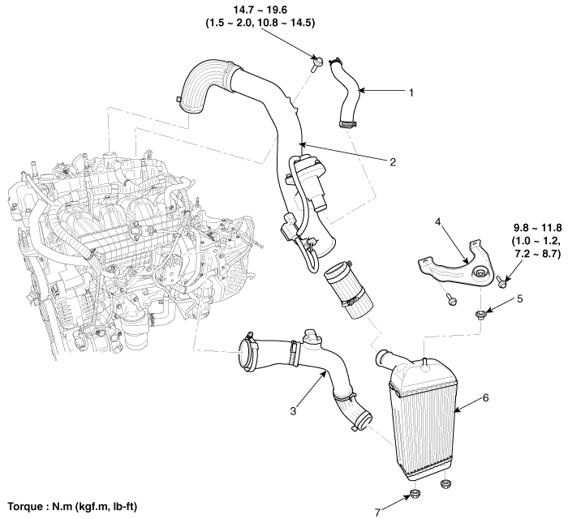

# Kia Sportage: Intercooler: Componentes e Localização dos Componentes

[Home](../../index.md) / [Manual de Serviço e Reparo do Kia Sportage SL](../sportage-482.md) / [Sistema Mecânico do Motor](sportage-484.md) / [Sistema de Admissão e Exaustão](sportage-519.md) / Componentes e Localização do Intercooler

## Componentes

| 1. Mangueira de recirculação 2. Conduite de entrada do intercooler e montagem 3. Conduite de saída do intercooler e montagem | 4. Suporte de montagem do intercooler 5. Isolador de montagem superior do intercooler 6. Intercooler 7. Isolador de montagem inferior do intercooler |
