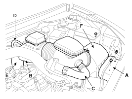
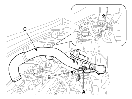
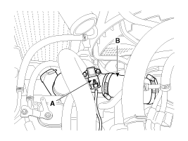
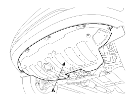
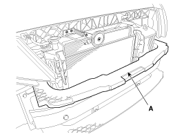
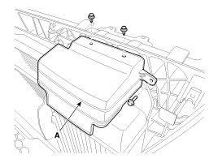
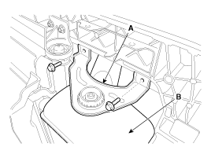

# Kia Sportage: Intercooler: Procedimentos de Reparo

[Home](../../index.md) / [Manual de Serviço e Reparo do Kia Sportage SL](../sportage-482.md) / [Sistema Mecânico do Motor](sportage-484.md) / [Sistema de Admissão e Exaustão](sportage-519.md) / Procedimentos de Reparo do Intercooler

## Remoção e Instalação

1. Desconecte o terminal negativo da bateria (A).

   ```
   Torque de aperto
   4,0 ~ 6,0 N.m (0,4 ~ 0,6 kgf.m, 3,0 ~ 4,4 lb-ft)
   ```

   

2. Remova a montagem do filtro de ar.

   | (1) | Remova o dutamento do filtro de ar (A). |
   | --- | --- |

   | (2) | Desconecte o mangote de respiração (B), o mangote de recirculação (C) e o mangote de vácuo do booster de freio (D). |
   | --- | --- |

   ```
   Desconecte o mangote de admissão (E) e, em seguida, remova a montagem do filtro de ar (F).
   Torque de aperto
   Mangote de aperto:
   2,9 ~ 4,9 N.m (0,3 ~ 0,5 kgf.m, 2,2 ~ 3,6 lb-ft)
   Parafusos da montagem do filtro de ar:
   7,8 ~ 9,8 N.m (0,8 ~ 1,0 kgf.m, 5,8 ~ 7,2 lb-ft)
   ```

   

3. Desconecte a conexão do válvula de recirculação (A) e o
   mangote de vácuo (B), e, em seguida, remova a montagem do tubo de entrada do intercooler & mangote (C).

   

4. Desconecte a conexão do sensor de pressão de boost (A) e, em seguida, remova a montagem do tubo de saída do intercooler & mangote (B).

   ```
   Torque de aperto
   4,9 ~ 6,9 N.m (0,5 ~ 0,7 kgf.m, 3,6 ~ 5,1 lb-ft)
   ```

   

5. Remova a cobertura inferior (A).

   ```
   Torque de aperto:
   9,8 ~ 11,8 N.m (1,0 ~ 1,2 kgf.m, 7,2 ~ 8,7 lb-ft)
   ```

   

6. Remova o para-choque dianteiro. (Consulte o grupo BD)

7. Remova o reforço superior do para-choque (A).

   

8. Remova a cobertura superior do radiador (A).

   

9. Remova o suporte de montagem superior do intercooler (A) e, em seguida, remova o intercooler (B).

   ```
   Torque de aperto
   9,8 ~ 11,8 N.m (1,0 ~ 1,2 kgf.m, 7,2 ~ 8,7 lb-ft)
   ```

   

10. A instalação é em ordem inversa da remoção.
