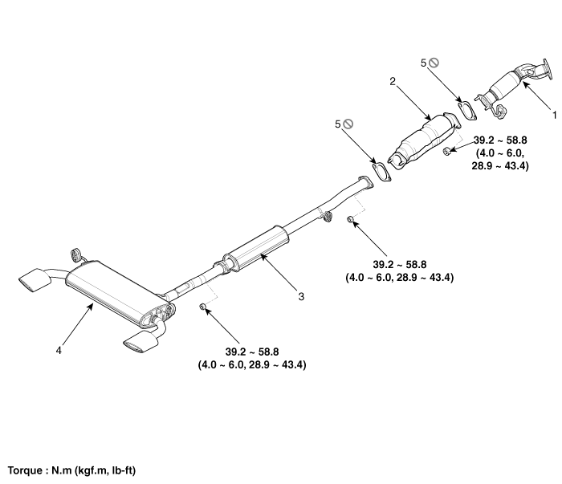

# Muffler — Componentes e localização

[Home](../../index.md) / [Manual de Serviço e Reparo](../sportage-482.md) / [Sistema Mecânico do Motor](sportage-484.md) / [Sistema de Admissão e Exaustão](sportage-519.md) / Componentes e localização

## Diagrama

## Legenda

| Nº | Componente |
| --- | --- |
| 1 | Muffler Anterior |
| 2 | Conversor Catalítico |
| 3 | Muffler Central |
| 4 | Muffler Principal |
| 5 | Gasketa |
