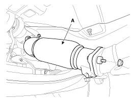
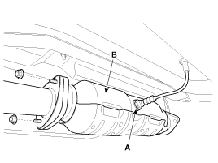
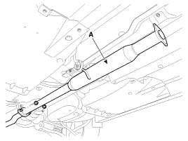
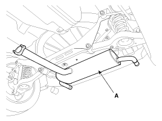

# Kia Sportage: Muffler: Procedimentos de Reparo

[Home](../../index.md) / [Manual de Serviço e Reparo do Kia Sportage SL](../sportage-482.md) / [Sistema Mecânico do Motor](sportage-484.md) / [Sistema de Admissão e Exaustão](sportage-519.md) / Procedimentos de Reparo do Muffler

## Remoção e Instalação

1. Remova o muffler frontal (A).

   ```
   Torque de aperto:
   39,2 ~ 58,8 N.m (4,0 ~ 6,0 kgf.m, 28,9 ~ 43,4 lb-ft)
   ```

   

2. Remova o catalisador (B) após remover o sensor de oxigênio (A).

   ```
   Torque de aperto:
   Sensor de oxigênio (A): 44,1 ~ 49,0 N.m (4,5 ~ 5,0 kgf.m, 32,5 ~ 36,2 lb-ft)
   Parafusos (B): 39,2 ~ 58,8 N.m (4,0 ~ 6,0 kgf.m, 28,9 ~ 43,4 lb-ft)
   ```

   

3. Remova o muffler central (A).

   ```
   Torque de aperto:
   39,2 ~ 58,8 N.m (4,0 ~ 6,0 kgf.m, 28,9 ~ 43,4 lb-ft)
   ```

   

4. Remova o muffler principal (A).

   

5. A instalação deve ser feita na ordem inversa da remoção.

   > **Nota**
   >
   > - Durante a instalação, substitua as borrachas de vedação novas.
