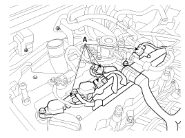
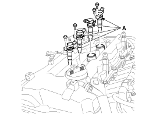
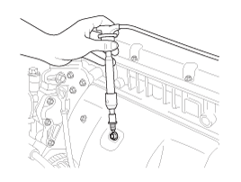
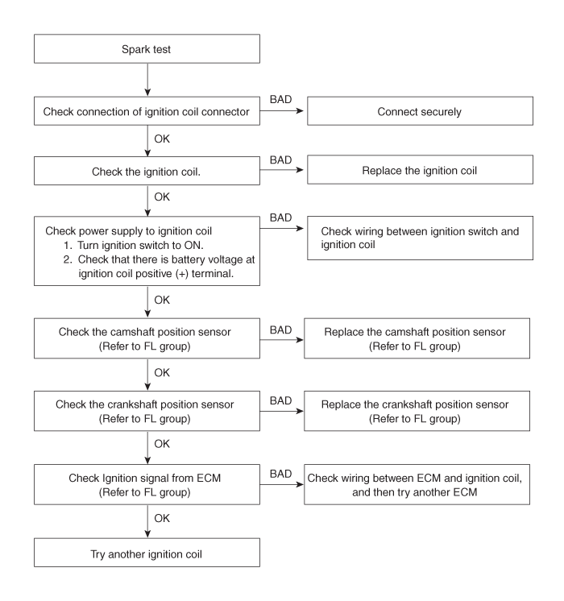
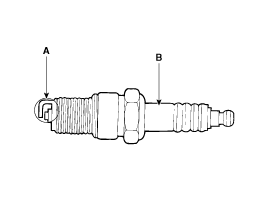
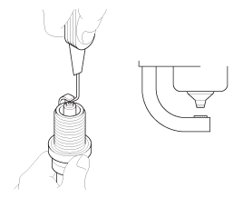
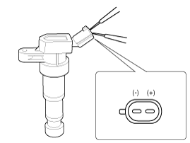

# Kia Sportage: Procedimentos de Reparo

[Home](../../index.md) / [Manual de Serviço e Reparo do Kia Sportage SL](../sportage-482.md) / [Sistema Elétrico do Motor](sportage-530.md) / [Sistema de Ignição](sportage-534.md) / Procedimentos de Reparo

## Inspeção no Veículo

### Teste de Trovoada

1. Desconecte as conexões do bobinado do ignição (A).

   

2. Remova os bobins do ignição (A).

   

3. Usando uma chave de trovoada, remova a trovoada.

4. Instale a trovoada no bobinado do ignição.

5. Tercele a trovoada ao motor.

   

6. Verifique se ocorre trovoada enquanto o motor estiver sendo girado.

   > **Nota**
   >
   > - Para prevenir a injeção de combustível dos injetores enquanto o motor estiver sendo girado, desconecte a conexão do injetor.
   > - Gire o motor por no máximo 5 ~ 10 segundos.

7. Inspeção de todas as trovoadas.

8. Usando uma chave de trovoada, instale a trovoada.

9. Instale o bobinado do ignição.

10. Reconecte as conexões do bobinado do ignição.



### Inspeção da Trovoada

1. Desconecte as conexões do bobinado do ignição (A).

   

2. Remova os bobins do ignição (A).

   

3. Usando uma chave de trovoada, remova a trovoada.

   > **Cautela**
   >
   > - Cuide para que nenhum contaminante entre pelas fendas da trovoada.

4. Inspeção dos eletrodos (A) e isolante cerâmico (B).

   

   **Inspeção dos Eletrodos**

   | Condição | Depósitos escuros | Depósitos brancos |
   | --- | --- | --- |
   | Descrição | – Mistura de combustível muito rica – Entrada de ar insuficiente | – Mistura de combustível muito pobre – Ajuste de ignição avançado – Torque de aperto da trovoada insuficiente |
   | – | Mistura de combustível muito rica | |
   | – | Entrada de ar insuficiente | |
   | – | Mistura de combustível muito pobre | |
   | – | Ajuste de ignição avançado | |
   | – | Torque de aperto da trovoada insuficiente | |

5. Verifique o espaço entre os eletrodos (A).

   ```
   Valor padrão
   Gasolina sem aditivos : 0,7 ~ 0,8 mm (0,0276 ~ 0,0315 in.)
   ```

   

### Inspeção do Bobinado do Ignição

1. Medir a resistência do bobinado primário entre os terminais (+) e (-).

   

   ```
   Valor padrão: 0,62? ± 10%
   ```

## Remoção e Instalação

1. Desconecte as conexões do bobinado do ignição (A).

   

2. Remova os bobins do ignição (A).

   ```
   Torque de aperto :
   3,9 ~ 5,9N.m (0,4 ~ 0,6kgf.m, 2,9 ~ 4,3lb-ft)
   ```

   

3. A instalação é o processo inverso da remoção.
