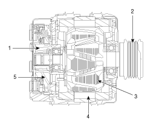

# Kia Sportage: Descrição e Operação

[Home](../../index.md) / [Manual de Serviço e Reparo do Kia Sportage SL](../sportage-482.md) / [Sistema Elétrico do Motor](sportage-530.md) / [Sistema de Carregamento](sportage-537.md) / Descrição e Operação

## Descrição

O sistema de carregamento inclui uma bateria, um alternador com regulador integrado, e a luz e o fio de indicador de carregamento.

O Alternador possui diodos integrados, cada um convertendo a corrente AC em corrente DC.

Portanto, a corrente DC aparece no terminal "B" do alternador.

Além disso, a tensão de carregamento deste alternador é controlada pelo ECM.

Os principais componentes do alternador são o rotor, estator, rectificador, escovas de carvão, rolamentos e polia do alternador com cinto V-ribbed. O suporte das escovas contém um regulador de tensão eletrônico integrado.

1. Escova

2. Polia do cinto de drive

3. Rotor

4. Estator

5. Rectificador

Sistema de Gerenciamento do Alternador (SGA)

O sistema de gerenciamento do alternador controla o ponto de tensão de carregamento para melhorar a economia de combustível, gerenciar a carga do alternador sob diferentes condições de operação, manter a bateria carregada e proteger a bateria de sobrecarregamento. O ECM controla a tensão gerada por ciclo de duty (controle de carregamento, controle de descarga, controle normal) com base nas condições da bateria e das condições de operação do veículo.

O sistema realiza o controle de descarga quando acelera o veículo. O veículo reduz a carga do alternador e consome energia da bateria.

O sistema realiza o controle de carregamento quando desacelera o veículo. O veículo aumenta a carga do alternador e recarrega a bateria.
