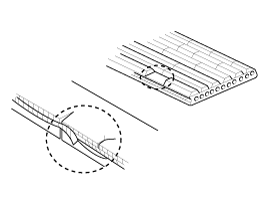
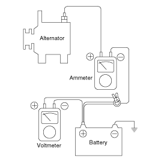
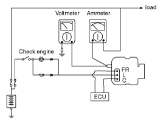
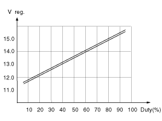

# Kia Sportage: Procedimentos de Reparo

[Início](../../index.md) / [Manual de Serviço e Reparo do Kia Sportage SL](../sportage-482.md) / [Sistema Elétrico do Motor](sportage-530.md) / [Sistema de Carregamento](sportage-537.md) / Procedimentos de Reparo

## Verificação no Veículo

> **Cuidado**
>
> - Verifique se os cabos da bateria estão conectados aos terminais corretos.
> - Desconecte os cabos da bateria quando a bateria for carregada rapidamente.
> - Nunca desconecte a bateria enquanto o motor estiver em funcionamento.

Verifique as Terminais e Fusíveis da Bateria

1. Verifique se os terminais da bateria não estão soltos ou corroídos.

2. Verifique a continuidade dos fusíveis.

Inspeção do Cinto de Distribuição

Verifique visualmente o cinto para sinais de desgaste excessivo, fios desgastados, etc.

Se qualquer defeito for encontrado, substitua o cinto de distribuição.

> **Nota**
>
> - Fendas no lado de ripas do cinto são consideradas aceitáveis. Se o cinto tiver pedaços faltando nas ripas, deve ser substituído.



Verifique as Conexões de Fiação do Alternador e Ouça Som Anormal

1. Verifique se a fiação está em boas condições.

2. Verifique se há algum som anormal do alternador enquanto o motor estiver em funcionamento.

Verifique o Circuito da Luz de Aviso de Descarga

1. Aqueça o motor e depois desligue-o.

2. Desligue todos os acessórios.

3. Ligue o interruptor de ignição "ON". Verifique se a luz de aviso de descarga está acesa.

4. Inicie o motor e verifique se a luz se apaga.

   Se a luz não se apagar conforme especificado, faça o diagnóstico do circuito da luz de aviso de descarga.

Teste de Descarga de Voltagem da Fiação de Saída do Alternador

Este teste determina se a fiação entre o terminal "B" do alternador e o terminal da bateria (+) está em boas condições pelo método de descarga de voltagem.

Preparação

1. Ligue o interruptor de ignição para "OFF".

2. Desconecte a fiação de saída do terminal "B" do alternador.
   Conecte o cabo de carga positivo do amperímetro ao terminal "B" do alternador e o cabo de carga negativo do amperímetro à fiação de saída. Conecte o cabo de carga positivo do voltmetro ao terminal "B" do alternador e o cabo de carga negativo do voltmetro ao terminal da bateria (+).

   

Teste

1. Inicie o motor.

2. Ligue os faróis e o ventilador e ajuste a velocidade do motor até que o amperímetro indique 20A.

   Em seguida, leia o voltmetro neste momento.

Resultado

1. O voltmetro pode indicar o valor padrão.

   ```
   Valor padrão: 0,2V máximo
   ```

2. Se o valor do voltmetro for maior do que o esperado (acima de 0,2V máximo), a fiação pode estar ruim. Neste caso, verifique a fiação do terminal "B" do alternador ao terminal da bateria (+). Verifique por conexões soltas, mudança de cor devido a aquecimento excessivo do cabo, etc. Corrija antes de fazer o teste novamente.

3. Após o término do teste, ajuste a velocidade do motor ao vazio.

   Desligue os faróis, o ventilador e o interruptor de ignição.

Teste de Corrente de Saída do Alternador

Este teste determina se o alternador está fornecendo uma corrente de saída equivalente à corrente de saída normal.

Preparação

1. Antes do teste, verifique os seguintes itens e corrija conforme necessário.

   Verifique a bateria instalada no veículo para garantir que ela esteja em boas condições. O método de verificação da bateria está descrito no

seção "Bateria".

A bateria usada para testar a corrente de saída deve estar parcialmente descarregada. Com uma bateria totalmente carregada, o teste pode não ser realizado corretamente.

Verifique a tensão do cinto de transmissão do alternador. O método de verificação da tensão do cinto de transmissão está descrito na seção "Inspeção do cinto de transmissão".

2. Desligue o interruptor da ignição.

3. Desconecte o cabo de terra da bateria.

4. Desconecte o fio de saída do alternador do terminal "B" do alternador.

5. Conecte um amperímetro DC (0 a 150A) em série entre o terminal "B" e o fio de saída desconectado. Certifique-se de conectar o fio (-) do amperímetro ao fio de saída desconectado.

   > **Nota**
   >
   > - Torne cada conexão segura, pois uma corrente pesada fluirá. Não dependa de clips.

6. Conecte um voltmetro (0 a 20V) entre o terminal "B" e o terra. Conecte o fio (+) ao terminal "B" do alternador e o fio (-) a um bom ponto de terra.

7. Fixe um tachômetro de motor e conecte o cabo de terra da bateria.

8. Deixe a capota do motor aberta.

   

Teste

1. Verifique se o voltmetro lê o mesmo valor que a tensão da bateria. Se o voltmetro ler 0V, e uma falha na linha entre o terminal "B" do alternador e o terminal (+) da bateria ou uma boa conexão com o terra for suspeita.

2. Inicie o motor e ligue os faróis.

3. Defina os faróis em alto e o interruptor do ventilador do aquecedor em ALTO, aumente rapidamente a velocidade do motor para 2.500 rpm e leia o valor máximo da corrente de saída indicado pelo amperímetro.

   > **Nota**
   >
   > - Após o acionamento do motor, a corrente de carregamento cai rapidamente.
   > - Portanto, a operação acima deve ser realizada rapidamente para ler o valor máximo da corrente corretamente.

Resultado

1. A leitura do amperímetro deve ser maior que o valor limite. Se for menor, mas o fio de saída do alternador estiver em bom estado, remova o alternador do veículo e teste-o.

   ```
   Valor limite : 60% da taxa de tensão
   ```

   > **Nota**
   >
   > - O valor da corrente de saída varia com a carga elétrica e a temperatura do alternador.
   > - Devido à temperatura, o máximo da corrente de saída pode não ser obtido. Neste caso, mantenha os faróis ligados para aumentar a carga elétrica.
   > - O valor nominal de corrente de saída pode não ser obtido se a temperatura do alternador ou a temperatura ambiente for muito alta.
   > - Neste caso, reduza a temperatura antes de testar novamente.

2. Ao final do teste de corrente de saída, reduza a velocidade do motor para o ponto de rotação de cruzeiro e desligue o interruptor da ignição.

3. Desconecte o cabo de terra da bateria.

4. Remova o amperímetro e o voltmetro e o tachômetro de motor.

5. Conecte o fio de saída do alternador ao terminal "B" do alternador.

6. Conecte o cabo de terra da bateria.

Teste de Tensão Regulada

O propósito deste teste é verificar que o regulador de tensão eletrônico controle a tensão corretamente.

Preparação

1. Antes do teste, verifique os seguintes itens e corrija se necessário.

   Verifique que a bateria instalada no veículo esteja completamente
   carregada. O método de verificação da bateria está descrito na seção
   "Bateria".

   Verifique a tensão do cinto de transmissão do alternador. O método de verificação do cinto de transmissão está descrito na seção "Inspeção do cinto de transmissão".

2. Gire o interruptor de ignição para "OFF".

3. Desconecte o cabo de terra da bateria.

4. Conecte um voltmetro digital entre o terminal "B" do alternador e o terra. Conecte o lead (+) do voltmetro ao terminal "B" do alternador. Conecte o lead (-) a um bom ponto de terra ou ao terminal (-) da bateria.

5. Desconecte a linha de saída do alternador do terminal "B" do alternador.

6. Conecte um amperímetro DC (0 a 150A) em série entre o terminal "B" e a linha de saída desconectada.

   Conecte o lead (-) do amperímetro à linha de saída desconectada.

7. Fixe o tachômetro do motor e conecte o cabo de terra da bateria.

   

Teste

1. Gire o interruptor de ignição e verifique se o voltmetro indica o seguinte valor.

   ```
   Tensão: Tensão da bateria
   ```

   Se ler 0V, há um circuito aberto na linha entre o terminal "B" do alternador e o terminal (-) da bateria e o terminal (-) da bateria.

2. Inicie o motor. Mantenha todas as luzes e acessórios desligados.

3. Execute o motor a uma velocidade de aproximadamente 2.500 rpm e leia o voltmetro quando a corrente de saída do alternador cair a 10A ou menos.

Resultado

1. Se a leitura do voltmetro não concordar com o valor padrão, o regulador de tensão ou o alternador está defeituoso.

2. Ao final do teste, reduza a velocidade do motor para o idle e desligue o interruptor de ignição.

3. Desconecte o cabo de terra da bateria.

4. Remova o voltmetro e o amperímetro e o tachômetro do motor.

5. Conecte a linha de saída do alternador ao terminal "B" do alternador.

6. Conecte o cabo de terra da bateria.

Tabela de Regulação de Tensão (Modo interno)

| Temperatura ambiente do regulador de tensão °C (°F) | Tensão de regulação (V) |
| --- | --- |
| -30 (-22) 25 (77) 130 (266) | 14,1 ~ 15,0 14,0 ~ 14,7 13,5 ~ 14,6 |

Tabela de Regulação de Tensão (Modo externo)


