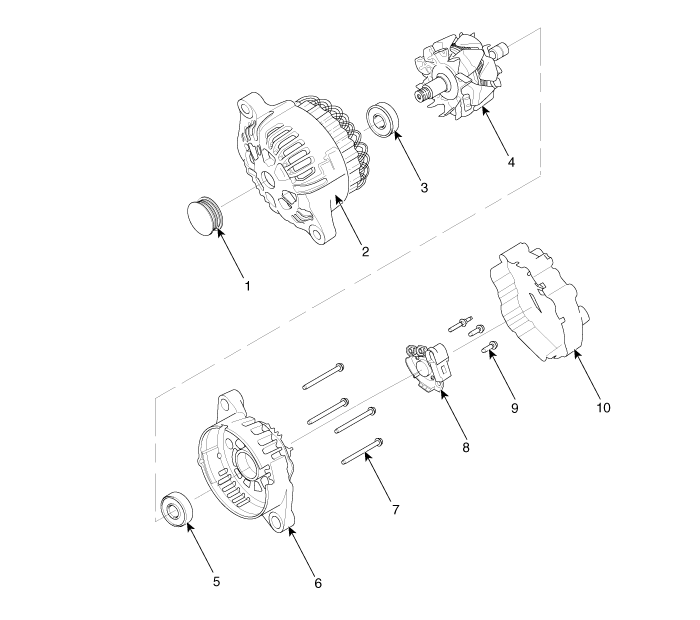

# Kia Sportage: Alternador: Componentes e Localização dos Componentes

[Home](../../index.md) / [Manual de Serviço e Reparo do Kia Sportage SL](../sportage-482.md) / [Sistema Elétrico do Motor](sportage-530.md) / [Sistema de Carregamento](sportage-537.md) / Componentes e Localização dos Componentes do Alternador

## Componentes

| 1. Polia 2. Bracket da frente 3. Rolamento da frente 4. Rotor 5. Rolamento do fundo | 6. Bracket do fundo 7. Parafuso através 8. Montagem do regulador 9. Parafuso do regulador 10. Cobertura do fundo |
